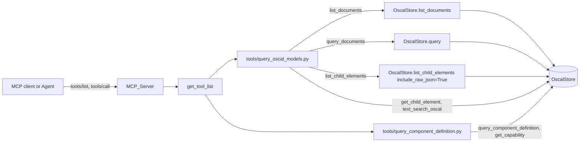

# Design Document

## Overview

This feature replaces 29 per-model and Component Definition list tools with three generic tools: `list_documents`, `query_documents`, and `list_child_elements`. It is a hard break released as 0.8.0 (GitHub issue #40). The Generic_Tools are thin, validating wrappers over `OscalStore.list_documents`, `OscalStore.query`, and `OscalStore.list_child_elements`. The store does not change.

Design decisions:

| Open item | Decision |
|---|---|
| Where the Generic_Tools live | `tools/query_oscal_models.py`. It already owns the `_store` singleton, `init_store()`, and the other cross-model tools (`text_search_oscal`, `get_child_element`). No new module, no new singleton. |
| What `query_component_definition.py` keeps | `query_component_definition`, `get_capability`, and their helpers. The three listers and their helpers (`_child_summary`, `_child_page`, `_list_components`, `_list_capabilities`, `_list_component_definitions`) are deleted. |
| Child summary `sizeInBytes` | Computed in the wrapper from `include_raw_json=True`, then `raw_json` is dropped. The store is not changed. |
| Argument validation | Wrappers check `model_type`, `element_type`, `query_type`, `query_value`, and the page before reading the store. Errors go through `try_notify_client_error` and raise `ValueError`. |
| Alias names | New `DocumentModelType` and `ChildElementType` in `tools/descriptions.py`. `PerModelQueryType` keeps its name. |
| Release note | `docs/releases/v0.8.0.md` (new tracked directory). `private/` is gitignored and cannot hold a tested file. |
| Budget constants | New `BEFORE_CONSOLIDATION_SIZE` (34,938) and `AFTER_CONSOLIDATION_SIZE` (measured at implementation). `TOTAL_BUDGET` becomes 110% of the After size. `BASELINE_SIZE` stays as history. |
| Test oracle for the removed tools | A frozen reference module, `tests/removed_tools_reference.py`, holds the removed tools' logic verbatim from commit 599a41d. It is checked once against the live removed tools before they are deleted. |

### Corrections to the requirements

Two statements in `requirements.md` do not match the repository. The design follows the measured values.

1. **Before_Size is not `BASELINE_SIZE`.** The requirements record Before_Size as `BASELINE_SIZE = 55_685` with 45 tools. That number is the size before the tool-context-optimization feature (0.6.3). The `tools/list` response at HEAD (599a41d, Python 3.14.8, `mcp` 2.1.1) measures **34,938 characters in 46 entries** (45 registry tools plus `about`). The 29 Removed_Tools account for 19,585 of those characters, not the roughly 29,000 quoted in the issue. A prototype of the final registry measures about 18,400 characters in 20 entries (45 − 29 + 3 = 19 registry tools plus `about`), so the saving is about 47%. The Release_Note and Budget_Module use the measured values. Requirement 12.1 is met by recording 34,938, the final After_Size, 46 and 20 entries, Python 3.14.8, and `mcp` 2.1.1.
2. **The Generic_Tools validate the page.** The removed per-model tools passed `offset` and `limit` to SQLite unchecked, so `limit=-1` returned every row and `limit=0` returned none. Requirement 4.1 makes the Generic_Tools reject values outside `0 <= offset`, `1 <= limit <= 100`. This is a behavior change for out-of-range input. The Release_Note lists it with the other behavior changes (requirement 15.6 lists the minimum set; this adds one item).

## Architecture



Registry before and after:

| | Before | After |
|---|---|---|
| Registry tools (`get_tool_list()`) | 45 | 19 |
| `tools/list` entries (adds `about`) | 46 | 20 |
| `tools/list` size (`tools_list_size`) | 34,938 | about 18,400 (final value measured at implementation) |
| Tools in `query_oscal_models.py` | 28 | 5: `list_documents`, `query_documents`, `list_child_elements`, `text_search_oscal`, `get_child_element` |
| Tools in `query_component_definition.py` | 5 | 2: `query_component_definition`, `get_capability` |

The one-tool-per-file convention in `.kiro/steering/structure.md` is already stale: `query_oscal_models.py`, `query_component_definition.py`, and `validate_oscal_content.py` each define several tools. The Generic_Tools follow the module-per-domain practice that the code uses, not the stale text. A new module (`tools/documents.py`) was rejected because it needs a second singleton, a new line in `main._install_store`, a new reset in `tests/conftest.py`, and a new entry in the Path_Leak_Test singleton list, and it buys nothing. Renaming `query_oscal_models.py` was rejected as churn (imports, tests, blame).

## Components and Interfaces

### 1. Shared aliases in `tools/descriptions.py`

Plain assignments (not PEP 695 `type`), each with a `*_DOC` constant of at most 250 characters.

```python
MODEL_TYPE_DOC = "Model type of the loaded documents."
ELEMENT_TYPE_DOC = "Child element type. Each type belongs to one model, e.g. control to catalog."

DocumentModelType = Annotated[
    Literal[
        "catalog",
        "profile",
        "component-definition",
        "system-security-plan",
        "assessment-plan",
        "assessment-results",
        "plan-of-action-and-milestones",
        "mapping-collection",
    ],
    ParamDoc(MODEL_TYPE_DOC),
]
ChildElementType = Annotated[
    Literal[
        "component", "capability",
        "control", "group",
        "import", "modify",
        "control-implementation", "system-component",
        "task", "activity",
        "result", "finding",
        "poam-item", "mapping",
    ],
    ParamDoc(ELEMENT_TYPE_DOC),
]
```

- The `Literal` values are static because `descriptions.py` imports only pydantic and has no import-time side effects. Tests keep them equal to `OSCALModelType` and `CHILD_ELEMENT_TYPES` (requirement 5).
- `DocumentModelType` is shared by `list_documents` and `query_documents`. `ChildElementType` is used by `list_child_elements`.
- Reused unchanged: `Offset`, `Limit`, `ParentDocUuid`, `PerModelQueryType`, `QueryValue`. `PerModelQueryType` keeps its name because it still means "the query type of the per-model-type query"; renaming it would touch `tool-authoring.md`, `test_descriptions.py`, and four other files for no behavior gain.
- `ModelName` and `OptionalModelName` (free-text model names that point to `list_oscal_models`) are unchanged.

### 2. Generic_Tools in `tools/query_oscal_models.py`

Every Generic_Tool runs the same sequence: check the enum argument, check the page, check tool-specific arguments, get the store (`_get_store()` raises `RuntimeError` naming `init_store()`), call the store, shape the result.

```python
_MODEL_VALUES = tuple(m.value for m in OSCALModelType)
_ELEMENT_VALUES = tuple(t for types in CHILD_ELEMENT_TYPES.values() for t in types)


def _reject(msg: str, ctx: Context | None) -> NoReturn:
    try_notify_client_error(msg, ctx)
    raise ValueError(msg)


def _check_model_type(value: object, ctx: Context | None) -> OSCALModelType:
    if isinstance(value, str) and value in _MODEL_VALUES:
        return OSCALModelType(value)
    shown_value = shown(value) if isinstance(value, str) else type(value).__name__
    _reject(f"Invalid model_type: '{shown_value}'. Valid values: {', '.join(_MODEL_VALUES)}", ctx)


def _check_element_type(value: object, ctx: Context | None) -> str:
    if isinstance(value, str) and value in _ELEMENT_VALUES:
        return value
    shown_value = shown(value) if isinstance(value, str) else type(value).__name__
    _reject(f"Invalid element_type: '{shown_value}'. Valid values: {', '.join(_ELEMENT_VALUES)}", ctx)


def _check_page(offset: int, limit: int, ctx: Context | None) -> None:
    try:
        check_page(offset, limit)  # metaschema_common: re-raises utils.paginate's ValueError
    except ValueError as err:
        try_notify_client_error(str(err), ctx)
        raise
```

`check_page` already exists in `metaschema_common` and `text_search_oscal` uses the same try/notify/raise shape. Messages contain only fixed text, enum values, and `shown()`-truncated caller text, so they hold no path (requirement 4.6).

#### `list_documents`

```python
@tool()
def list_documents(
    model_type: DocumentModelType,
    offset: Offset = 0,
    limit: Limit = 10,
    ctx: Context | None = None,
) -> dict:
    """List loaded OSCAL documents of one model type with UUID, title, child count, and size.
    Use when picking a `query_value` for query_documents. Results are paged."""
    model = _check_model_type(model_type, ctx)
    _check_page(offset, limit, ctx)
    return _get_store().list_documents(ctx=ctx, oscal_model_type=model, offset=offset, limit=limit)
```

The result is the store's Page_Envelope unchanged, so requirements 1.3 to 1.5 and 6.1 hold by construction. An empty model type returns `total` 0 and no error.

#### `query_documents`

```python
@tool()
def query_documents(
    model_type: DocumentModelType,
    query_type: PerModelQueryType = "all",
    query_value: QueryValue = None,
    offset: Offset = 0,
    limit: Limit = 10,
    ctx: Context | None = None,
) -> dict:
    """Return loaded OSCAL documents of one model type with metadata and `childTypeCounts`,
    matched by UUID or title. For child elements, use list_child_elements, then
    get_child_element."""
    model = _check_model_type(model_type, ctx)
    _check_page(offset, limit, ctx)
    if query_type not in VALID_QUERY_TYPES:
        _reject(f"Invalid query_type: '{shown(str(query_type))}'. Valid types: ...", ctx)
    if query_type != "all" and not query_value:
        _reject(f"query_value is required for query_type '{query_type}'", ctx)
    return _get_store().query(
        ctx=ctx, oscal_model_type=model, query_type=query_type,
        query_value=query_value, offset=offset, limit=limit,
    )
```

- `query_value` is passed through unchanged (no `strip()`), so the result equals `OscalStore.query` for the same arguments (requirement 2.4). `query_component_definition` strips; that tool is unchanged.
- The pre-check exists so the client gets a notification (requirement 2.6); the store would raise the same `ValueError` without one.
- With `query_type="all"`, a supplied `query_value` is ignored, as before.

#### `list_child_elements`

```python
@tool()
def list_child_elements(
    element_type: ChildElementType,
    parent_doc_uuid: ParentDocUuid = None,
    offset: Offset = 0,
    limit: Limit = 10,
    ctx: Context | None = None,
) -> dict:
    """List child elements (controls, components, findings, etc.) of one type with ID, title,
    parent document, and size. Get one's OSCAL JSON with get_child_element. Results are paged."""
    element = _check_element_type(element_type, ctx)
    _check_page(offset, limit, ctx)
    page = _get_store().list_child_elements(
        ctx=ctx, parent_doc_uuid=parent_doc_uuid, element_type=element,
        offset=offset, limit=limit, include_raw_json=True,
    )
    return {**page, "items": [_child_summary(item) for item in page["items"]]}


def _child_summary(item: dict) -> dict:
    """Return the store item without ``raw_json`` and with ``sizeInBytes`` (0 when no JSON)."""
    raw_json = item.get("raw_json")
    summary = {k: v for k, v in item.items() if k != "raw_json"}
    summary["sizeInBytes"] = len(raw_json.encode("utf-8")) if raw_json is not None else 0
    return summary
```

- Result keys: `items`, `total`, `offset`, `limit`, `hasMore` (from the store). Item keys: `id`, `title`, `element_type`, `description`, `parentDocumentTitle`, `parentDocumentUuid`, `sizeInBytes`. `raw_json` never leaves the wrapper (requirement 3.9).
- `parent_doc_uuid` that matches nothing yields `total` 0 (the store's `WHERE d.uuid = ?`), and a parent with no child of that type does too (requirement 3.8).
- Alternative rejected: add a `size_in_bytes` column to the store query (`length(CAST(ce.raw_json AS BLOB))`). It avoids loading up to 100 `raw_json` strings per page, but it changes the store API for a value the removed `list_components` already computed this way. If a page of large Components proves slow, that is a follow-up.
- Ordering is the store's `ce.title COLLATE NOCASE, ce.uuid` (requirement 3.4). `NOCASE` folds ASCII letters only. Tests use that ordering as the oracle, not Unicode case folding.

#### Retained tools in the same module

`text_search_oscal` and `get_child_element` are unchanged. The module docstring changes from "Each OSCAL model type gets a query/list tool pair" to describe the generic tools. The helpers `_query`, `_list_documents`, and `_list_children` are deleted; each had a single caller group that no longer exists.

### 3. `tools/query_component_definition.py` after removal

Kept: `init_store`, `_require_store`, `_Scope`, `_resolve_scope`, `_iter_children`, `_first`, `_raw`, `_component_type`, `_has_prop_value`, `_select_component_candidates`, `_materialize_components`, `_find_capability`, `_query_component_definition`, `_get_capability`, and the tools `query_component_definition` and `get_capability`.

Deleted: `_child_summary`, `_child_page`, `_list_components`, `_list_capabilities`, `_list_component_definitions`, and the three `@tool` wrappers.

Text changes (requirements 9.2 to 9.4):

- `query_component_definition` description (434 characters, within the 450 target):
  > Return OSCAL Components from loaded Component Definitions as OSCAL JSON, or one Capability when a by_uuid or by_title query matches a Capability. Use when you need component details: call it directly with by_title or by_type when you know the name or type, else find them first with list_child_elements (element_type `component`); list Capabilities with element_type `capability`, and fetch one with get_capability. Results are paged.
- `get_capability` `uuid` parameter: `"UUID of the Capability, from list_child_elements with element_type capability."` The description of `get_capability` is unchanged.
- The info message in `_resolve_scope` becomes: `"... Try again without a filter or look up the filter value with the tool list_documents (model_type component-definition)."`
- The module docstring drops "All tools read ..." wording that implies the listers. `_oscal_store` and `init_store` stay (they back the two remaining tools and `main._install_store`).

### 4. `get_tool_list()` in `tools/__init__.py`

The Component Definition and `query_oscal_models` import blocks shrink to the retained and new names. The generic tools replace the per-model block, in this order: `list_documents`, `query_documents`, `list_child_elements`, `text_search_oscal`, `get_child_element`. `main._setup_tools`, `oscal_agent.agent_tools`, and `bin/build_mcpb.py` read this list and need no change.

### 5. Routing_Guide rewrite (`tools/descriptions.py`)

Three bullets of `ROUTING_GUIDE` change (the other bullets and the Metaschema tip stay byte-identical):

```
- Loaded OSCAL documents of one model_type: list_documents, or query_documents to find one by \
UUID or title; its child elements (controls, components, findings, and so on): \
list_child_elements, then get_child_element
- Full-text search across loaded OSCAL content: text_search_oscal, then get_child_element \
for child hits or query_documents (by_uuid) for document hits
- Component Definitions: query_component_definition, directly with by_title or by_type when \
you know the name or type, else after list_documents (component-definition) or \
list_child_elements (component); list_child_elements (capability) and get_capability only \
for definitions that contain capabilities
```

The guide is about 1,550 characters and the full server instructions about 1,900, under `ROUTING_GUIDE_CAP` (3,000). `unknown_tool_refs` reports no unknown name in the guide or the four edited descriptions (checked with a prototype). The existing line check `"text_search_oscal, then get_child_element"` still holds.

### 6. Budget_Module (`tools/tool_budget.py`)

```python
# Historical: measured before tool-context-optimization (0.6.3, c973674). Kept for its test.
BASELINE_SIZE = 55_685

# Measured on main at 599a41d, before consolidate-tools (Python 3.14.8, mcp 2.1.1):
# 46 tools/list entries (45 registry tools + about).
BEFORE_CONSOLIDATION_SIZE = 34_938
BEFORE_CONSOLIDATION_TOOLS = 46

# Measured on <commit>, after consolidate-tools (Python 3.14.8, mcp 2.1.1): 20 entries.
AFTER_CONSOLIDATION_SIZE = <measured>   # about 18_400
AFTER_CONSOLIDATION_TOOLS = 20

TOTAL_BUDGET = AFTER_CONSOLIDATION_SIZE * 110 // 100  # at most 110% of the After size
```

- `TOTAL_BUDGET` satisfies `After <= TOTAL_BUDGET <= 1.10 * After` (requirement 12.3). It is about 20,200, so the budget keeps the saving: the old 38,979 budget would let the response double.
- The `<commit>` in the comment is the commit that holds the final tool code. The After constants go in a follow-up commit so the comment can name a real SHA. If that is impractical, the comment names "main at 599a41d plus the consolidate-tools working tree" and the measurement command.
- Measurement command, run for Before in a worktree of 599a41d with `PYTHONPATH=<worktree>/src` and for After on the feature branch: `hatch run python bin/export_tools_list.py <out.json>` (field `toolsListChars`, which uses the same compact JSON as `tools_list_size`).
- Other limits (`TOOL_DESCRIPTION_CAP`, `PARAMETER_DESCRIPTION_CAP`, `ROUTING_GUIDE_CAP`) do not change.
- `.kiro/steering/tool-authoring.md` changes in the same commit: the Limits table shows the new `TOTAL_BUDGET` (`TestSteeringSync.test_steering_states_limit` reads it), and the size-plan list names `query_documents`, `list_documents`, `list_child_elements`, `get_child_element`, and `text_search_oscal` at 180 characters.

### 7. Release note (`docs/releases/v0.8.0.md`)

Placement:

- `private/` is gitignored (`.gitignore:3`). The 0.7.0 body lives at `private/release-body-v0.7.0.md` and was pasted into the GitHub release by hand. A gitignored file cannot be checked by a test in CI, and requirement 15 needs a tracked, tested note.
- The repo has no `CHANGELOG.md` or `docs/`. A `CHANGELOG.md` would commit the project to maintaining it for every release. One file per release under `docs/releases/` matches how the project already works (one hand-written body per tag) and adds no standing duty.
- How the draft is made: `.agents/summary/workflows.md` says the `draft-release` job in `.github/workflows/build.yml` runs `gh release create --draft` with the build artifacts on a `v*` tag. I could not read the workflow (`.github/` is blocked for this agent by `.kiroignore`), so I did not verify whether it passes a notes file. The documented step is manual: after the draft exists, run `gh release edit v0.8.0 --notes-file docs/releases/v0.8.0.md`, then publish. Teaching the workflow to pass `--notes-file` is optional and outside this spec; it needs a maintainer who can edit `.github/`.
- The version comes from the tag through hatch-vcs, so no version file changes.

Structure of the note (same tone as the 0.7.0 body):

1. `# 0.8.0`, a "Breaking" label, link to #40.
2. Highlights: 29 tools replaced by 3; `tools/list` from 34,938 to the measured After size characters; 46 to 20 entries.
3. `## Breaking changes`: no aliases or compatibility flag; the Mapping_Table; behavior changes (below).
4. `## Measurements`: Before_Size, After_Size, tool counts, Python 3.14.8, `mcp` 2.1.1, measurement command.

Behavior changes listed (requirements 7.5 to 7.7, 15.6, plus the page check):

- `list_documents` and `list_child_elements` return an empty page where `list_component_definitions` and `list_components` raised `RuntimeError` on an empty store.
- `importedComponentDefinitionsCount` was the literal 0 for every item regardless of `import-component-definitions`; it carried no information and has no replacement.
- `componentCount` is renamed `childCount`; it counts Components plus Capabilities (it did so before; the old name hid that).
- Child items gain `sizeInBytes` (the 12 per-model child listers did not return it), `element_type`, and `description` (the removed Component and Capability listers did not return them).
- Document items from `list_documents(model_type="component-definition")` gain `model_type`.
- `offset` and `limit` outside the valid range are rejected with an error; the removed tools passed them to SQLite unchecked.
- `query_documents` and `list_documents` accept `model_type="component-definition"`; the removed per-model query tools had no Component Definition document lookup.

### 8. Sync targets and documentation

Each file lists the Generic_Tools and none of the Removed_Tools (except the Mapping_Table and absence tests):

| File | Change |
|---|---|
| `src/mcp_server_for_oscal/tools/README.md` | Replace the Catalog, SSP, Profile, AP, AR, POA&M, and Mapping rows and the three CDef lister rows with three Generic_Tool rows. |
| `conf/powers/oscal/POWER.md` | Same table change. |
| `README.md` | Tool list if present, and the transcript example at line 262 (`list_components`) becomes `list_child_elements`. |
| `AGENTS.md` | Code map rows for `query_oscal_models.py` (five tools) and `query_component_definition.py` (two tools). |
| `.kiro/steering/product.md`, `structure.md`, `tool-authoring.md` | Tool list, convention text, Limits table and size-plan list. |
| `.agents/summary/components.md`, `interfaces.md` | Tool tables. |
| `.agents/summary/index.md`, `workflows.md` | One mention each (`list_catalog_controls`, `query_catalog`); not in the Sync_Targets list, but the removed-names scan includes them. |
| `.agents/summary/review_notes.md` | Left unchanged. Line 32 records a past documentation discrepancy; the scan excludes this file. |
| `bin/eval_tool_selection_prompts.json` | See the eval migration below. |
| `conf/mcpb/manifest.json` | No edit: `"tools": []` is generated by `bin/build_mcpb.py` from `get_tool_list()` summaries. |

Eval prompt migration (`bin/eval_tool_selection_prompts.json`): replace each removed name in `expect` and `ok` with its Mapping_Table replacement, then drop duplicates and keep order. For example `docs-catalogs` expects `["list_documents", "query_documents"]`, `docs-control-ac2` expects `["get_child_element", "list_child_elements"]` with `ok: ["list_documents", "query_documents"]`, and `cdef-all-components` expects `["list_child_elements"]`. A test checks that every name in the file is a registry tool or `about` and none is removed.

## Data Models

Result shapes (all plain JSON-serializable dicts):

```text
Page_Envelope      {items, total, offset, limit, hasMore}        hasMore == (offset + limit < total)
Document_Summary   {uuid, title, model_type, childCount, sizeInBytes}                  (list_documents)
Query_Item         {uuid, title, model_type, sizeInBytes, childTypeCounts}             (query_documents)
Child_Summary      {id, title, element_type, description,
                    parentDocumentTitle, parentDocumentUuid, sizeInBytes}              (list_child_elements)
```

Key renames for the Removed_CDef_Listers:

| Old tool | Old item key | New item key |
|---|---|---|
| `list_component_definitions` | `uuid`, `title`, `sizeInBytes` | same |
| | `componentCount` | `childCount` (Components plus Capabilities) |
| | `importedComponentDefinitionsCount` | removed; no replacement |
| | (absent) | `model_type` added |
| `list_components` | `uuid` | `id` |
| | `title` | `title` |
| | `parentComponentDefinitionTitle` | `parentDocumentTitle` |
| | `parentComponentDefinitionUuid` | `parentDocumentUuid` |
| | `sizeInBytes` | `sizeInBytes` |
| | (absent) | `element_type`, `description` added |
| `list_capabilities` | `uuid` | `id` |
| | `name` | `title` |
| | `parentComponentDefinitionTitle` / `parentComponentDefinitionUuid` | `parentDocumentTitle` / `parentDocumentUuid` |
| | `sizeInBytes` | `sizeInBytes` |
| | (absent) | `element_type`, `description` added |

### Old-to-new mapping for all 29 Removed_Tools

Other arguments (`query_type`, `query_value`, `parent_doc_uuid`, `offset`, `limit`) pass through unchanged. This table is the content of the Mapping_Table and, as data, of `REMOVED_TOOLS` in `tests/removed_tools.py`.

| # | Removed tool | Replacement | Replacement arguments | Result changes |
|---|---|---|---|---|
| 1 | `query_catalog` | `query_documents` | `model_type="catalog"` | none |
| 2 | `query_profile` | `query_documents` | `model_type="profile"` | none |
| 3 | `query_ssp` | `query_documents` | `model_type="system-security-plan"` | none |
| 4 | `query_assessment_plan` | `query_documents` | `model_type="assessment-plan"` | none |
| 5 | `query_assessment_results` | `query_documents` | `model_type="assessment-results"` | none |
| 6 | `query_poam` | `query_documents` | `model_type="plan-of-action-and-milestones"` | none |
| 7 | `query_mapping_collection` | `query_documents` | `model_type="mapping-collection"` | none |
| 8 | `list_catalogs` | `list_documents` | `model_type="catalog"` | none |
| 9 | `list_profiles` | `list_documents` | `model_type="profile"` | none |
| 10 | `list_ssps` | `list_documents` | `model_type="system-security-plan"` | none |
| 11 | `list_assessment_plans` | `list_documents` | `model_type="assessment-plan"` | none |
| 12 | `list_assessment_results` | `list_documents` | `model_type="assessment-results"` | none |
| 13 | `list_poams` | `list_documents` | `model_type="plan-of-action-and-milestones"` | none |
| 14 | `list_mapping_collections` | `list_documents` | `model_type="mapping-collection"` | none |
| 15 | `list_catalog_controls` | `list_child_elements` | `element_type="control"` | adds `sizeInBytes` |
| 16 | `list_catalog_groups` | `list_child_elements` | `element_type="group"` | adds `sizeInBytes` |
| 17 | `list_profile_imports` | `list_child_elements` | `element_type="import"` | adds `sizeInBytes` |
| 18 | `list_profile_modify` | `list_child_elements` | `element_type="modify"` | adds `sizeInBytes` |
| 19 | `list_ssp_control_implementations` | `list_child_elements` | `element_type="control-implementation"` | adds `sizeInBytes` |
| 20 | `list_ssp_system_components` | `list_child_elements` | `element_type="system-component"` | adds `sizeInBytes` |
| 21 | `list_assessment_plan_tasks` | `list_child_elements` | `element_type="task"` | adds `sizeInBytes` |
| 22 | `list_assessment_plan_activities` | `list_child_elements` | `element_type="activity"` | adds `sizeInBytes` |
| 23 | `list_assessment_results_results` | `list_child_elements` | `element_type="result"` | adds `sizeInBytes` |
| 24 | `list_assessment_results_findings` | `list_child_elements` | `element_type="finding"` | adds `sizeInBytes` |
| 25 | `list_poam_items` | `list_child_elements` | `element_type="poam-item"` | adds `sizeInBytes` |
| 26 | `list_mapping_collection_mappings` | `list_child_elements` | `element_type="mapping"` | adds `sizeInBytes` |
| 27 | `list_component_definitions` | `list_documents` | `model_type="component-definition"` | `componentCount` to `childCount`; `importedComponentDefinitionsCount` removed; `model_type` added; empty store returns an empty page |
| 28 | `list_components` | `list_child_elements` | `element_type="component"` | key renames above; `element_type` and `description` added; empty store returns an empty page |
| 29 | `list_capabilities` | `list_child_elements` | `element_type="capability"` | key renames above; `element_type` and `description` added |

The Mapping_Table cell format is fixed so a test can parse it: the first cell is the backticked old name, the second the backticked replacement, the third the backticked arguments rendered as `name="value"` joined by `, `.

## Error Handling

| Condition | Where | Behavior |
|---|---|---|
| `offset < 0`, `limit < 1`, or `limit > 100` | all three tools, before any store read | `try_notify_client_error(str(err), ctx)`, then the `ValueError` from `utils.paginate` (via `check_page`) |
| `model_type` not one of the 8 values (direct Python call; MCP and Agent callers are stopped earlier by the schema `enum`) | `list_documents`, `query_documents` | notify, then `ValueError("Invalid model_type: '<shown>'. Valid values: <all 8>")` |
| `element_type` not one of the 14 values (direct call) | `list_child_elements` | notify, then `ValueError("Invalid element_type: '<shown>'. Valid values: <all 14>")` |
| `query_type` not in `VALID_QUERY_TYPES` (direct call) | `query_documents` | notify, then `ValueError` listing valid types |
| `query_type` is `by_uuid` or `by_title` and `query_value` is `None` or `""` | `query_documents` | notify, then `ValueError("query_value is required for query_type '<type>'")` |
| Store not initialised | all three tools | `RuntimeError` naming `init_store()` (from `_get_store()`), raised after the argument checks |
| `parent_doc_uuid` unknown, or no child of the type | `list_child_elements` | empty Page_Envelope, no error |
| No documents of the model type | `list_documents`, `query_documents` | empty Page_Envelope, no error |

Order of checks is fixed: enum argument, page, tool-specific arguments, store. An invalid argument therefore raises `ValueError` even when the store is not initialised. Messages never include a path; caller text is cut by `shown()` (`MAX_SHOWN_CHARS`), and `try_notify_client_error` also redacts storage locations.

The `ctx` argument is last and typed `Context | None = None` in every tool, so the MCP SDK hides it and `oscal_agent.agent_tools()` strips it from the Agent spec by name.

## Test Migration Plan

Fixtures: `build_leak_store(root)` in `tests/fixture_store.py` already writes one valid document per `OSCALModelType`, indexes it, and has a child of every Element_Type plus several Component Definitions. It is the main fixture for the new tests (module-scoped through `tmp_path_factory`, read-only). Hypothesis tests draw from it and never rebuild the store per example. `tests/conftest.py` changes: `reset_oscal_store` also nulls `query_oscal_models._store` and restores it, and `fixture_store` also calls `query_oscal_models.init_store`. `installed_store` in `tests/test_properties.py` does the same. This follows step 4 of the tool-authoring rules.

### New files

| File | Content |
|---|---|
| `tests/removed_tools.py` | `REMOVED_TOOLS: dict[str, Replacement]` with the 29 rows above (`Replacement(tool, args)`), helpers `render_args()` and the `GENERIC_TOOLS` and `RETAINED_TOOLS` name sets. Shared data only; no tests. |
| `tests/removed_tools_reference.py` | Frozen reference implementations of the removed tools, copied from 599a41d: `old_query`, `old_list_documents`, `old_list_children` (each is the store call the removed tool made), and `old_list_component_definitions`, `old_list_components`, `old_list_capabilities`, `old_child_summary` (the removed helper bodies, verbatim). Each takes a store. |
| `tests/tools/test_generic_tools.py` | Unit and property tests for the three tools (properties 1 to 9 below), signatures, aliases, enum sync (5.1 to 5.4), and the uninitialised-store cases. |
| `tests/tools/test_removed_tools_equivalence.py` | Property 5 over all 29 mapping rows against the reference module; the Component Definition scenarios of requirement 7 against the fixtures of `tests/tools/test_query_component_definition.py`. |
| `tests/test_removed_tools.py` | Removed-names test (8.x), Mapping_Table test (15.x), Release_Note content test, eval-prompt names test. |

Sequence that keeps the oracle honest: (1) add the Generic_Tools and the reference module; (2) while the removed tools still exist, add a temporary test that asserts each removed tool equals its reference function over the fixture store, and run it; (3) delete the removed tools and the temporary test. From then on the reference module is the only oracle.

### Existing tests: rewritten, deleted, kept

| File | Action |
|---|---|
| `tests/tools/test_query_oscal_models.py` | **Rewrite** `TestCatalogTools`, the six empty-model classes, `TestPageResponseFormat`, `TestToolSignatures`, `TestToolDescriptions`, `TestMultiTypeIntegration`, and `TestPerModelItemsHaveNoFilePath` to call the Generic_Tools with `model_type` (one parametrized case per old per-model case, so the same scenario is exercised; requirement 14.6). `_PER_MODEL_BODIES` is re-keyed by `OSCALModelType`. `TestToolSignatures.test_ctx_last_and_every_parameter_described` expects 5 module tools (was 28). **Keep** `TestInitStore`, `TestTextSearchOscal`, `TestTextSearchIntegration`, `test_component_definition_query_results_unchanged`. |
| `tests/tools/test_query_oscal_models_child_elements.py` | **Rewrite** `TestListCatalogControls`, `TestListCatalogGroups`, `TestListPoamItems`, `TestListChildElementToolsEmptyResults` as `list_child_elements(element_type=...)` cases, adding the `sizeInBytes` key. `TestToolRegistration` (exactly 13 child tools) becomes "the module defines exactly these 5 tools". **Keep** `TestGetChildElement`. |
| `tests/tools/test_query_oscal_models_child_element_properties.py` | **Rewrite** Properties 1 to 3 (delegation, signature, response format) over `element_type` drawn from the 14 values, for the single tool. |
| `tests/tools/test_query_oscal_models_child_element_properties_2.py` | **Rewrite** `TestStoreDependencyEnforcement` for the three Generic_Tools. **Keep** the `get_child_element` classes. |
| `tests/tools/test_query_component_definition.py` | **Delete** the tests of `list_component_definitions`, `list_components`, `list_capabilities` (lines near 180 to 260 and the three `WRAPPER_CALLS` entries). **Move** the empty-store cases (`TestEmptyStores`) into `test_generic_tools.py` as the empty-envelope cases of requirement 7.5. **Add** a test that the filter-miss info message names `list_documents` (requirement 9.4). **Keep** every other test: they are the regression tests for retained behavior. |
| `tests/test_properties.py` | **Rewrite** the property "List helpers complete and correctly keyed" to page `list_child_elements` for `component` and `capability` and `list_documents` for `component-definition`, with the new key sets. Update `installed_store` as above. |
| `tests/test_path_leak.py` | **Replace** the 29 `CALLS` entries with entries for the three tools: `query_documents` (the `_query_model_calls` cases for every model type), `list_documents` (every model type), `list_child_elements` (`_child_list_calls` for every Element_Type). `TestCallsTable` already fails if a registry tool has no entry. |
| `tests/tools/test_text_search.py` | **Rewrite** `PER_MODEL_QUERY` as `functools.partial(qom.query_documents, model_type=...)` per model. |
| `tests/tools/test_descriptions.py` | **Edit** the routing-guide tool list (`query_catalog` becomes `query_documents`; add `list_documents` and `list_child_elements`). |
| `tests/test_tool_budget.py` | **Rewrite** the constants tests (`BEFORE_CONSOLIDATION_SIZE`, `AFTER_CONSOLIDATION_SIZE`, bounds on `TOTAL_BUDGET`; the `BASELINE_SIZE` 70% test stays true). Replace `PER_MODEL_QUERY_TOOLS` tests with `query_documents` ones. Rewrite `CDEF_TOOLS` and `test_cdef_main_route_and_capability_scope` for the new description text. `TestLiveCallPath` uses `query_documents` with `{"model_type": "catalog", "query_type": "by_type"}`. `ROUTED_TOOLS` lists the Generic_Tools. Add the 180-character check for the Generic_Tools. Add the removed-names-in-instructions check. |
| `tests/test_tool_registry.py` | **Rewrite** `BASE_TOOL_NAMES` (19 names) and the count assertion (19; 20 with `about`). Prune `PRE_FEATURE_TOOLS` to the retained tools and fix `test_snapshot_matches_registry_minus_new_tool` to `set(PRE) == (BASE - GENERIC - {"get_oscal_documentation"}) | {"about"}`. The snapshot keeps recording that no retained tool lost a parameter. |
| `tests/test_tool_param_parity.py` | **Add** required-parameter and enum-value parity (requirement 13.2) for the Generic_Tools. The existing name and description parity tests iterate `get_tool_list()` and need no change. |
| `tests/test_build_mcpb.py`, `tests/test_oscal_agent.py`, `tests/test_main.py` | No change expected; they iterate the registry. Verify by running them. |

### Coverage

Before the first edit, record the line coverage of `tools/query_oscal_models.py` and `tools/query_component_definition.py` from the report that `hatch run tests` writes to `private/docs/coverage`. After the change, both files must be at or above those values (requirement 16.3). Deleting the listers and their tests removes covered and tested lines together; the error paths of the new wrappers need tests to keep `query_oscal_models.py` from dropping.

## Correctness Properties

*A property is a characteristic or behavior that should hold true across all valid executions of a system-essentially, a formal statement about what the system should do. Properties serve as the bridge between human-readable specifications and machine-verifiable correctness guarantees.*


Reflection on redundancy (what was merged): the removed list and query tools were thin delegates, so "equals the removed tool" (6.1, 6.2) and "equals the store" (1.4, 2.4) are the same assertion and share the first two properties below. The removed-lister key check (6.3) is implied by the child-element property, which compares the six shared fields to the store. Criteria 1.5 and 3.8 are edge cases covered by generators that include missing models and unknown parents. Criteria 4.2 and 4.3 share one property. Criteria 8.1 to 8.5 and 14.2 share one removal property. Criteria 15.2, 15.3, and 15.7 share one mapping-table property. Schema, signature, size, and document-content criteria are example tests, not properties.

### Property 1: list_documents equals the store

For any Model_Type, any Valid_Page, and any store contents (including a store with no document of that Model_Type), `list_documents` returns exactly `OscalStore.list_documents` for the same arguments, the result has exactly the Page_Envelope keys, every item has exactly the Document_Summary keys and the requested `model_type`, and `hasMore` is true exactly when `offset + limit < total`.

**Validates: Requirements 1.3, 1.4, 1.5, 6.1**

### Property 2: query_documents equals the store

For any Model_Type, any Query_Type, any `query_value` (an existing UUID, an existing title, a case variant of a title, a partial title, an unknown value, or null for `all`), and any Valid_Page, `query_documents` returns exactly `OscalStore.query` for the same arguments (or both raise `ValueError`), and every returned item has exactly the Query_Item keys and the requested `model_type`.

**Validates: Requirements 2.4, 2.5, 6.2**

### Property 3: list_child_elements equals the store, scoped and summarized

For any Element_Type, any `parent_doc_uuid` (null, an existing document, a document of another model, or an unknown UUID), and any Valid_Page, `list_child_elements` returns the same `total`, `offset`, `limit`, `hasMore`, and item order as `OscalStore.list_child_elements` for the same arguments. Every item has the same `id`, `title`, `element_type`, `description`, `parentDocumentTitle`, and `parentDocumentUuid` as the store's item, has `element_type` equal to the argument, has `parentDocumentUuid` equal to `parent_doc_uuid` when one is given, has exactly the Child_Summary keys, and has no `raw_json`. When the parent is unknown or holds no child of the type, `items` is empty and `total` is 0.

**Validates: Requirements 3.4, 3.5, 3.6, 3.8, 3.9, 6.3**

### Property 4: sizeInBytes is the UTF-8 length of the stored JSON

For any Element_Type and any child in the store (including children whose JSON has multi-byte characters), the `sizeInBytes` of its Child_Summary equals `len(raw_json.encode("utf-8"))` for the child's stored `raw_json`, and equals 0 when the store holds no `raw_json` for it.

**Validates: Requirements 3.7**

### Property 5: Paging a Generic_Tool visits every item once, in order

For any Generic_Tool, any argument set that selects a result list, and any `limit` from 1 to 100, calling the tool with `offset` 0, `limit`, `2 * limit`, and so on until `hasMore` is false returns items whose concatenation equals the items of one call that is large enough to hold the whole list, with no repeats. The sequence order depends on the tool: (a) for `list_documents` and `list_child_elements` it is ordered by (ASCII-lowercased title, identifier); (b) for `query_documents` it is the same order as one `OscalStore.query` call, which is insertion order and not title order.

`query_documents` keeps the store's insertion order, matching the removed `query_*` tools.

**Validates: Requirements 1.3, 2.4, 3.4**

### Property 6: Out-of-range pages are rejected before the store is read

For any Generic_Tool, any otherwise valid arguments, and any `offset` below 0 or `limit` below 1 or above 100, the tool notifies the client and raises the `ValueError` that `utils.paginate` raises for those values, and it does so even when the store singleton is not initialised (so the store was not read).

**Validates: Requirements 4.1**

### Property 7: Invalid enum arguments are rejected with the valid values

For any string that is not a Model_Type, `list_documents` and `query_documents` notify the client and raise a `ValueError` whose message contains every Model_Type value. For any string that is not an Element_Type, `list_child_elements` does the same with every Element_Type value. For any string that is not a Query_Type, `query_documents` does the same with every Query_Type.

**Validates: Requirements 4.2, 4.3**

### Property 8: A missing query_value is rejected

For any Model_Type, any `query_type` of `by_uuid` or `by_title`, and any `query_value` that is null or empty, `query_documents` notifies the client and raises a `ValueError` whose message contains the `query_type`.

**Validates: Requirements 2.6**

### Property 9: Results are plain JSON

For any valid call to any Generic_Tool, the result equals `json.loads(json.dumps(result))` and no value in it is a Pydantic model instance.

**Validates: Requirements 4.5**

### Property 10: Component Definition listers map onto the Generic_Tools

For any set of Component Definition documents, any Valid_Page, and each of `list_component_definitions`, `list_components`, and `list_capabilities` as frozen in `tests/removed_tools_reference.py`: the replacement call from the Mapping_Table returns the same `total` and `hasMore`, the same item order, and for each item the renamed keys with equal values (`componentCount` to `childCount` equal to Components plus Capabilities of the source document; `uuid` to `id`; `name` to `title`; `parentComponentDefinitionTitle` to `parentDocumentTitle`; `parentComponentDefinitionUuid` to `parentDocumentUuid`; `uuid`, `title`, and `sizeInBytes` unchanged where they keep their names). When no Component Definition (or no Component) is loaded, the replacement returns an empty Page_Envelope.

**Validates: Requirements 7.1, 7.2, 7.3, 7.4, 7.5**

### Property 11: Removed names appear nowhere

For any name in the Removed_Tools, the name is absent from `get_tool_list()`, the live `tools/list`, `agent_tools()`, the attributes of `query_oscal_models`, `query_component_definition`, the `tools` package, and `main`, every tool description, every parameter description, the server instructions, and every file in the Sync_Targets list (excluding the Release_Note, the removed-names tests, and `.agents/summary/review_notes.md`). The registry equals the Generic_Tools plus the Retained_Tools.

**Validates: Requirements 8.1, 8.2, 8.3, 8.4, 8.5, 14.2**

### Property 12: The Mapping_Table is exactly the removal set

For any row of the Mapping_Table parsed from `docs/releases/v0.8.0.md`, the old name is a Removed_Tool, the replacement is a registry tool, and the arguments equal `REMOVED_TOOLS[old]` rendered in the fixed cell format, with each argument value a member of the replacement's schema `enum`. Every Removed_Tool appears in exactly one row, and there are 29 rows.

**Validates: Requirements 15.2, 15.3, 15.7**

### Property 13: Server and Agent expose the same contract

For any Generic_Tool, the MCP_Server `inputSchema` and the Agent tool spec have the same parameter names, the same required parameters, the same `enum` values, and the same parameter descriptions, and the Agent spec has no `ctx`.

**Validates: Requirements 13.2, 13.3**

## Testing Strategy

**Dual approach.** Property tests (Hypothesis, at least 100 examples each, `deadline=None`) cover Properties 1 to 10. Example tests cover the rest: schema and signature facts, size caps, routing-guide lines, document content, and the uninitialised-store case. Property 11 to 13 are finite quantifications over names or tools and run as parametrized tests; they are tagged as properties because they are universal over the removal set, not because randomness helps.

**Tag format.** Each property test carries a comment `Feature: consolidate-tools, Property N: <title>` and a `**Validates: Requirements ...**` line, as in `tests/test_properties.py`.

**Generators.**

- Store: one module-scoped `build_leak_store` result (a document of every model, a child of every Element_Type, several Component Definitions). Properties 3, 5, 6, 7, 8, and 9 draw from it. For the empty-model and empty-store cases of Properties 1 and 10, a second small store is built with `OscalStore` over `tmp_path` and cdef fixtures from `tests/fixture_store.py` (`build_fixture_store`). No per-example store build, because the existing `installed_store` pattern is slow.
- Model_Type from `sampled_from(OSCALModelType)`, Element_Type from `sampled_from(flattened CHILD_ELEMENT_TYPES)`.
- `offset` from `integers(0, 30)`, `limit` from `integers(1, 100)`; invalid values from `integers(max_value=-1)`, `integers(min_value=101)`, and `integers(max_value=0)` for `limit`.
- `query_value` from `sampled_from(existing UUIDs and titles)` mixed with `text()` and case-swapped titles.
- `parent_doc_uuid` from `none()`, existing document UUIDs, and random UUID strings.
- Invalid enum text from `text().filter(lambda s: s not in VALUES)`.
- Property 4 needs non-ASCII child titles; the fixture store or an extra document supplies one. The `raw_json is None` case is an example test that patches one store row.

**Oracles.** Properties 1 to 3 compare to the store API, which is what each removed tool called (checked once against the live removed tools, see the sequence in the migration plan). Property 10 compares to `tests/removed_tools_reference.py`. Property 5 checks title order only for `list_documents` and `list_child_elements`, using an ASCII-only lowercase key because SQLite `NOCASE` folds ASCII only; for `query_documents` its oracle is the order of one `OscalStore.query` call (insertion order).

**Example and integration tests.**

- Signatures: parameter order, aliases (`DocumentModelType` is the annotation of `model_type` in both document tools), defaults, `ctx` last.
- Enum sync (5.1 to 5.4): live schema enums against `OSCALModelType`, the flattened `CHILD_ELEMENT_TYPES`, and `VALID_QUERY_TYPES`; uniqueness of Element_Type names. Mutation check during implementation: remove one literal value and see the test fail.
- Uninitialised store: each tool raises `RuntimeError` matching `init_store`.
- Live budget tests: caps, shape, unknown refs, `TOTAL_BUDGET` between After_Size and 110% of it, steering table values, Generic_Tools at most 180 characters.
- Path_Leak_Test: `CALLS` entries for the three tools (requirement 4.6).
- Release note: contains `0.8.0`, `breaking`, `#40`, the five key renames, the no-alias statement, the behavior changes, and the recorded sizes and versions.
- Eval prompts: every name in `bin/eval_tool_selection_prompts.json` is a registry tool or `about`.
- Retained tools: existing tests for `query_component_definition`, `get_capability`, `get_child_element`, and `text_search_oscal` stay; the pre-feature snapshot guards parameter names.

**Not property-tested.** The store (unchanged and already tested), Metaschema tools, and the wording of descriptions. Description quality is checked by shape and size rules only.

**Commands.** `hatch test tests/tools/test_generic_tools.py`, then `hatch run tests` before any commit. Every command goes through `hatch`, never with a `cd` prefix.

## Risks and Open Items

1. **Workflow not verified.** `.github/workflows/build.yml` and `release.yml` could not be read from this session. The release-note procedure (`gh release edit --notes-file`) assumes the draft is created without notes. If the workflow already passes a notes file or generated notes, adjust the procedure; the note's path and tests do not change.
2. **Before_Size mismatch.** The requirement text quotes 55,685. Implementers should use 34,938 and say why in the Release_Note measurement section.
3. **Description headroom.** `query_documents` is 179 of 180 characters. Any wording change can break the size-plan target test; shorten first.
4. **After_Size commit.** The After constants cite a commit that exists only after the code commit. The implementation task orders the work: code and tests, measure, then constants and note. No commit is made without approval (the branch is `main` today; a feature branch tied to issue #40 comes first, per the git strategy rules).
5. **`list_child_elements` memory.** A page of up to 100 large Components loads their `raw_json` once to compute the size. The removed `list_components` did the same. If it matters, add a size column to the store in a follow-up.
6. **Coverage baseline.** Record the baseline before the first edit; it cannot be recovered after the removal without a checkout of 599a41d.
