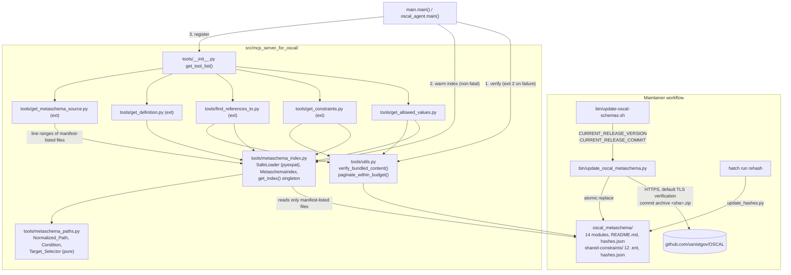
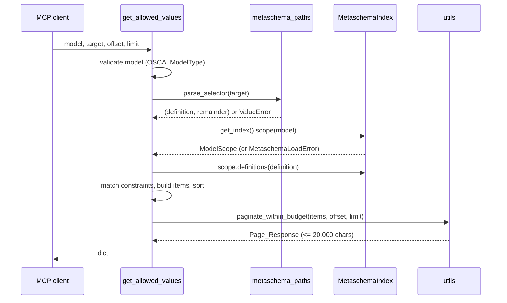
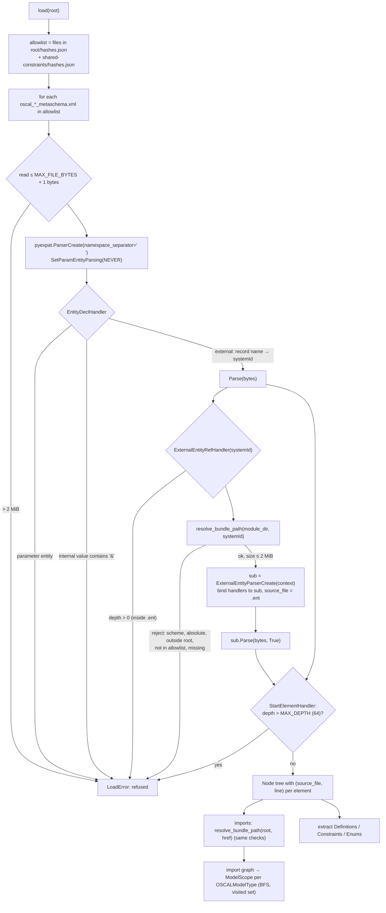
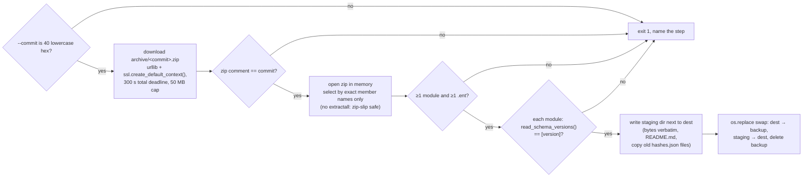

# Design Document: Metaschema Constraints

## Overview

GitHub issue #20. This feature bundles the NIST OSCAL Metaschema sources (`src/metaschema/oscal_*_metaschema.xml` and `src/metaschema/shared-constraints/*.ent` from `usnistgov/OSCAL` at tag `v<Bundled_OSCAL_Version>`), verifies them at startup with the existing hash-manifest mechanism, parses them into an immutable in-memory Metaschema_Index on first use, and exposes the index through size-bounded MCP tools.

The work ships in two slices that touch disjoint modules:

| Slice | Requirements | Ships |
|---|---|---|
| Core (PR 1) | 1-7, plus 12 for `get_allowed_values` | Bundle, integrity, update script, `metaschema_paths.py`, `metaschema_index.py`, `utils.paginate_within_budget`, `get_allowed_values` |
| Extended (PR 2+) | 8-11, 12 for the remaining tools | `get_constraints`, `find_references_to`, `get_definition`, `get_metaschema_source`. Each is one new module reading the core index; no core changes beyond optional index accessors |

Design facts verified against the `v1.2.3` tag archive and the project's Python 3.14.8 / expat 2.8.5 environment during design (experiment scripts were run with `hatch run python` and then deleted):

- The tag holds **14** `oscal_*_metaschema.xml` modules (not 17) and 12 `.ent` files. The other files in `src/metaschema/` (`readme.md`, `doc-identity-notes.md`, `.css`, `.svg`, `.xsl`) are not Metaschema_Sources. All 26 files use LF line endings.
- The NIST release zip (`releases/download/v1.2.3/oscal-1.2.3.zip`) contains only `metaschema/*_RESOLVED.xml` files and no `.ent` files, so it cannot provide entity-file Source_Locations. The source archive has the unresolved sources.
- Tag `v1.2.3` is an annotated tag (tag object `a504f40b…`) that dereferences to commit `e061961c7702afeabffdf5e59894d35e748dade1` (`gh api repos/usnistgov/OSCAL/git/ref/tags/v1.2.3`, then `gh api repos/usnistgov/OSCAL/git/tags/<sha> --jq .object`). The commit archive `archive/e061961c7702afeabffdf5e59894d35e748dade1.zip` has the zip comment `e061961c7702afeabffdf5e59894d35e748dade1` and the member prefix `OSCAL-e061961c7702afeabffdf5e59894d35e748dade1/`. The tag archive `archive/refs/tags/v1.2.3.zip` has the same zip comment but the prefix `OSCAL-1.2.3/`.
- The two archives differ in size (574,028 vs 550,298 bytes, downloaded the same day), but their 26 Metaschema_Sources are byte-identical. Archive bytes therefore depend on the URL form and are not a stable thing to hash; the commit and the member bytes are.
- Bundle size and shape limits: the largest Metaschema_Source is `oscal_assessment-common_metaschema.xml` at 148,652 bytes; the deepest element nesting in any module is 12; the bundle has 500 Definitions with 266 distinct names, and the longest name is `security-objective-confidentiality` (34 characters).
- Parsing all 14 modules with `pyexpat`, expanding the 38 external entity references, takes about 8 ms. All 914 `enum` start tags (275 of them from `.ent` files) were attributed to the correct file and 1-based line when each entity is parsed by its own `ExternalEntityParserCreate` sub-parser.
- `defined-component`'s `type` flag is **not** an inline flag. It is `<flag ref="defined-component-type"><use-name>type</use-name></flag>`, and the `oscal-component-type` constraint sits on the global flag `defined-component-type`. Likewise `system-component` references the global flag `system-component-type`, which holds `this-system` inline (not in an `.ent` file). Requirement 5 criterion 4 must therefore also follow flag references (see Requirement Changes, RC-2).
- 5 `allowed-values` targets use the descendant step `//` (e.g. `part[...]//part[...]/@name`), 2 `index` targets use `doc(...)`, 2 targets use a `has-oscal-namespace((uri1, uri2))` sequence argument, and many predicates combine a namespace test with other tests (`has-oscal-namespace('...') and @name='asset-type'`). Self steps occur as both `(.)[...]` and `.[...]`. No target uses `has-namespace`, `or` at the top level of a predicate, axes, or wildcards in 1.2.3, but the algorithm handles them without failing.

## Architecture



Request flow for `get_allowed_values(model, target)`:



### Key decisions (resolving the requirements' Open Questions)

**OQ1. Structural matching, not Metapath evaluation.** Decision: match Normalized_Paths structurally. Rationale: the tools answer questions about the model, not about an instance document, so there is no context node to evaluate a Metapath against. `elementpath` (XPath 3.1) exists but would need a synthetic instance tree and still could not express "which constraints could apply here". Structural matching covers every `allowed-values` target in 1.2.3, including the 5 with `//` (kept literally, see RC-3). Predicates are not dropped silently: they are reported as Conditions.

**OQ2. No inherited or referenced-definition constraints in the first slice.** Decision: return only Constraints declared on the named Definition, its inline flag Definitions, and the global flag Definitions it references (RC-2). Rationale: following ancestors needs the full model graph (assembly references, `group-as`, `use-name`, choice) to decide whether an ancestor's deeper target reaches the requested path; that is the core of a later `declared-on` feature. The global `property` Definition is directly queryable (`get_allowed_values("component-definition", "property/@name")` returns `marking`), so the docstring tells callers to also query `property/@name` and `link/@rel` for generic values. The item shape leaves room for a `declared-on` key later without breaking callers.

**OQ3. Parser: stdlib `pyexpat` used directly.** Verified behavior (expat 2.8.5):
- `xml.etree` exposes no line numbers and no per-entity origin.
- `xml.sax` with `feature_external_ges` does report entity-relative lines and the entity system ID through its locator (verified: `provided-by` at `.../allowed-values-component_component_service.ent` line 1). But its default resolver opens system IDs itself through `xml.sax.saxutils.prepare_input_source` / `urllib`, including URLs, so it would need an `EntityResolver` override to be safe, plus more indirection than `pyexpat` itself.
- `pyexpat` never opens anything itself. With no `ExternalEntityRefHandler`, external entity references are dropped silently (not even `SkippedEntityHandler` fires). With a handler, expat only passes `(context, base, systemId, publicId)` and the handler decides what to open (verified with `http://example.invalid/x.ent` and `/etc/passwd`: both reported, neither opened).
- `ExternalEntityParserCreate(context)` gives a sub-parser whose `CurrentLineNumber` counts from line 1 of the entity file. The outer parser's line numbers stay correct after the entity returns. pyexpat copies the parent's handlers to the sub-parser, so handlers must be re-bound per parser to read the right line counter.
- expat's built-in amplification guard rejects a classic billion-laughs document (`limit on input amplification factor ... breached`). Raising from `EntityDeclHandler` aborts the parse with that exception.
- `defusedxml` and `lxml` are not needed. No new dependency.

**OQ4. Runtime parse with a process-wide cache, no build-time artifact.** Decision: parse the whole bundle once, on first use, into an immutable `MetaschemaIndex`. `main.main()` and `oscal_agent.main()` warm it right after the integrity check. Rationale: the full parse costs milliseconds, a build-time artifact would need its own hash, build step, and staleness checks, and the raw sources must ship anyway for citations. Warming at startup narrows the window between verification and read to the same order as `get_oscal_schema`, which reads bundled schemas lazily today.

**OQ5. Key style.** Decision: hyphenated item keys (`allow-other`, `source-file`, `constraint-id`, `suggested-targets`, `flag-definition`) and the existing `Page_Response` envelope keys from `utils.paginate` (`items`, `total`, `offset`, `limit`, `hasMore`). Rationale: matches Metaschema attribute names and the repo's OSCAL JSON output; the envelope matches every other list tool.

**OQ6. Raw fallback.** Decision: a separate `get_metaschema_source` tool with line ranges (Requirement 11), and `get_oscal_schema` stays unchanged. Rationale: modules are up to 149 KB; line ranges match Source_Location citations; `get_oscal_schema` returns an unpaged string and its signature and tests would change for an unrelated format.

**OQ7. OSCAL-Reference pages.** Out of scope, as stated in the requirements. No design work.

**OQ8. Tool naming.** Decision: keep the names from the issue (`get_allowed_values`, `get_constraints`, `find_references_to`, `get_definition`, `get_metaschema_source`). Rationale: the owner proposed them; the server is OSCAL-only, so an `oscal` qualifier adds no disambiguation; existing names are already mixed (`get_capability`, `get_child_element`, `list_components`). Docstrings say "OSCAL Metaschema" in their first sentence so clients that list many servers still see the domain. If the owner prefers `get_oscal_*`, renaming is a one-line change per tool plus the registry test.

**OQ9. Upstream source.** Decision: the commit source archive `https://github.com/usnistgov/OSCAL/archive/$CURRENT_RELEASE_COMMIT.zip`, members under `OSCAL-<commit>/src/metaschema/`, where `CURRENT_RELEASE_COMMIT` is the commit that tag `v$CURRENT_RELEASE_VERSION` points to (RC-9). Rationale: the release zip has only resolved modules and no `.ent` files (verified above); pinning the commit instead of the tag means a moved or re-created tag cannot change what the script downloads (threat model T3, T17).

**OQ10. Implementation notes.**
- (a) `.gitattributes`: add `src/mcp_server_for_oscal/oscal_metaschema/** -text` after the `*` line, next to the `oscal_schemas` entry.
- (b) Wheel: no `pyproject.toml` change. Hatch's wheel target includes every non-ignored file under `packages = ["src/mcp_server_for_oscal"]`; `artifacts` is only for gitignored files. Verified on the existing wheel `build/mcp_server_for_oscal-0.5.4...whl`, which contains all 20 `oscal_schemas/` entries including `.xsd` and `hashes.json`. `.gitignore` has no pattern matching `.xml`, `.ent`, or the new directory. Requirement 1 criterion 6 is checked by the CI `mcpb` job: the smoke test starts the server from the installed wheel, and startup verification exits 2 if any bundle file or manifest is missing (see Testing Strategy).
- (c) Integrity `except`: widen to `(RuntimeError, KeyError, OSError, ValueError)` in both entry points through one shared helper. `OSError` covers `FileNotFoundError` (missing manifest or directory); `ValueError` covers `json.JSONDecodeError`. `verify_package_integrity` keeps its exception types, because `tests/test_file_integrity.py` asserts `json.JSONDecodeError` and `KeyError`.
- (d) `rehash`: add `hatch run bin/update_hashes.py src/mcp_server_for_oscal/oscal_metaschema` and `git add` for both manifests. `update_hashes.py` already recurses into `shared-constraints/` and writes its manifest there; `verify_package_integrity` already recurses on verification.

### Requirement changes (to apply to requirements.md)

| ID | Requirement | Change | Reason |
|---|---|---|---|
| RC-1 | Intro, 1.1 | "17 module files" becomes "14 module files" | Counted at tag `v1.2.3` |
| RC-2 | 5.4, 6.1, Intro, 4 (user story) | 5.4 also covers flag references: when `<name>` has `<flag ref="X">` whose effective name (`use-name` if declared, else `X`) equals `<flag>`, return Constraints of the global flag Definition `X` in the Model_Scope whose Normalized_Path is empty. Add a `flag-definition` item key naming the flag Definition that declares the Constraint whenever the match came through 5.4 (inline or referenced). The Intro example and the Requirement 4 user story wrongly place `oscal-component-type` on an inline flag and `this-system` in an `.ent` file | `defined-component/@type` and `system-component/@type` (Requirement 7.7) only work through flag references |
| RC-3 | Glossary (Normalized_Path, Target_Selector), 5.11, 7.8 | A Normalized_Path keeps a descendant step as `//`. A Target_Selector may contain `//` (e.g. `part//part/@name`); 5.11 rejects `///`, a leading or trailing `/`, whitespace anywhere, and the characters `[ ] ( ) \|` (predicates and unions are never part of a selector). Alternatives that start with `doc(...)` are cross-document: they never match a Target_Selector and are used only by `find_references_to` | 5 `allowed-values` targets use `//`; without this, 7.8 would generate selectors that 5.11 rejects |
| RC-4 | Glossary (Condition, Namespace_Condition), 6.4, 6.5 | A predicate is split into top-level `and` conjuncts. A conjunct is a Namespace_Condition only if it is `has-oscal-namespace('<uri>')` or `has-namespace('<uri>')` with exactly one string literal. `namespace` is taken from the last step whose predicate has a Namespace_Condition; remaining conjuncts form that step's Condition, joined by ` and `. Sequence arguments, predicates with top-level `or`, and Namespace_Conditions on earlier steps stay verbatim in `conditions` | Real targets combine namespace and name tests in one predicate and have namespace tests on more than one step |
| RC-5 | 4.1, 4.2, 4.3 | Only files listed in a bundle `hashes.json` manifest may be opened (allowlist, in addition to the path checks). External entity references inside an entity file and all parameter entities are refused with a load error | Smaller attack surface; upstream uses neither |
| RC-6 | 10.1, 10.6 | `get_definition` takes `offset`/`limit` and returns a Page_Response of matches. `remarks` keep paragraph and list-item breaks (`\n\n`, `- `) | 52 Definitions are named `uuid` and 50 `description`; truncating remarks alone cannot meet the Response_Budget |
| RC-7 | 4.8, 5.13 | Load failures raise `MetaschemaLoadError`, a `ValueError` subclass | One type for both criteria |
| RC-8 | 12.5 | For `get_allowed_values`, the shortened free-text field is `description` | The other fields are short identifiers |
| RC-9 | 3.1, 3.3, 1.4, Glossary (Update_Script) | 3.1: the Update_Script downloads the Metaschema_Sources from the commit archive of `CURRENT_RELEASE_COMMIT`, a full 40-hex commit SHA declared next to `CURRENT_RELEASE_VERSION` in `bin/update-oscal-schemas.sh`, which must be the commit that tag `v$CURRENT_RELEASE_VERSION` points to; the download uses HTTPS with default certificate and host-name verification. 3.3 adds failure cases: `CURRENT_RELEASE_COMMIT` is not 40 lowercase hex characters, or the archive's zip comment is not exactly that commit (same exit, message, and untouched-bundle behavior). 1.4: the README also states `Commit: <sha>` | Threat model T3, T17: a moved or re-created tag, or a wrong archive, must not change the bundle silently |
| RC-10 | 4 (new criterion 10) | IF a manifest-listed file is larger than 2 MiB (2,097,152 bytes), or element nesting in a module (counting entity content at its reference point) exceeds 64, THEN the Metaschema_Index SHALL not parse further, SHALL exclude that module, and SHALL record a load error naming the module file (and the entity file, if the limit is hit there) and the limit | Threat model T15. Largest file is 148,652 bytes and deepest nesting is 12, so the limits leave >10x headroom |
| RC-11 | 6.7, 10.4 | `a` becomes `[text](href)` only when `href` is an absolute `http:`/`https:` URL, a fragment (`#…`), or a relative reference with no scheme that does not start with `//`; otherwise only `text` is emitted. In link text, `\`, `[`, and `]` are backslash-escaped; in `href`, `(`, `)`, `<`, `>`, and every character at or below U+0020 are percent-encoded. C0 control characters other than tab and newline are removed from all rendered text before whitespace handling | Tool output is read by LLMs and may be rendered as Markdown; the rules keep a link from breaking the surrounding structure or carrying an executable scheme |
| RC-12 | 5.10 | Edit distance is computed against the first 64 characters of the unknown segment (case-insensitive). The message names the segment truncated to 80 characters | Bounds per-call cost (threat model T10). The longest Definition name is 34 characters, so the cap does not change which names are nearest for any realistic input |
| RC-13 | 4.6, 4.8, 5.13, and every error criterion that names a file or path | Client-facing messages (via `try_notify_client_error` and raised exception text) name files only by bundle-relative path or module file name, plus entity names, `href` values as written in the module, and the rule broken. They SHALL NOT contain absolute filesystem paths, OS exception text that embeds a path, exception reprs, or tracebacks. Tracebacks and absolute paths go to the server log only | Threat model T12 |

## Components and Interfaces

### Module layout

```
src/mcp_server_for_oscal/
├── oscal_metaschema/                      # Metaschema_Bundle (new, core)
│   ├── README.md                          # provenance: repo, tag, retrieval date
│   ├── hashes.json
│   ├── oscal_<name>_metaschema.xml        # 14 modules, byte-identical to tag
│   └── shared-constraints/
│       ├── hashes.json
│       └── allowed-values-*.ent           # 12 entity files
└── tools/
    ├── utils.py                           # + verify_bundled_content, BUNDLED_CONTENT_DIRS,
    │                                      #   RESPONSE_BUDGET, paginate_within_budget
    ├── metaschema_paths.py                # core: pure string algorithms (no I/O)
    ├── metaschema_index.py                # core: safe loader, data model, index, singleton
    ├── get_allowed_values.py              # core tool
    ├── get_constraints.py                 # extended
    ├── find_references_to.py              # extended
    ├── get_definition.py                  # extended
    └── get_metaschema_source.py           # extended
bin/
├── update-oscal-schemas.sh                # + calls update_oscal_metaschema.py first
└── update_oscal_metaschema.py             # new: download, check, atomic replace, README
```

Every Metaschema_Tool module imports only `metaschema_index` (and `metaschema_paths` for selector parsing) for Metaschema data (Requirement 7.1). Only `metaschema_index` opens bundle files; `get_metaschema_source` reads line ranges through `MetaschemaIndex.source_lines()`.

### `tools/metaschema_paths.py` (core, pure)

No I/O, no index dependency, so it can be property-tested in isolation.

```python
@dataclass(frozen=True, slots=True)
class Condition:
    step: str        # step text without predicates, e.g. "prop", "(.)", "."
    predicate: str   # predicate text verbatim (after removing a Namespace_Condition conjunct)

@dataclass(frozen=True, slots=True)
class PathAlternative:
    raw: str                         # alternative text as written (stripped)
    path: str | None                 # Normalized_Path; None if unparseable
    conditions: tuple[Condition, ...]
    namespace: str | None            # from the last step with a Namespace_Condition
    cross_document: bool             # starts with doc(...)

def normalize_target(target: str | None) -> tuple[PathAlternative, ...]: ...
def parse_selector(selector: str) -> tuple[str, str]: ...      # (definition, remainder)
def compose_selector(definition: str, path: str) -> str: ...
def validate_selector(selector: str) -> None: ...              # ValueError with rule broken
MAX_SELECTOR_LENGTH = 512
```

`normalize_target` never raises. `None` (no `target` attribute) is treated as `.` and yields one alternative with `path == ""`.

### `tools/metaschema_index.py` (core)

Public API (everything else is private):

```python
BUNDLE_DIR: Final[Path]            # <package>/oscal_metaschema
MAX_FILE_BYTES: Final = 2 * 1024 * 1024   # per-file read cap (RC-10)
MAX_DEPTH: Final = 64                     # element nesting cap incl. entity content (RC-10)
CONSTRAINT_TYPES: Final[tuple[str, ...]] = ("allowed-values", "matches", "index",
    "index-has-key", "is-unique", "has-cardinality", "expect")

class MetaschemaLoadError(ValueError): ...

class MetaschemaIndex:
    @classmethod
    def load(cls, root: Path = BUNDLE_DIR) -> "MetaschemaIndex": ...  # never raises per-module errors
    def scope(self, model: OSCALModelType) -> "ModelScope": ...      # raises MetaschemaLoadError
    def all_modules(self) -> "ModelScope": ...                       # whole bundle (ext. tools)
    def source_files(self) -> tuple[str, ...]: ...                   # manifest-listed, sorted
    def source_lines(self, rel: str) -> tuple[str, ...]: ...         # keepends=True (ext.)
    load_errors: Mapping[str, tuple[LoadError, ...]]                 # by module file

class ModelScope:
    modules: tuple[str, ...]                                   # each once, BFS order
    def definitions(self, name: str) -> tuple[Definition, ...]: ...
    def definition_names(self) -> tuple[str, ...]: ...         # sorted, distinct
    def global_definition(self, kind: str, name: str) -> tuple[Definition, ...]: ...

def get_index() -> MetaschemaIndex: ...        # process-wide singleton, thread-safe
def read_schema_versions(data: bytes) -> list[str]: ...   # used by update script and guard test
def model_module(model: OSCALModelType) -> str: ...       # e.g. "oscal_component_metaschema.xml"
```

`model_module` derives the file name from `utils.schema_names` (`oscal_component_schema` → `oscal_component_metaschema.xml`), so the mapping has one source.

### Safe loader (inside `metaschema_index.py`)



`resolve_bundle_path(base_dir, ref)` rejects, without opening anything:
1. a URL scheme (`^[A-Za-z][A-Za-z0-9+.-]*:`, which also catches Windows drive letters), a leading `/` or `\`, a UNC path, or a NUL byte;
2. any path whose `(base_dir / ref).resolve()` (normalizes `..`, follows symlinks) is not inside `root.resolve()`;
3. any path whose bundle-relative POSIX form is not in the manifest allowlist (RC-5);
4. a path that does not exist (reported as a missing file, Requirement 4.6).

Resource limits (RC-10), module constants so tests can lower them:

- `MAX_FILE_BYTES = 2 * 1024 * 1024`. Every module and entity file is read with `f.read(MAX_FILE_BYTES + 1)`; a longer read is refused before any byte reaches expat. Reading with a bound (not `stat` then `read`) avoids a check-then-use gap.
- `MAX_DEPTH = 64`. One depth counter per module load is shared by the outer parser and every entity sub-parser, so entity content counts at its reference point. The start-element handler refuses when the counter exceeds the limit; the end-element handler decrements it.
- expat's amplification guard stays as the second line of defense. No cross-file element-count cap: the per-file size limit, the depth limit, and the refusal of nested and parameter entities already bound the work per module to a linear pass over at most 2 MiB per file.

The handler raises a private `_Refused` exception; `load` catches it, plus `pyexpat.ExpatError`, `OSError`, and `UnicodeDecodeError`, per module, and records a `LoadError(module, subject, reason)`.

`LoadError` fields hold client-safe text only (RC-13): `module` and `subject` are bundle-relative names, or the entity name or `href` exactly as written in the module, and `reason` is built from fixed strings. For `OSError` the reason is `exc.strerror` (e.g. `No such file or directory`), never `str(exc)`, which embeds the absolute filename. For `ExpatError` it is `pyexpat.ErrorString(exc.code)` with line and column. The original exception, with absolute paths and traceback, goes to the server log through `logger.warning(..., exc_info=True)`. Because the MCP SDK reports a raised tool exception to the client as its `str()`, `MetaschemaLoadError` messages are built from `LoadError` fields only, and the original exception is attached with `raise ... from` for logging, not interpolated. A failing module is excluded from the index, and every ModelScope that reaches it carries the error, so tool calls raise `MetaschemaLoadError` (Requirement 4.8) while unaffected models still work.

The loader builds a minimal tree (`_Node(tag, attrs, children, text parts, source_file, line)`) for elements in the Metaschema namespace `http://csrc.nist.gov/ns/oscal/metaschema/1.0`. Markup children (`code`, `q`, `em`, `p`, ...) are kept so descriptions can be rendered. Comments and processing instructions are ignored. Element text from an entity is attached to the enclosing node in document order, which gives inlining semantics (Requirement 4.1).

### Extraction

Walking each module tree:

- **Definitions**: `define-assembly`, `define-field`, `define-flag` directly under `METASCHEMA` are global. Ones nested in a definition, its `model`, or a `choice` are local, with `parent` set to the enclosing Definition.
- **Flag slots** of a Definition: inline `define-flag` children (effective name = `use-name` or `name`) and `flag ref` children (effective name = `use-name` or `ref`; target = the global flag Definition named `ref`, resolved within the ModelScope at query time, because the visible set depends on the scope).
- **Constraints**: children of a Definition's `constraint` element whose local name is in `CONSTRAINT_TYPES`. Each records its declaring Definition, Source_Location of its start tag, `normalize_target(target)`, and type-specific attributes.
- **Enums**: `enum` children of `allowed-values`, in document order after entity expansion, each with its own Source_Location.

### `tools/utils.py` additions (core)

```python
BUNDLED_CONTENT_DIRS: Final = ("oscal_schemas", "oscal_metaschema")
RESPONSE_BUDGET: Final = 20_000

def verify_bundled_content(package_dir: Path) -> None:
    """Verify every bundled content directory; raises what verify_package_integrity raises."""

INTEGRITY_ERRORS: Final = (RuntimeError, KeyError, OSError, ValueError)

def paginate_within_budget(items: list[dict], offset: int, limit: int, *,
                           budget: int = RESPONSE_BUDGET,
                           truncatable: tuple[str, ...] = ("description",),
                           extra: Mapping[str, object] | None = None) -> dict: ...
```

`main.main()` and `oscal_agent.main()` replace their single `verify_package_integrity(... "oscal_schemas")` call with:

```python
try:
    verify_bundled_content(PACKAGE_DIR)   # module constant Path(__file__).parent; tests patch it
except INTEGRITY_ERRORS as err:
    logger.exception("Bundled content failed integrity verification; exiting.")
    raise SystemExit(2) from err
```

`verify_package_integrity` messages gain the directory (`File X has been modified in <dir>; expected hash ...`, `File X missing from package <dir>.`). The existing tests match substrings (`"File file2.json missing from package."`, `"test.bin has been modified"`), so the suffix keeps them passing. The unexpected-file path already logs the directory before re-raising `KeyError`.

Manifests are checked byte-for-byte, not only parsed: `utils.manifest_bytes(state)` (`json.dumps(state, indent=2)`, UTF-8, LF, no trailing newline) is the single definition of the format. `bin/update_hashes.py` writes through `utils.write_manifest`, and `verify_package_integrity` raises `RuntimeError("Manifest hashes.json in <dir> is not in canonical form ...")` when the raw bytes differ from `manifest_bytes` of the parsed content, or names the keys when the manifest has top-level keys other than `commit` and `file_hashes`. Without this, whitespace or escape edits to a manifest parse to the same object and pass.

### `get_allowed_values` (core tool)

```python
@tool()
def get_allowed_values(
    model: str,
    target: str,
    offset: int = 0,
    limit: int = 25,
    ctx: Context | None = None,
) -> dict:
    """Look up the values OSCAL Metaschema allows at a point in an OSCAL model, e.g. "Is asset-type an OSCAL prop name on defined-component, and are other names allowed?" or "Which component types does an SSP accept?".

    target is a Target_Selector: a Metaschema definition name, optionally followed by a path in
    instance names, e.g. "defined-component/prop/@name", "system-component/@type",
    "defined-component/link/@rel", "property/@name". Predicates from the Metaschema are not part
    of the selector; they are returned per value as `namespace` and `conditions`. Values that
    apply to every prop or link are declared on `property` and `link`; query those too.
    ...
    """
```

Steps:
1. `model` must equal an `OSCALModelType` value, else `ValueError` naming it and pointing to `list_oscal_models` (5.9).
2. `metaschema_paths.validate_selector(target)`, then `parse_selector` (5.11). No index access before this point.
3. `scope = get_index().scope(OSCALModelType(model))` (raises `MetaschemaLoadError`, 5.13 / 4.8).
4. `defs = scope.definitions(name)`; if empty, raise with up to 10 suggestions ordered by (case-insensitive Levenshtein distance, name) (5.10, RC-12). See "Suggestion cost bound" below.
5. Collect matches as `(constraint, matched_alternatives, flag_definition | None)`:
   - for each `d` in `defs`, each `allowed-values` Constraint `c` on `d` with at least one non-cross-document alternative whose `path == remainder` (5.2, 5.3);
   - if `remainder` is `@<flag>`: for each flag slot of `d` with effective name `<flag>` (inline, or referenced and resolved with `scope.global_definition("flag", ref)`), each `allowed-values` Constraint on that flag Definition with an alternative whose `path == ""` (5.4, RC-2).
   Deduplicate by constraint identity (5.5).
6. Expand each match into one item per enum, sort by `(constraint.source_file, constraint.line, enum_index)` (5.7).
7. If no items: return `paginate([], offset, limit)` plus `suggested-targets` (5.8).
8. Return `paginate_within_budget(items, offset, limit)` (5.12, 12.x).

Errors call `try_notify_client_error(msg, ctx)` before raising, as in `get_schema.py`.

#### Suggestion cost bound

Found while triaging T10. A naive Levenshtein of a 512-character segment against every name costs about 512 × 34 × 266 ≈ 4.6M cell updates in pure Python per call (more against the 500 non-distinct names). The design bounds it:

- `MAX_SUGGEST_CHARS = 64`. The segment is lowercased and cut to its first 64 characters before comparison (RC-12). Every Definition name is at most 34 characters, so this cap never changes the ordering for a segment of 64 characters or fewer.
- Candidates are the distinct names of the Model_Scope (`definition_names()`, at most 266).
- `_bounded_levenshtein(a, b, cutoff)` returns the exact distance if it is `<= cutoff`, else `cutoff + 1`. It skips the comparison when `abs(len(a) - len(b)) > cutoff`, computes only the diagonal band of width `2 * cutoff + 1`, and stops as soon as a row minimum exceeds `cutoff`.
- The caller keeps the 10 best `(distance, name)` pairs in a heap; `cutoff` is the current 10th-best distance (initially `max(len(a), longest name)`, which no distance exceeds). Names whose distance equals the cutoff are still computed exactly, so ties are broken by name as 5.10 requires.

Worst case per call: 266 names × 64 × 34 ≈ 580K cell updates, independent of how long `target` is. In practice the band and length skip cut this by an order of magnitude. Results are identical to a full Levenshtein over the capped segment (Property 8).

### Extended tools (PR 2+)

Each reads `get_index()` and `metaschema_paths` only, and reuses the core item builders.

| Tool | Module | Core reuse | Notes |
|---|---|---|---|
| `get_constraints(model, target, constraint_types=None, offset=0, limit=25, ctx)` | `get_constraints.py` | step 5 matcher generalized over `CONSTRAINT_TYPES`; bare-name mode walks the Definition and all nested local Definitions | Ordered by constraint Source_Location; `truncatable=("message", "test")` |
| `find_references_to(assembly, model=None, offset=0, limit=25, ctx)` | `find_references_to.py` | `all_modules()` index of `index` constraints by name; `index-has-key` filtered by scope | `cross-document` from `PathAlternative.cross_document` |
| `get_definition(name, model=None, kind=None, offset=0, limit=10, ctx)` | `get_definition.py` | Definition records (plus `Definition.as_type` for flag datatypes), markup renderer (block mode) | Paged per RC-6; `truncatable=("remarks",)`. `name` comes first because it is required (same as `find_references_to`) |
| `get_metaschema_source(file=None, start_line=1, line_count=200, ctx)` | `get_metaschema_source.py` | `source_files()`, `source_lines()` | Exact-match allowlist lookup before any read; budget cut by whole lines |

### Caching and thread safety

MCP runs sync tools on worker threads, so the singleton is built with double-checked locking:

```python
_index: MetaschemaIndex | None = None
_lock = threading.Lock()

def get_index() -> MetaschemaIndex:
    global _index  # noqa: PLW0603 - process-wide singleton, same pattern as init_store()
    idx = _index
    if idx is None:
        with _lock:
            if _index is None:
                _index = MetaschemaIndex.load(BUNDLE_DIR)
            idx = _index
    return idx
```

- `load` never raises for per-module problems (they become `LoadError`s), so one bad file cannot leave the singleton unset and make every call re-parse. If `load` itself fails (for example, a missing manifest), it raises `MetaschemaLoadError` with a client-safe message (RC-13, see Error Handling) chained from the original exception, the singleton stays `None`, and the next call retries; startup verification makes this case unreachable in a verified install.
- After `load` returns, nothing mutates the index: frozen dataclasses, tuples, `MappingProxyType`. Readers need no lock. Per-call work (one dict lookup, a filter over at most a few dozen constraints, a sort) is well under a millisecond, so there is no per-query cache to invalidate.
- `ModelScope`s for all eight `OSCALModelType`s and `all_modules()` are precomputed in `load`.
- Tests that need a different bundle build their own `MetaschemaIndex.load(tmp_root)` and patch `metaschema_index.get_index`; a `reset_metaschema_index` fixture in `tests/conftest.py` restores `_index` for tests that touch the singleton.

### Response budget enforcement

`utils.paginate_within_budget(items, offset, limit, budget=20_000, truncatable=(...), extra=None)`:

1. `page = paginate(items, offset, limit)` (raises its `ValueError` first, Requirement 12.2), then merge `extra` (e.g. `suggested-targets`).
2. `size(p) = len(json.dumps(p))` with default separators and `ensure_ascii=True`. That is at least as long as the compact or UTF-8 encodings the MCP SDK and Strands produce, so a response within budget here is within budget on the wire.
3. If `size(page) <= budget`, return it.
4. Otherwise binary-search the largest `k` in `[1, len(page.items))` with `size(prefix k) <= budget`, then set `items = items[offset:offset+k]`, `limit = k`, `hasMore = offset + k < total` (12.4).
5. If even `k = 1` does not fit, shorten each `truncatable` string of that item (longest first, cut at a code-point boundary and suffix `…`) by binary search on length until it fits; set `truncated: true`; keep `source-file` and `line` (12.5).

Because every page holds at least one item when `offset < total`, the walk `offset += len(items)` always progresses and reaches `hasMore == false` (12.6). `get_metaschema_source` uses the same `size` function but cuts whole lines (11.4). `get_definition` applies it to the `matches` page with `truncatable=("remarks",)`.

### Update script changes (Requirement 3)

`bin/update-oscal-schemas.sh` gains a pinned commit next to the version, and calls the metaschema step before it downloads the JSON/XSD release zip:

```bash
CURRENT_RELEASE_VERSION="1.2.3"
# Commit that tag v$CURRENT_RELEASE_VERSION points to (dereference annotated tags):
#   gh api repos/usnistgov/OSCAL/git/ref/tags/v$CURRENT_RELEASE_VERSION
#   gh api repos/usnistgov/OSCAL/git/tags/<tag-object-sha> --jq .object.sha
CURRENT_RELEASE_COMMIT="e061961c7702afeabffdf5e59894d35e748dade1"

python "$SCRIPT_DIR/update_oscal_metaschema.py" --version "$CURRENT_RELEASE_VERSION" \
    --commit "$CURRENT_RELEASE_COMMIT" \
    --dest "$PROJECT_ROOT/src/mcp_server_for_oscal/oscal_metaschema" || exit 1
```

The script runs as `hatch run update-oscal-schemas`, so `python` is the hatch env interpreter. Running the metaschema step first means a failure stops before the schemas change, so the two bundles never move to different versions in one run. Bumping the OSCAL release now means editing two adjacent lines; a guard test checks that `CURRENT_RELEASE_COMMIT` is 40 lowercase hex characters and that it equals the `Commit:` line of the bundle README.

`bin/update_oscal_metaschema.py` (stdlib only):



- URL: `https://github.com/usnistgov/OSCAL/archive/<commit>.zip`, built from the validated commit only (RC-9). The tag is not part of the URL, so moving or re-creating the tag upstream cannot change what is downloaded.
- TLS: `urllib.request.urlopen(url, context=ssl.create_default_context(), timeout=...)`, which verifies the certificate chain against the system CA store and checks the host name. GitHub redirects to `codeload.github.com`; urllib follows the redirect over HTTPS with the same context. No certificate pinning: GitHub rotates certificates, so a pin would break the script without a code change.
- Commit check: `zipfile.ZipFile.comment` must equal the commit as ASCII bytes (verified: GitHub writes the commit SHA as the archive comment). This catches a wrong URL, a stale cache, or a mixed-up archive. It is not a cryptographic check, since a party able to break TLS could forge the comment. The protection against substitution is TLS plus the review of the committed bundle diff (next item).
- Review: the bundle bytes and their `hashes.json` are committed, so every update arrives as a reviewable diff in a pull request, and the hashes pin what ships in the wheel.
- Members are `OSCAL-<commit>/src/metaschema/oscal_*_metaschema.xml` and `OSCAL-<commit>/src/metaschema/shared-constraints/*.ent`, matched by `fnmatch` on the full member name, with no further `/` in the file part.
- Files are written with `Path.write_bytes(zip.read(member))`, so no newline or whitespace conversion happens (3.5).
- The retrieval date is `datetime.now(UTC).date().isoformat()`; the README also records `Commit: <sha>`.
- Out of scope: the existing JSON/XSD release-zip download in `update-oscal-schemas.sh` uses `curl -L` on the tag release URL with no pin. It has the same gap and gets a follow-up issue; this feature does not change it.
- The old `hashes.json` files are copied into the staging tree so the bundle keeps its layout; they are stale until `hatch run rehash`, which the script tells the maintainer to run (same as for `oscal_schemas/` today). Startup verification fails until then, so a forgotten rehash cannot ship.
- Every failure before the swap leaves `dest` untouched (3.3, 3.4); the staging dir is removed in a `finally` block. The functions are importable (`download`, `check_commit`, `select_members`, `check_versions`, `replace_bundle`) so tests can drive them with a fake archive and no network.

### Wiring and documentation (Requirement 7)

- `tools/__init__.py`: import and append `get_allowed_values` to the list (later PRs append their tools). No condition on AWS settings (7.3).
- `main.main()`: `verify_bundled_content` (exit 2), then `_warm_metaschema_index()` (calls `get_index()`; logs a warning on exception, never exits, because per-model errors are reported per call), then `_init_oscal_store()`, then `_setup_tools()`. `oscal_agent.main()` does the same.
- Docs in the same change (7.5): `src/mcp_server_for_oscal/tools/README.md` tool table, `README.md` tool list, `AGENTS.md` (code map rows for `metaschema_index.py` / `metaschema_paths.py` / `oscal_metaschema/`, the `rehash` and `update-oscal-schemas` rows), `tests/test_tool_registry.py` `BASE_TOOL_NAMES`, and the tool table in `conf/powers/oscal/POWER.md` (it enumerates tools by name, so Requirement 7.5 applies to it too).
- `.gitattributes`: `src/mcp_server_for_oscal/oscal_metaschema/** -text`.
- `pyproject.toml` `rehash`: two new lines (OQ10 d).

## Data Models

All records are frozen dataclasses with `slots=True`; collections are tuples, lookup maps are wrapped in `types.MappingProxyType`. The index is never mutated after `load` returns.

```python
@dataclass(frozen=True, slots=True)
class SourceLocation:
    source_file: str   # bundle-relative POSIX path, e.g. "shared-constraints/x.ent"
    line: int          # 1-based line of the element's start tag in that file

@dataclass(frozen=True, slots=True)
class Markup:
    """Captured markup-line / markup-multiline content."""
    node: _Node        # private tree node; rendered on demand
    def plain(self) -> str: ...      # inline rendering (Requirement 6.7)
    def blocks(self) -> str: ...     # block rendering for remarks (RC-6)

@dataclass(frozen=True, slots=True)
class EnumValue:
    value: str
    description: Markup | None
    deprecated: str | None
    location: SourceLocation

@dataclass(frozen=True, slots=True)
class Constraint:
    type: str                                 # one of CONSTRAINT_TYPES
    id: str | None
    level: str                                # "ERROR" if absent
    target: str                               # verbatim; "." if absent
    alternatives: tuple[PathAlternative, ...]
    attrs: Mapping[str, str]                  # allow-other, extensible, name, datatype, regex,
                                              # min-occurs, max-occurs, test, ...
    message: Markup | None                    # expect
    key_fields: tuple[str, ...]               # key-field/@target in document order
    enums: tuple[EnumValue, ...]              # allowed-values only
    definition_key: DefinitionKey             # declaring Definition
    location: SourceLocation

@dataclass(frozen=True, slots=True)
class FlagSlot:
    effective_name: str                       # use-name or name/ref
    inline: "DefinitionKey | None"            # inline define-flag
    ref: str | None                           # flag ref target name
    required: bool

@dataclass(frozen=True, slots=True)
class DefinitionKey:
    module: str
    kind: Literal["assembly", "field", "flag"]
    name: str
    location: SourceLocation                  # unique per Definition

@dataclass(frozen=True, slots=True)
class Definition:
    key: DefinitionKey
    scope: Literal["global", "local"]
    parent: DefinitionKey | None
    formal_name: str | None
    description: Markup | None
    remarks: Markup | None
    use_name: str | None
    group_as: str | None
    flags: tuple[FlagSlot, ...]
    model_children: tuple[ModelChild, ...]    # used by get_definition (ext.)
    constraints: tuple[Constraint, ...]
    nested: tuple[DefinitionKey, ...]         # local definitions, for get_constraints bare mode
    as_type: str | None = None                # declared as-type, for get_definition flag datatypes

@dataclass(frozen=True, slots=True)
class LoadError:
    module: str
    subject: str    # entity name, import href, or "xml"
    reason: str
```

### Markup rendering (`Markup.plain()` / `Markup.blocks()`)

Tool output is read by LLMs and may be shown to users as Markdown, so rendering keeps the output structurally safe (RC-11):

1. Text: C0 control characters other than tab (U+0009) and newline (U+000A) are removed. XML 1.0 already forbids them, so expat rejects them in practice; the step is defense in depth. Then whitespace is collapsed (`plain`) or blocks are separated by `\n\n` and list items start with `- ` (`blocks`).
2. `code`, `q`, `em`, `strong`: `` `x` ``, `"x"`, `*x*`, `**x**` as before.
3. `a`: `_safe_href(href)` accepts an `href` only if it is an absolute URL with scheme `http` or `https` (case-insensitive), a fragment starting with `#`, or a relative reference with no scheme (no `:` before the first `/`, `?`, or `#`) that does not start with `//`. Accepted: `[text](href)` with `\`, `[`, `]` in `text` backslash-escaped and `(`, `)`, `<`, `>`, and every character at or below U+0020 in `href` percent-encoded. Rejected (`javascript:`, `data:`, `file:`, `mailto:`, `//host`, empty or missing `href`): `text` only.
4. Other elements: text content.

No content filtering beyond this. The bundle is NIST-authored and hash-verified at startup, so the risk of indirect prompt injection through descriptions is low; the rules above only keep a value from breaking the surrounding Markdown or carrying an executable link.

### Allowed_Value_Item (tool output)

Built by `_allowed_value_item(constraint, enum, matched_alternatives, definition_name, flag_definition)`:

| Key | Presence | Source |
|---|---|---|
| `value` | always | `enum/@value` verbatim |
| `description` | always | `Markup.plain()`, `""` if empty |
| `allow-other` | always | `true` iff `@allow-other == "yes"` |
| `definition` | always | the selector's first segment (declaring or containing Definition) |
| `target` | always | `Constraint.target` verbatim (`.` when absent) |
| `level` | always | `@level`, default `ERROR` |
| `source-file`, `line` | always | `EnumValue.location` |
| `extensible` | if declared | verbatim |
| `namespace` | if exactly one distinct namespace across matched alternatives | RC-4 |
| `conditions` | if any | `[{"step", "predicate"}]`, ordered distinct union across matched alternatives |
| `deprecated` | if declared | verbatim |
| `constraint-id` | if declared | verbatim |
| `flag-definition` | if matched via a flag slot | name of the flag Definition (RC-2) |
| `truncated` | only when `description` was shortened | `true` |

Example (`component-definition`, `defined-component/link/@rel`):

```json
{"value": "provided-by", "description": "This service is provided by the referenced component identifier.",
 "allow-other": true, "definition": "defined-component", "target": "(.)[@type='service']/link/@rel",
 "level": "ERROR", "source-file": "shared-constraints/allowed-values-component_component_service.ent",
 "line": 1, "constraint-id": "oscal-service-component-link-rel-type",
 "conditions": [{"step": "(.)", "predicate": "@type='service'"}]}
```

### Normalized_Path and Condition algorithm (`normalize_target`)

A small scanner tracks single/double-quoted strings, parenthesis depth, and bracket depth. "Top level" means outside quotes with both depths zero.

1. `target is None` → treat as `"."`.
2. Split on top-level `|` into alternatives; strip whitespace on each.
3. For each alternative:
   1. If it starts with `doc(`, consume the balanced call; mark `cross_document = True` and continue with the rest (which starts with `/`).
   2. Split on top-level `/` into steps. An empty step between two `/` marks a descendant step `//`; a leading empty step (`//part`) is kept the same way.
   3. Each step = base text before its first top-level `[`, plus each top-level `[...]` predicate (multiple predicates allowed).
   4. Strip leading self steps: while the first step's base is `.` or `(.)`, move its predicates to Conditions with that step text and drop it. A `//` following a dropped self step is kept (`.//by-component` → `//by-component`).
   5. For each predicate, split on top-level `and` (word-bounded). If no top-level `or` is present and a conjunct matches `^(has-oscal-namespace|has-namespace)\(\s*(['"])(.*?)\2\s*\)$`, it is a Namespace_Condition. The namespace of the last step that has one becomes `namespace`; its other conjuncts are re-joined with ` and ` as that step's Condition (if any remain). Every other predicate, including Namespace_Conditions on earlier steps, is a Condition verbatim.
   6. `path` = step bases joined by `/`, with descendant markers rendered as `//`. If the scanner finds unbalanced quotes, parentheses, or brackets, `path = None` (never matches) and the raw text is kept.

Examples:

| Constraint_Target | path | namespace | conditions |
|---|---|---|---|
| `prop[has-oscal-namespace('http://csrc.nist.gov/ns/oscal')]/@name` | `prop/@name` | `http://csrc.nist.gov/ns/oscal` | none |
| `prop[has-oscal-namespace('…/oscal') and @name='asset-type']/@value` | `prop/@value` | `…/oscal` | `[{prop, @name='asset-type'}]` |
| `(.)[@type='service']/link/@rel` | `link/@rel` | none | `[{(.), @type='service'}]` |
| `.[has-oscal-namespace('…/oscal')]/@name` | `@name` | `…/oscal` | none |
| `a/@x\|b/@x` | `a/@x`, `b/@x` | per alternative | per alternative |
| `.//by-component` | `//by-component` | none | none |
| `metadata/role\|doc(import-ssp/@href)/metadata/role` | `metadata/role`, `metadata/role` (cross-document) | none | none |
| absent | `""` | none | none |

### Target_Selector grammar

```
selector   := def-name ( sep step )*
sep        := "/" | "//"
def-name   := 1*( any char except "/" )
step       := 1*( any char except "/" )
```

`validate_selector` rejects, with the rule named in the message: empty; longer than 512; leading or trailing whitespace or any whitespace; leading or trailing `/`; `///`; any of `[ ] ( ) |`. `parse_selector` splits at the first `/`: if the rest starts with `//`, the remainder keeps it (`part//part/@name` → `("part", "//part/@name")`); otherwise one `/` is dropped (`defined-component/prop/@name` → `("defined-component", "prop/@name")`). `compose_selector(d, p)` is the inverse: `d` if `p == ""`, `d + p` if `p` starts with `//`, else `d + "/" + p`.

### Bundle README.md format

```markdown
# OSCAL Metaschema sources

Source repository: usnistgov/OSCAL
Tag: v1.2.3
Commit: e061961c7702afeabffdf5e59894d35e748dade1
Retrieved: 2026-10-13

Byte-identical copies of `src/metaschema/oscal_*_metaschema.xml` and
`src/metaschema/shared-constraints/*.ent` at the tag. Do not edit; run
`hatch run update-oscal-schemas`, then `hatch run rehash`.
```

The guard test (3.7) reads the `Tag:` line, and the commit guard test (3.8) compares the `Commit:` line with `CURRENT_RELEASE_COMMIT`; the update script rewrites the whole file.

## Correctness Properties

*A property is a characteristic or behavior that should hold true across all valid executions of a system-essentially, a formal statement about what the system should do. Properties serve as the bridge between human-readable specifications and machine-verifiable correctness guarantees.*

PBT fits this feature: path normalization, selector parsing, matching, markup rendering, paging, and path resolution are pure functions over large input spaces, and the bundled index is cheap to query hundreds of times. Fixed-content checks (bundle file list, README, schema versions, registration, docs) are example or smoke tests instead.

Reflection applied: per-key item checks (6.1-6.3, 6.6, 6.9-6.11) are one shape property; ordering, deduplication, and same-name resolution (5.5-5.7) fold into the matching oracle property; invalid `model`, selector, and paging arguments (5.9, 5.11, 12.2) are one rejection property; Source_Location checks on generated bundles (4.1, 4.5) are one property, separate from the bundle-wide citation property (7.8), because they test different inputs.

### Core properties

### Property 1: Target normalization recovers the structure it was rendered from

*For any* generated Constraint_Target structure (1-4 union alternatives; each an optional `doc(...)` prefix, optional leading `.` or `(.)` self step, and 0-6 steps that are names, `@flags`, or descendant markers, each with 0-2 predicates built from namespace calls with one or several URIs, comparisons, `and`/`or` conjunctions, and quoted strings containing `/`, `|`, `[`, `]`, `and`), rendering it to text and calling `normalize_target` SHALL return one alternative per rendered alternative with the expected `path`, the expected `namespace` (from the last step with a single-literal Namespace_Condition, else absent), the expected `conditions` in order with verbatim predicate text, and `cross_document` true exactly for `doc(...)` alternatives; and for any arbitrary text, `normalize_target` SHALL not raise.

**Validates: Requirements 6.4, 6.5, 8.7, 9.5, 9.7**

Also covers the Glossary terms Normalized_Path, Condition, and Namespace_Condition as amended by RC-3 and RC-4.

### Property 2: Target_Selector compose/parse round trip

*For any* definition name and Normalized_Path that satisfy the selector grammar (including empty paths, `@flag` steps, and `//` descendant steps), `parse_selector(compose_selector(name, path))` SHALL equal `(name, path)`, and `validate_selector` SHALL accept the composed selector.

**Validates: Requirements 5.2, 5.3**

Uses the selector grammar amended by RC-3.

### Property 3: Invalid arguments are rejected before the index is read

*For any* `model` string that is not an `OSCALModelType` value, *any* `target` that breaks one selector rule (empty, longer than 512, whitespace, leading/trailing `/`, `///`, or containing `[ ] ( ) |`), or *any* `offset < 0` or `limit` outside 1-100, `get_allowed_values` SHALL raise `ValueError` whose message names the offending value and the broken rule (or refers to `list_oscal_models`, or is the `utils.paginate` message), SHALL call `try_notify_client_error` for model and selector errors, and SHALL not call `get_index()` for model and selector errors.

**Validates: Requirements 5.9, 5.11, 5.12, 12.2**

### Property 4: get_allowed_values equals a brute-force oracle

*For any* model and *any* Target_Selector drawn from the bundled index (every `compose_selector(definition, alternative.path)` for every `allowed-values` Constraint in that model's scope, every `<name>/@<flag>` for every flag slot, and every bare definition name), the multiset of `(constraint location, enum location)` pairs across all pages of `get_allowed_values` SHALL equal the set computed by a direct scan of the index's Definitions, Constraints, and flag slots under the matching rules; the items SHALL be sorted by `(constraint source-file, constraint line, enum document order)`; and two calls with the same arguments SHALL return identical results.

**Validates: Requirements 5.2, 5.3, 5.4, 5.5, 5.6, 5.7**

Includes flag references per RC-2.

### Property 5: Allowed_Value_Item shape

*For any* item returned for *any* selector from Property 4, the item SHALL contain `value`, `description`, `allow-other`, `definition`, `target`, `level`, `source-file`, and `line`; `allow-other` SHALL be a boolean equal to (`@allow-other == "yes"`); `level` SHALL equal `@level` or `ERROR`; `value`, `target`, `extensible`, `deprecated`, and `constraint-id` SHALL equal the source attributes verbatim and be present exactly when declared; `flag-definition` SHALL be present exactly when the match came through a flag slot; and the item SHALL contain no `None` values and only keys from the documented hyphenated key set.

**Validates: Requirements 6.1, 6.2, 6.3, 6.6, 6.9, 6.10, 6.11**

Includes the `flag-definition` key from RC-2.

### Property 6: Every citation points at its value

*For any* item returned for *any* selector from Property 4, `source-file` SHALL be a file listed in a bundle manifest and line `line` (1-based) of that file SHALL contain the XML-escaped form of `value`.

**Validates: Requirements 4.5, 6.12, 7.8**

### Property 7: Suggested targets are valid and productive

*For any* definition name in a model's scope and *any* remainder that matches no `allowed-values` Constraint on it, `get_allowed_values` SHALL return `items == []`, `total == 0`, `hasMore == false`, and a `suggested-targets` list of 0-20 distinct strings in ascending order, each of which passes `validate_selector`, starts with that definition name, and returns at least one item when passed back as `target`.

**Validates: Requirements 5.8**

### Property 8: Unknown-definition suggestions are the nearest names

*For any* string of 1-512 characters that is not a definition name in a model's scope and passes `validate_selector`, `get_allowed_values` SHALL raise `ValueError` listing 1-10 names, all from that scope, equal to the first 10 of all scope names sorted by (naive full-matrix case-insensitive Levenshtein distance to the segment's first 64 characters, name); and *for any* such string longer than 64 characters, the listed names SHALL equal those listed for its first 64 characters.

**Validates: Requirements 5.10**

Includes the segment cap from RC-12. The naive oracle makes this a model-based test of the banded, early-exit implementation.

### Property 9: Paging walks the full result exactly once

*For any* selector from Property 4, *any* `limit` in 1-100, and *any* start `offset` in 0 to `total + 3`, following pages (`offset += len(items)` until `hasMore` is false) SHALL yield exactly `full[offset:]` of the `offset = 0` walk, in order, with no duplicates, the same `total` on every page, at least one item on every page while `offset < total`, every serialized page at most 20,000 characters, and an empty page with `hasMore == false` when `offset >= total`.

**Validates: Requirements 5.12, 7.9, 12.3, 12.6, 12.7**

### Property 10: Budget pager returns the longest fitting prefix

*For any* list of generated item dicts (string values of 0-30,000 characters, including non-ASCII), *any* valid `offset` and `limit`, and *any* budget of at least 2,000, `paginate_within_budget` SHALL return a page whose `json.dumps` length is at most the budget; when `offset < total`, it SHALL contain `k >= 1` items equal to `items[offset:offset+k]` (except a `truncated` single item), where adding item `k+1` would exceed the budget or `k` equals the requested limit; `limit` SHALL equal the number of items returned when reduced; `hasMore` SHALL equal `offset + k < total`; and a single oversized item SHALL come back with `truncated: true`, shortened `truncatable` fields that are prefixes of the originals, and unchanged non-truncatable fields.

**Validates: Requirements 12.3, 12.4, 12.5**

### Property 11: Markup renders to the documented Markdown

*For any* generated inline markup tree (text including `[`, `]`, `(`, `)`, `\`, tabs and newlines; `code`, `q`, `em`, `strong`, `a` with an `href` drawn from `http:`, `HTTPS:`, `#frag`, relative paths, `//host`, `javascript:`, `data:`, `file:`, `mailto:`, values containing spaces, parentheses, and angle brackets, or no `href`; and unknown elements, nested to depth 3, with arbitrary whitespace runs and empty content), parsing its XML serialization with the loader and calling `Markup.plain()` SHALL equal a reference renderer's output: `` `x` ``, `"x"`, `*x*`, `**x**`, `[x](href)` with escaped text and percent-encoded href only for safe hrefs and `x` alone otherwise, text content for other elements, whitespace runs collapsed to one space, and leading and trailing whitespace removed (empty for empty content); and *for any* string passed to the C0 filter, the result SHALL contain no character below U+0020 other than tab and newline.

**Validates: Requirements 6.7, 6.8, 10.4**

Includes the link and control-character rules from RC-11. The C0 filter is tested directly on strings because XML 1.0 cannot carry most C0 characters.

### Property 12: Entities expand in place with their own Source_Locations

*For any* generated temporary bundle (one module with 1-5 `allowed-values` constraints whose enums are a random interleaving of inline `enum`s and references to 1-4 entity files, each holding 1-5 enums on random lines, with manifests generated for it), `MetaschemaIndex.load` SHALL record no load errors, each constraint's enum values SHALL equal the inlined document order, and each enum's Source_Location SHALL be the file and 1-based line where its start tag was written.

**Validates: Requirements 4.1, 4.5**

### Property 13: Path resolution never escapes the allowlist

*For any* reference string (generated from relative names, `..` sequences, `./` prefixes, absolute POSIX and Windows paths, UNC paths, URL schemes, NUL bytes, symlinks inside a temporary bundle that point outside it, and names missing from the manifest), `resolve_bundle_path` SHALL either return a path whose bundle-relative POSIX form is in the manifest allowlist and exists, or raise `_Refused`; and no file outside the allowlist SHALL be opened during a `load` of a module that declares that reference as an entity or import (checked with an `open` spy), with the module's `LoadError` naming the module and the entity name or `href`.

**Validates: Requirements 4.2, 4.6**

Includes the manifest allowlist from RC-5.

### Property 14: Model_Scope is the import closure, each module once

*For any* generated import graph over 1-12 modules (including self-imports, cycles, and diamonds), the scope computed for each root SHALL contain exactly the modules reachable from it, each once, and computing it SHALL terminate without a load error.

**Validates: Requirements 4.4, 4.7**

### Property 15: Any single-byte change fails startup verification

*For any* file in a temporary copy of the bundle (module, `.ent`, `README.md`, or `hashes.json`), *any* byte offset in it, and *any* replacement byte different from the original, `verify_bundled_content` SHALL raise an exception in `INTEGRITY_ERRORS`, and `main.main()` started against that copy SHALL exit with status 2. For `hashes.json` this relies on the canonical-form and key-set checks: a whitespace change still parses to the same manifest.

**Validates: Requirements 2.4, 2.6**

### Property 16: Metaschema update is all-or-nothing and byte-exact

*For any* generated fake commit archive (a requested commit that is valid 40-hex or malformed; a zip comment equal to it, a different SHA, empty, or absent; 0-5 modules with matching or mismatching `<schema-version>`; 0-5 `.ent` files with arbitrary bytes including CRLF; extra non-matching members) and *any* prior bundle contents, with an optional injected download timeout or bad zip, `replace_bundle` SHALL either succeed, leaving the bundle with exactly the archive's matching files (byte-identical), a README stating the tag, the commit, and today's UTC date, and the prior manifests, or fail with a non-zero exit, an error naming the step, and every prior bundle file byte-identical with none added or removed; it SHALL succeed exactly when the commit is 40 lowercase hex characters, the download completes, the zip comment equals the commit, there is at least one module and one `.ent` file, and every module declares exactly the requested version.

**Validates: Requirements 3.1, 3.2, 3.3, 3.4, 3.5**

Includes the commit pin and zip-comment check from RC-9.

### Core properties from the threat model

Numbered after the extended properties so existing numbers stay stable.

### Property 23: Loader size and depth limits

*For any* generated temporary bundle (one or two modules, each with element nesting depth 1-80 split between the module and 0-2 entity files, and file sizes around a test-lowered `MAX_FILE_BYTES`), `MetaschemaIndex.load` SHALL record a load error for a module exactly when one of its files exceeds `MAX_FILE_BYTES` or its combined nesting depth exceeds `MAX_DEPTH`, naming the module, the file where the limit was hit, and the limit; SHALL exclude that module from every Model_Scope that reaches it; and SHALL load the other module without error.

**Validates: Requirements 4.8, 4.10**

Covers the new criterion from RC-10. One example test also uses the real limits: a 2,097,153-byte entity file and a 65-level module.

### Property 24: Client-facing errors never disclose host paths

*For any* failure kind (missing entity file, refused reference, oversize file, nesting too deep, malformed XML, unreadable file via a permission change where the OS supports it, missing or malformed manifest) injected into a temporary bundle under a directory whose absolute path contains a random marker, the text of the raised `MetaschemaLoadError` and every message passed to `try_notify_client_error` SHALL contain the bundle-relative name of the failing file, and SHALL contain neither the marker, the absolute bundle path, `Traceback`, nor `Errno`.

**Validates: Requirements 4.6, 4.8, 4.11, 5.13**

Covers RC-13.

### Extended properties (PR 2+)

### Property 17: get_constraints agrees with get_allowed_values and filters by type

*For any* selector from Property 4, each item of `get_constraints(model, target, ["allowed-values"])` SHALL have `value-count` equal to its Constraint's enum count. For a path selector, expanding those Constraints' enums in item order SHALL give exactly the `get_allowed_values` items for the same arguments (a Constraint with no enums contributes none). For a bare definition name, the `get_allowed_values` items SHALL be the expansion of the returned Constraints that are declared on a Definition of that name and have a same-document empty path; the other returned Constraints are on nested local Definitions or target another path (Requirement 8.3). *For any* subset of `CONSTRAINT_TYPES`, the result SHALL be the subset of the unfiltered result whose `type` is in it, in the same order, and an empty list SHALL equal no filter.

**Validates: Requirements 8.2, 8.3, 8.4, 8.5**

### Property 18: get_constraints item shape

*For any* item returned by `get_constraints` for *any* selector or bare definition name in the bundle, the item SHALL contain the common keys, exactly the type-specific keys whose source attribute or child is declared, `namespace`/`conditions` per Property 1's rules, no `None` values, and only documented hyphenated keys.

**Validates: Requirements 8.6, 8.7**

### Property 19: find_references_to pairs every key reference with its index

*For any* assembly name drawn from the last steps of all `index` alternatives and all definition `use-name`s (plus random strings), every item SHALL pair an `index` Constraint whose alternative's last step equals the assembly (or the `use-name` of a Definition named that) with an `index-has-key` Constraint of the same `name`, resolved across all modules; the item set SHALL equal a brute-force scan, filtered by `model` scope when given; `cross-document` SHALL be true exactly when the `index` target contains a `doc(...)` alternative; and items SHALL be ordered by (`index-has-key` source-file, line, `index-name`).

**Validates: Requirements 9.2, 9.3, 9.4, 9.5, 9.6, 9.7, 9.8, 9.11**

### Property 20: get_definition returns every same-named Definition within budget

*For any* definition name in the bundle and *any* `kind` filter, the walk of `get_definition` pages SHALL return exactly the Definitions with that name and kind in the searched modules, ordered by Source_Location, each local one with `parent-definition`, with no `None` values, and every response at most 20,000 characters, with `truncated: true` exactly on matches whose `remarks` were shortened.

**Validates: Requirements 10.2, 10.3, 10.5, 10.6**

Uses the paged `get_definition` from RC-6.

### Property 21: get_metaschema_source pages reconstruct the file

*For any* manifest-listed file and *any* `line_count` in 1-500, concatenating `text` from `start_line = 1` while `has-more` is true (next `start_line = end-line + 1`) SHALL reproduce the file's bytes exactly (decoded as UTF-8), with `end-line` and `has-more` consistent with `total-lines` and every response at most 20,000 characters.

**Validates: Requirements 11.2, 11.4**

### Property 22: get_metaschema_source rejects everything outside the allowlist

*For any* `file` string that is not exactly a manifest-listed bundle-relative path (including case variants, `..`, absolute paths, URLs, and backslash forms), and *any* `start_line` or `line_count` out of range for a listed file, `get_metaschema_source` SHALL raise `ValueError` with the documented content and SHALL not open any file (checked with an `open` spy).

**Validates: Requirements 11.3, 11.6, 11.7**

## Error Handling

All tool errors follow the repo pattern: build the message, call `try_notify_client_error(msg, ctx)`, then raise. Nothing returns partial results.

| Condition | Where detected | Raised | Message content |
|---|---|---|---|
| `model` not an `OSCALModelType` value | tool, before index | `ValueError` | the value; "use `list_oscal_models`" |
| Malformed Target_Selector | `metaschema_paths.validate_selector` | `ValueError` | the selector (truncated to 80 chars in the message) and the rule broken |
| Unknown definition (first segment) | tool, after scope | `ValueError` | the segment; up to 10 nearest names |
| `offset` / `limit` out of range | `utils.paginate` | `ValueError` | `utils.paginate`'s message, not wrapped |
| Unknown definition, segment longer than 64 chars | tool, after scope | `ValueError` | as above; distances use the first 64 characters (RC-12) |
| Load error in Model_Scope | `ModelScope` access | `MetaschemaLoadError(ValueError)` | module file, entity name or `href` as written, reason |
| File over 2 MiB, or nesting over 64 (RC-10) | loader, recorded as `LoadError` | `MetaschemaLoadError` on access | module file, the file where the limit was hit (bundle-relative), the limit |
| Bundle-level load failure (manifest missing or malformed) | `MetaschemaIndex.load` | `MetaschemaLoadError` | bundle-relative manifest name (`oscal_metaschema/hashes.json` or `oscal_metaschema/shared-constraints/hashes.json`); "reinstall the package, or run `hatch run rehash` in a checkout". No absolute path (RC-13) |

Every client-facing message in this table follows RC-13: bundle-relative paths, module and entity names, and the rule broken only. The full exception, with absolute paths and traceback, is logged on the server side.
| Invalid `constraint_types` (ext.) | `get_constraints` | `ValueError` | each invalid value; the 7 valid names |
| `file` not in allowlist (ext.) | `get_metaschema_source` | `ValueError` | list of available files |
| Line range out of bounds (ext.) | `get_metaschema_source` | `ValueError` | valid range for that file |

Startup:

| Condition | Behavior |
|---|---|
| Any hash mismatch, missing listed file, unlisted file, missing or malformed manifest, missing bundle directory | `logger.exception` names the directory and file, `SystemExit(2)`; `oscal-agent` identical |
| Index warm-up raises | warning logged with traceback; server continues; affected tools raise per call |
| Load errors recorded for some modules | warning per module at startup; tools for unaffected models work |

Update script: exit 1 with `ERROR: <step>: <detail>` on stderr for a malformed `--commit` (not 40 lowercase hex), download timeout (300 s total), HTTP or TLS verification error, archive over 50 MB, bad zip, a zip comment that does not equal the commit (naming both values), zero modules or zero `.ent` files, or a `<schema-version>` mismatch (naming the module and its declared versions). The bundle is untouched in every case.

Security controls are summarized in the Threat Model section below.

## Threat Model

Source: `threat-model.tc.json` in this spec directory (Threat Composer v1), generated with threat-composer-ai (Sonnet 4.6): 20 threats, 23 mitigations. The orchestrator triaged it; this section records the outcome.

Trust boundaries for this feature:

- LLM client → Metaschema_Tools: every argument (`model`, `target`, `file`, offsets) is untrusted. Output goes back to an LLM and may be rendered as Markdown.
- Bundle on disk → loader: files are verified by hash at startup, but the loader still treats them as untrusted XML.
- Maintainer workstation → GitHub during `hatch run update-oscal-schemas`: the archive crosses the network.

| Threat | Short paraphrase | Disposition | Where handled |
|---|---|---|---|
| T3, T17 | Substituted archive (MITM, compromised workstation) or moved tag during update | Adopted. M5 adapted: pin the commit, not archive bytes. M21 rejected: certificate pinning breaks on GitHub cert rotation | `CURRENT_RELEASE_COMMIT`, commit-archive URL, zip-comment check, default TLS context, PR review of committed bundle bytes (Update script changes; RC-9; Property 16) |
| T15 | Oversized or deeply nested XML exhausts the loader | Adopted in reduced form (M19): 2 MiB per-file cap and depth 64. Cross-file element-count cap rejected as redundant | Safe loader resource limits (RC-10; Property 23); expat amplification guard as second line |
| T10 | Many or expensive tool calls exhaust the server | Partly adopted: the unknown-definition suggestion path is bounded. M16 rate limiting rejected: stdio is single-client and local, and reads are lock-free after load | Suggestion cost bound (RC-12; Property 8) |
| T12 | Error messages disclose host paths and internals | Adopted in narrow form (M18): client messages carry bundle-relative names and the rule broken only; tracebacks stay in server logs. Generic exception-to-message mapping rejected: it would remove the actionable errors the requirements specify | Safe loader `LoadError` text, Error Handling (RC-13; Property 24) |
| (triage) | Rendered descriptions break Markdown or carry unsafe links into LLM output | Adopted. No content filtering: the content is NIST-authored and hash-verified, so indirect prompt-injection risk is low | Markup rendering (RC-11; Property 11) |
| T2 | Crafted selector or path reaches file I/O (traversal) | Already mitigated. Selectors are matched against in-memory strings and never reach file I/O; `get_metaschema_source` uses exact allowlist lookup before any read; `resolve_bundle_path` resolves, follows symlinks, checks containment and the allowlist. M4 is subsumed; M3 (PurePosixPath normalization of selectors) does not apply because selectors are not paths | `metaschema_paths.validate_selector`, `resolve_bundle_path`, Properties 3, 13, 22 |
| T14 | Attacker with write access to the installed package swaps bundle files and `hashes.json` | Accepted. M6 rejected: whoever can write the package can also change the code that checks a signature. Release-level provenance (PyPI trusted publishing, already used; PEP 740 attestations) is the right layer, follow-up issue | Startup verification still catches accidental or partial changes (Property 15) |
| T18 | Reading bundled content through the tools | Accepted: public NIST data | None needed |
| T1 | Unauthenticated `streamable-http` transport (M1, M2) | Out of scope: pre-existing, dev-only, already documented | Existing docs |
| T4-T9, T11, T13, T16, T19, T20 | Credentials, S3 sessions, agent prompt injection, `validate_oscal_content` input size, FTS5 queries, Bedrock cost, `OSCAL_DOCUMENTS_DIR`, KB output | Out of scope: pre-existing server and agent concerns unrelated to this feature | None in this feature |

Controls in this design, for reference:

- The loader opens only manifest-listed files inside the bundle, after path normalization and symlink resolution, with a bounded read of at most 2 MiB + 1 byte. expat performs no I/O on its own; with `XML_PARAM_ENTITY_PARSING_NEVER` it never loads an external DTD. Parameter entities, nested external entities, and internal entities that reference other entities are refused; nesting deeper than 64 is refused; expat's amplification limit is a second line of defense.
- The index never parses user-supplied XML. All user input (selectors, names, file paths) is matched against in-memory strings or the allowlist. Suggestion work per call is bounded independently of input length.
- Client-facing errors carry no absolute paths, OS exception text, or tracebacks.
- Rendered Markdown links use only `http`, `https`, fragment, or scheme-less relative targets, with structural characters escaped.
- No new network-exposed surface. The new tools are read-only and run with the existing transports; the existing note that `streamable-http` has no authentication still applies.
- The update script downloads a pinned commit over verified TLS and checks the archive's commit comment. bandit: `urllib.request.urlopen` on a URL built from a fixed `https://github.com/` prefix and a validated 40-hex commit (`# nosec B310` with that reason).
- Known gap, out of scope: the JSON/XSD release download in `update-oscal-schemas.sh` is not pinned (follow-up issue).

## Testing Strategy

### Approach

- **Property tests** (Hypothesis, already in `devtest` and `hatch-test`): Properties 1-16, 23, and 24 in the core PR, 17-22 with their tools. Each property is one test function with `@settings(max_examples=100)` (or more), tagged in its docstring as `Feature: metaschema-constraints, Property <n>: <title>`. `OSCAL_TEST_MAX_EXAMPLES` caps them on Windows CI as for other tests.
- **Example tests** for fixed content and specific scenarios (below). They stay few, because the properties cover input variation.
- Strategies over the real bundle use `st.sampled_from(BUNDLE_SELECTORS)`, where `BUNDLE_SELECTORS` is computed once per session from `get_index()` (the full parse is ~10 ms). Strategies needing files (Properties 12, 13, 15, 16) write small trees under `tmp_path_factory` and avoid copying more than the ~600 KB bundle per example.
- Run with `hatch test` (e.g. `hatch test tests/tools/test_get_allowed_values.py`) and the full gate with `hatch run tests` before each commit.

### Test files

| File | Content |
|---|---|
| `tests/test_metaschema_bundle.py` | Smoke: 14 modules + 12 `.ent` + README + 2 manifests and nothing else (1.1, 1.2); every entity `SYSTEM` id and `<import href>` resolves (1.3, 1.7); README provenance and `Tag: v<Bundled_OSCAL_Version>` (1.4, 3.7); `CURRENT_RELEASE_COMMIT` in `update-oscal-schemas.sh` is 40 lowercase hex and equals the README `Commit:` line (3.8); every module has exactly one `<schema-version>` equal to `get_bundled_oscal_version()`, message names offenders (3.6); `git check-attr text` reports `unset` for a bundle file (1.5, skipped if `git` is unavailable); `verify_package_integrity` passes on the unmodified bundle (2.6); manifests list exactly the files in their directory (2.1); `rehash` script lines present in `pyproject.toml` (2.2) |
| `tests/test_metaschema_integrity.py` | Property 15; examples: missing listed file, unlisted extra file in `shared-constraints/`, missing manifest, malformed manifest each give exit 2 from `main.main()` and `oscal_agent.main()` (2.3-2.6); verification runs before `_setup_tools` (2.3) |
| `tests/tools/test_metaschema_paths.py` | Properties 1, 2; the normalization example table from this design as parametrized examples |
| `tests/tools/test_metaschema_index.py` | Properties 11, 12, 13, 14, 23, 24; real-limit examples: a 2,097,153-byte entity file and a 65-level module each give a `LoadError` naming the file and limit, while the unmodified bundle loads (4.10); `javascript:` and `//host` links render as text only (RC-11); billion-laughs and parameter-entity modules give `LoadError` (4.3); a module with a missing entity file gives a `LoadError` naming the path (4.6); `socket.socket` patched to raise during `load` (4.3); load error affects only models whose scope reaches it (4.8); concurrent `get_index()` from 8 threads returns one object and parses once |
| `tests/tools/test_get_allowed_values.py` | Properties 3-9 (Property 8 compares against a naive Levenshtein oracle and checks the 64-character cap on segments up to 512 characters); examples 7.6 and 7.7 exactly as written, `property/@name` returns `marking`, signature check (5.1), docstring checks (7.4), `MetaschemaLoadError` path (5.13) |
| `tests/test_utils.py` (extend) | Property 10 for `paginate_within_budget` |
| `tests/test_update_oscal_metaschema.py` | Property 16; URL built from the commit only, never the tag (3.1, RC-9); `urlopen` receives an `ssl.SSLContext` with `verify_mode == CERT_REQUIRED` and `check_hostname` true; an archive whose comment is a different SHA is rejected with the bundle untouched; script exits 1 and names the step for each failure kind |
| `tests/test_tool_registry.py` (extend) | `BASE_TOOL_NAMES` gains each tool as it ships; the existing Property 1 there then covers 7.3 |
| `tests/test_metaschema_docs.py` | each registered Metaschema_Tool name appears in `tools/README.md`, `README.md`, `AGENTS.md`, and `conf/powers/oscal/POWER.md` tool tables (7.5); tool modules import `metaschema_index` and do not call `open`/`read_text`/`read_bytes` (AST scan, 7.1) |
| `tests/test_integration_stdio_smoke.py` (extend) | `list_tools` includes `get_allowed_values`; one `call_tool("get_allowed_values", {"model": "component-definition", "target": "defined-component/prop/@name"})` returns `asset-type`. In the CI `mcpb` job this runs from the installed wheel, so it also covers wheel inclusion (1.6) and LF-exact checkout on macOS and Windows (1.5) |
| Extended PRs | `tests/tools/test_get_constraints.py` (Properties 17, 18; 8.1, 8.8-8.11 examples), `tests/tools/test_find_references_to.py` (Property 19; SSP `component` includes the `depends-on` and `uses-service` link `@href` references, SSP `by-component` includes the cross-document `provided-by` link reference; 9.1, 9.8, 9.9, 9.10), `tests/tools/test_get_definition.py` (Property 20; `uuid` across modules; 10.7-10.9), `tests/tools/test_get_metaschema_source.py` (Properties 21, 22; listing mode 11.5) |

### Not covered by automated tests

- Upstream byte identity of the committed bundle is established by the update script (Property 16 tests the script; the bundle's hashes pin the result). Re-downloading in CI is avoided on purpose: CI should not depend on GitHub archive availability.
- Whether structural matching answers every real modeling question is a product judgment (OQ1, OQ2); the examples in 7.6 and 7.7 and `property/@name` are the acceptance evidence for the first slice.
