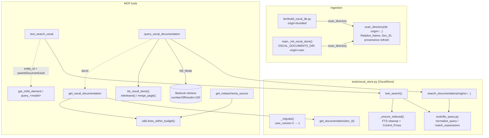

# Design Document: Search/Fetch Pairs

## Overview

GitHub issue #45. This feature makes two discover → fetch pairs work end to end and removes storage locations from every tool result and client-facing message:

| Content | Discover (snippets) | Fetch (full) |
|---|---|---|
| OSCAL entities | `text_search_oscal` | `get_child_element` (child hits), `query_<model>` with `by_uuid` (document hits) |
| Documentation | `query_oscal_documentation` | `get_oscal_documentation` (new) |

The work has five parts that share one store change (Origin and Relative_Name columns):

1. **Provenance.** `documents` gets `origin` and `relative_name`. Doc_IDs become `uuid5(DOC_ID_NAMESPACE, "<origin>:<relative_name>")`. A schema version marker (`PRAGMA user_version`) drives an in-place upgrade of older persistent DBs.
2. **Query normalization.** One pure module (`tools/fts_query.py`) turns caller text into quoted FTS5 phrases with stop words removed, matched with OR and ordered all-terms-first, then by FTS5 rank. It is used by text search, documentation search, and the `by_title` FTS fallback.
3. **Text search.** Hits carry the Element_ID or Document_UUID and `parentDocumentUuid`, cover only OSCAL content, index pending documents first, include catalog Control_Prose, and fit `RESPONSE_BUDGET`.
4. **Documentation search and fetch.** One paged Doc_Result_Item shape in both modes; user documentation is merged into KB results; the new `get_oscal_documentation` tool reads line ranges by Doc_ID through a line-range helper shared with `get_metaschema_source`.
5. **Path hygiene.** `file_path` and `source` leave all results, KB responses are normalized, error messages use fixed text, and a Path_Leak_Test runs every registered tool against a Fixture_Store.

Facts verified during design (probe scripts were run with `hatch run python <script>` and then deleted):

- The FTS5 table uses the default `unicode61` tokenizer (`CREATE VIRTUAL TABLE fts_index USING fts5(entity_type, entity_id, title, description, model_type)`, no `tokenize=` option). It treats `-`, `.`, `_`, `:` and other punctuation as separators and does no stemming.
- On SQLite 3.53.1 (the hatch env): `{title description} : ("ac-2" OR "profile")` matches "AC-2 Account Management"; `{title description} : "back-matter"` matches "back-matter"; `{title description} : ("a""b" OR "x*y:z")` runs without error. An unscoped `"document"` matches the `entity_type` column of document rows, and a column-scoped `"document"` does not. So every phrase must be column-scoped.
- `rowid IN (SELECT rowid FROM fts_index WHERE fts_index MATCH :all)` inside an outer `MATCH :any` query works and gives the all-terms flag in one statement.
- In oscal-bindings, `Control.parts`, `Part.parts`, and `CatalogGroupWithControls.parts` are `list[Part] | None`; `Part.name` and `Part.prose` are `str` / `str | None`; `CatalogGroupWithControls` has `controls` and no `groups`; `CatalogGroupWithGroups` has `groups` and no `controls`.
- The bundled DB holds 230 component definitions, 1 catalog, and 22 documentation pages (largest 30,933 characters). `PRAGMA user_version` is 0. `file_path` values are absolute build-machine paths.
- Live `tools/list` is 33,941 characters for 45 tools; `SERVER_INSTRUCTIONS` is 1,795 characters.
- `hatch run python -c "..."` treats `{...}` in the code as a hatch context field, so probes with braces must be script files.

## Architecture



Request flow for `query_oscal_documentation` in KB_Mode:

```mermaid
sequenceDiagram
    participant C as MCP client
    participant T as query_oscal_documentation
    participant K as Bedrock KB
    participant S as OscalStore
    C->>T: query, offset, limit
    T->>T: check offset/limit; blank query → empty page
    T->>K: retrieve(query, numberOfResults=100)
    alt KB call fails
        T->>T: log warning (details in log only)
        T->>S: search_documentation(query, offset, limit, origins=both)
    else KB ok
        K-->>T: retrievalResults
        T->>T: kb_result_items() → [{title, snippet}]
        T->>S: search_documentation(query, 0, offset+limit, origins=("user",))
        S-->>T: local items prefix + local total
        T->>T: merge_page(kb, local, local_total, offset, limit)
    end
    T->>T: budget_page() (≤ RESPONSE_BUDGET)
    T-->>C: Page_Response of Doc_Result_Items
```

### Key decisions

**D1. Keep the FTS5 schema; resolve identifiers by join.** `fts_index.entity_id` keeps the internal row id (`child_elements.id` or `documents.id`). Search queries join to `child_elements` and `documents` to return Element_IDs and Document_UUIDs and never select the row id into an item. Rationale: changing an FTS5 table means dropping and rebuilding it in every DB; the join is cheap (primary-key lookups on one page of rows), and `AUTOINCREMENT` guarantees row ids are never reused, so an orphan FTS row can never resolve to the wrong element. Orphans are filtered by the join and removed by D3.

**D2. Column-scoped, quoted phrases joined by OR; all-terms-first by a computed flag.** Each Search_Term becomes `{title description} : "<term>"`. The match-any expression joins them with `OR`; the match-all expression joins them with `AND`. One SQL statement selects hits of the match-any expression and orders by `(rowid IN (match-all subquery)) DESC, rank, rowid`. Rationale: quoting makes every caller character literal (FTS5 tokenizes string contents with the same tokenizer, so `ac-2` becomes the phrase `ac 2`); scoping keeps `entity_type`, `entity_id`, and `model_type` values from matching query words; one statement keeps `LIMIT/OFFSET` paging exact and deterministic (the `rowid` tie-break). The per-phrase form (`{cols} : "a" OR {cols} : "b"`) is used rather than `{cols} : (...)` because it is basic FTS5 syntax on every SQLite version Python ships.

**D3. `_ensure_indexed` deletes the document's FTS rows before reinserting.** Today it deletes `child_elements` rows but not their `fts_index` rows, so every re-index (changed content, and now the catalog re-extraction) leaves orphan and duplicate FTS rows. The fix deletes the child rows' FTS entries (by the child ids about to be deleted) and the document's own `document` FTS row in the same transaction.

**D4. Origin inference for pre-feature DBs is one-time and best effort; the next scan corrects it.** A pre-feature persistent DB cannot say which rows came from the bundled seed and which from `OSCAL_DOCUMENTS_DIR`. The upgrade infers Origin from bundled build path markers (rows whose `file_path` contains `/data/component_definitions/` or `/data/oscal_docs/`, or the pre-move `mcp_server_for_oscal/component_definitions/` or `mcp_server_for_oscal/oscal_docs/`, are `bundled`; all others are `user`). Then Requirement 1.5 makes the startup scan of `OSCAL_DOCUMENTS_DIR` overwrite Origin, Relative_Name, and Doc_ID for every file still present. This path-marker check runs only inside the migration; runtime selection uses the `origin` column (Requirement 1.6).

**D5. KB_Mode always requests 100 KB_Hits.** `numberOfResults` is fixed at `KB_MAX_RESULTS = 100` (the Bedrock maximum) instead of `offset + limit`. Rationale: with a fixed request, the merged sequence is the same for every page of a query, so consecutive pages never repeat or skip an item (Requirement 11.6) even if a smaller request would rank differently. KB_Hits after position 100 are not reachable; the tool description does not promise them.

**D6. KB titles never come from KB metadata.** Requirement 3.4 and the glossary treat KB `location` and `metadata` values as Storage_Locations, and Path_Leak_Test 5.4 fails if any of them appears. The title is the passage's first markdown heading, else a humanized file stem of the location's object key or URL (last path segment, extension removed, `-`/`_` → space), else `""`. The stem is never a full location value, and the derived title is rejected (→ `""`) if it still looks like a Storage_Location.

**D7. Response budget for both search tools.** `text_search_oscal` (up to 100 items of up to 500 + 1 characters each) and `query_oscal_documentation` (KB passages are often over 1,000 characters) can exceed `RESPONSE_BUDGET` (20,000). Both use a new `utils.budget_page()` (the post-slice half of `paginate_within_budget`) on their SQL- or merge-sliced page: the page holds the longest fitting prefix, `limit` is set to the number of items returned, and `hasMore` is recomputed, so callers continue from `offset + len(items)` without skipping. This needed RC-1 below (applied).

**D8. Defense in depth for messages.** Primary mechanism: every client-facing message site uses fixed text with no exception string that can carry a path. Secondary: `try_notify_client_error` passes the message through `utils.redact_storage_locations()`, which replaces `s3://…` URIs, `arn:aws…` ARNs, and the home, temp, and package directories with `<redacted>`. The Path_Leak_Test enforces the primary mechanism; the redactor only limits damage from a future regression in a notification.

**D9. `get_oscal_documentation` lives in `query_documentation.py`.** It shares that module's `_store` singleton and `init_store`, so no new `init_store` call is needed in `main._init_oscal_store()`.

### Requirement changes (applied to requirements.md)

| ID | Requirement | Change | Reason | Status |
|---|---|---|---|---|
| RC-1 | 10.1, 7.7 | `limit` uses the shared `BudgetedLimit` alias (default 10, range 1-100), not `Limit` | D7: a page may hold fewer items to fit `RESPONSE_BUDGET`, which `BudgetedLimit`'s text says and `Limit`'s does not. `text_search_oscal.limit` changes the same way (parameter name and range unchanged, so 13.3 holds) | Applied: 10.1 updated, 7.7 added |

## Components and Interfaces

### 1. `tools/fts_query.py` (new, pure)

No SQLite import; unit- and property-testable alone.

```python
STOP_WORDS: Final[frozenset[str]] = frozenset({
    "a", "about", "an", "and", "are", "as", "at", "be", "but", "by", "can", "could",
    "did", "do", "does", "for", "from", "had", "has", "have", "how", "i", "if", "in",
    "into", "is", "it", "its", "me", "my", "of", "on", "or", "our", "should", "so",
    "than", "that", "the", "their", "them", "then", "there", "these", "they", "this",
    "those", "to", "was", "we", "were", "what", "when", "where", "which", "who", "whom",
    "why", "will", "with", "would", "you", "your",
})
MAX_SEARCH_TERMS: Final = 16
SEARCH_COLUMNS: Final = "{title description}"

# A Search_Term: word characters, optionally joined by - . / : ' ’ to more word characters.
_TERM = re.compile(r"\w+(?:[-./:'\u2019]\w+)*")

def normalize_query(text: str) -> tuple[str, ...]: ...
def phrase(term: str) -> str: ...            # '"' + term.replace('"', '""') + '"'
def match_expressions(terms: Sequence[str]) -> tuple[str, str]: ...  # (any_expr, all_expr)
def like_pattern(term: str) -> str: ...      # %term% with \ % _ escaped (ESCAPE '\')
```

Query_Normalization (`normalize_query`):

1. If `text` is not a `str`, raise `ValueError`.
2. Find all `_TERM` matches in `text`, in order. Every other character (whitespace, `"`, `*`, `(`, `)`, `^`, `{`, `}`, `+`, `,`, `?`, a leading or trailing joiner) is a separator. So `"ac-2"`, `back-matter`, `ac-2.1`, `urn:x` stay one term each, and `NEAR(a b)` gives `NEAR`, `a`, `b`.
3. Dedupe by `casefold()`, keeping the first spelling.
4. If at least one term is not in `STOP_WORDS` (compared by `casefold()`), drop every term that is (Requirement 8.4). If all terms are stop words, keep them, so "what is" still searches.
5. Keep the first `MAX_SEARCH_TERMS` terms. This bounds the cost of the match-all subquery; the kept terms are the Search_Terms, so Requirement 8.5 holds for them.
6. Return the tuple (possibly empty).

`match_expressions(terms)` returns `(" OR ".join(f"{SEARCH_COLUMNS} : {phrase(t)}"), " AND ".join(...))`. `AND`, `OR`, `NOT`, and `NEAR` from the caller are always inside quotes, so FTS5 reads them as text (Requirement 8.3). `phrase()` doubles `"` even though `_TERM` cannot produce one, so the function is safe on its own.

### 2. OscalStore schema and migration

`documents` gains two columns (fresh `CREATE TABLE` and `ALTER TABLE` both use the same definitions):

```sql
origin        TEXT NOT NULL DEFAULT '',   -- 'bundled' | 'user' after ingestion or migration
relative_name TEXT NOT NULL DEFAULT '',   -- '/'-separated, relative to the Scan_Root
CREATE INDEX IF NOT EXISTS idx_documents_origin ON documents(origin, model_type);
```

No SQL `CHECK`: SQLite verifies an `ADD COLUMN ... CHECK` against existing rows, and `''` would fail it. `scan_directory` validates Origin in Python, and Property 1 checks the invariant.

```python
SCHEMA_VERSION: Final = 1
Origin = Literal["bundled", "user"]
ORIGIN_BUNDLED: Final = "bundled"
ORIGIN_USER: Final = "user"
ORIGINS: Final[tuple[Origin, ...]] = (ORIGIN_BUNDLED, ORIGIN_USER)
DOC_ID_NAMESPACE: Final = uuid5(NAMESPACE_URL, "https://github.com/dfkunstler/mcp-server-for-oscal/doc-id")
```

`_init_schema()` creates tables as today (with the new columns), then calls `_migrate()`:

```python
def _migrate(self) -> None:
    conn = self._conn
    if conn.execute("PRAGMA user_version").fetchone()[0] >= SCHEMA_VERSION:
        return
    conn.execute("BEGIN IMMEDIATE")          # serializes two servers on one persistent DB
    try:
        if conn.execute("PRAGMA user_version").fetchone()[0] >= SCHEMA_VERSION:
            conn.rollback(); return          # another process upgraded meanwhile
        self._add_column_if_missing("origin", "TEXT NOT NULL DEFAULT ''")
        self._add_column_if_missing("relative_name", "TEXT NOT NULL DEFAULT ''")
        self._backfill_provenance()          # D4, rows WHERE origin = ''
        self._rekey_documentation()          # Doc_ID per Requirement 2 for model_type='documentation'
        conn.execute("UPDATE documents SET indexed = 0 WHERE model_type = 'catalog'")  # 14.3
        self._delete_orphan_fts_rows()
        conn.execute(f"PRAGMA user_version = {SCHEMA_VERSION}")  # constant int, nosec B608
        conn.commit()
    except sqlite3.Error as exc:
        conn.rollback()
        logger.exception("Schema upgrade failed for %s", self._db_path)
        raise RuntimeError("Failed to upgrade the OSCAL store schema") from exc
```

- `_add_column_if_missing` reads `PRAGMA table_info(documents)` instead of suppressing `OperationalError`.
- `_backfill_provenance` uses `legacy_provenance(file_path) -> (Origin, relative_name)` (pure): normalize `\` to `/`, find the last bundled marker (D4), and take the suffix after it as `relative_name` (`bundled`). Otherwise the origin is `user` and `relative_name` is the basename, or `<zip basename>/<member>` when the path contains `.zip/`. The startup scan replaces these with exact values (Requirement 14.4).
- `_rekey_documentation` sets `uuid = doc_id(origin, relative_name)`. If two legacy rows map to one Doc_ID, it keeps the lower `id` and deletes the other row and its `documentation` FTS row (FTS rows have no foreign key, so they are deleted explicitly).
- `_delete_orphan_fts_rows` removes FTS rows whose `entity_id` matches no `child_elements.id` (`child_element`) or `documents.id` (`document`, `documentation`). Old re-indexes left these behind (D3).
- Fresh and bundled DBs: `build_oscal_db.py` creates a fresh DB, so `_migrate` runs on an empty table and sets `user_version = 1`. The bundled DB then opens with no migration and no writes, which keeps the post-copy hash check meaningful.

### 3. Ingestion provenance

```python
def relative_name(path: Path, root: Path) -> str:
    """'/'-joined parts of path relative to root, NFC-normalized."""
    return unicodedata.normalize("NFC", "/".join(path.relative_to(root).parts))

def zip_member_name(zip_relative_name: str, member: str) -> str:
    return unicodedata.normalize("NFC", f"{zip_relative_name}/{member.replace(chr(92), '/')}")

def doc_id(origin: Origin, rel: str) -> str:
    return str(uuid5(DOC_ID_NAMESPACE, f"{origin}:{rel}"))
```

`origin` never contains `:`, so `"<origin>:<rel>"` is unambiguous, and different Origins give different names (Requirement 2.3). NFC normalization makes macOS (NFD file names on HFS+) and other systems agree (Requirement 2.2).

`scan_directory(directory, model_type_filter=None, *, origin: Origin = ORIGIN_USER) -> int`:

- Raises `ValueError` if `origin not in ORIGINS`.
- Passes `root=directory` and `origin` to `_process_json_file`, `_process_zip_file`, and `_process_markdown_file`. Each computes the Relative_Name from the path it already has (`zip_member_name(relative_name(zip_path, root), inner_name)` for zip members).
- The default is `user` so existing callers (tests, `load_external_component_definition`) record the non-bundled Origin. The build script passes `bundled` explicitly, and Requirement 14.5 tests check it.

`_file_unchanged(file_path, content_hash) -> bool` becomes `_unchanged_row(file_path, content_hash) -> sqlite3.Row | None`, which returns the stored row (`id`, `uuid`, `model_type`, `origin`, `relative_name`) when the hash matches. If a row is returned, the processors call `_refresh_provenance(row, origin, rel)` instead of returning early (Requirement 1.5):

```python
def _refresh_provenance(self, row, origin: Origin, rel: str) -> None:
    new_uuid = doc_id(origin, rel) if row["model_type"] == "documentation" else row["uuid"]
    if (row["origin"], row["relative_name"], row["uuid"]) == (origin, rel, new_uuid):
        return
    # UPDATE documents SET origin=?, relative_name=?, uuid=? WHERE id=?   (2.4)
    # On IntegrityError (Doc_ID held by another row): log a warning, update origin and
    # relative_name only.
```

The FTS `documentation` row is keyed by `documents.id`, so a Doc_ID change needs no FTS update. `_upsert_document` gains `origin` and `relative_name` parameters, writes them on `INSERT`, and updates them `ON CONFLICT(uuid)`. `_process_markdown_file` computes `doc_uuid = doc_id(origin, rel)` instead of `uuid5(NAMESPACE_URL, str(md_file))`. OSCAL documents keep their content `uuid` (Requirement 2.5).

`load_external_component_definition` (not a tool): local zips are scanned with `origin=user` and `root=zip_path.parent`. Remote documents get `origin=user` and `relative_name` = the URL path's last segment. It also stops echoing the source URI in client-facing messages.

`count_documents_under(directory)` is replaced by `count_documents(*, origin: Origin) -> int` (`SELECT COUNT(*) FROM documents WHERE origin = ?`). `main` uses it for `about` (Requirement 1.7).

### 4. Indexing: FTS cleanup and Control_Prose

`_ensure_indexed(doc_id)` inside its existing transaction, before deleting children (D3):

```sql
DELETE FROM fts_index WHERE entity_type = 'child_element'
  AND entity_id IN (SELECT CAST(id AS TEXT) FROM child_elements WHERE parent_doc_id = ?);
DELETE FROM fts_index WHERE entity_type = 'document' AND entity_id = ?;
```

Catalog extraction sets `description=control_prose(ctrl)` for top-level controls and in `_extract_controls_from_groups` (every level the store extracts, Requirement 9.4). The FTS insert already copies `child.get("description", "")`; it changes to `child.get("description") or ""` so a `None` description is stored as `""`.

```python
PROSE_PART_NAMES: Final = frozenset({"statement", "guidance"})

def control_prose(control: object) -> str:
    """Prose of the control's statement and guidance parts and their nested parts,
    in document order, joined by blank lines; "" when there are none (9.3)."""
    out: list[str] = []
    for part in _as_list(getattr(control, "parts", None)):
        if _token(getattr(part, "name", None)) in PROSE_PART_NAMES:
            _collect_prose(part, out)
    return "\n\n".join(out)

def _collect_prose(part: object, out: list[str]) -> None:
    prose = getattr(part, "prose", None)
    text = str(getattr(prose, "root", prose)).strip() if prose is not None else ""
    if text:
        out.append(text)
    for child in _as_list(getattr(part, "parts", None)):
        _collect_prose(child, out)

def _as_list(value: object) -> list:   # unwraps RootModel wrappers, None → []
    value = getattr(value, "root", value)
    return list(value) if value else []

def _token(value: object) -> object:   # Enum member → OSCAL value
    return getattr(value, "value", value)
```

These are written against the typed oscal-bindings models (`Control`, `Part`) reached through `MODEL_MAP[OSCALModelType.CATALOG]`. `_as_list` and `_token` follow the oscal-bindings rules for `RootModel` arrays and closed enums, though today's `Part.name` is a `str` and the lists are plain. Group traversal already handles both group classes through `getattr(grp, "controls"/"groups", None) or []`. Parameter insertions (`{{ insert: param, … }}`) stay as written. Control enhancements nested in `control.controls` are not extracted today and stay out of scope (Requirement 9.4 covers only extracted levels).

### 5. `OscalStore.text_search`

```python
TEXT_SEARCH_DESCRIPTION_CAP: Final = 500

def text_search(self, query_text: str, oscal_model_type: OSCALModelType | None = None,
                offset: int = 0, limit: int = 10) -> dict:
```

1. `terms = normalize_query(query_text)`. If empty, return the empty Page_Response (Requirement 8.8).
2. `_index_pending_oscal_documents()`: for each `SELECT id, uuid FROM documents WHERE indexed = 0 AND model_type != 'documentation'`, call `_ensure_indexed`. On any exception, `logger.warning("Failed to index document %s for text_search", uuid)` and continue (Requirements 7.2, 7.3). A failed document stays `indexed=0` and is retried on the next search. These documents passed model validation at ingestion, so failures should be rare.
3. Run the ranked query (D1, D2). Values are bound; only fixed fragments are composed (`# nosec B608`):

```sql
WITH hits AS (
  SELECT f.rowid AS rid, f.entity_type, f.entity_id, f.title, f.description,
         f.model_type, f.rank AS r
  FROM fts_index f
  WHERE fts_index MATCH :any
    AND f.entity_type IN ('document', 'child_element')       -- 7.1
    [AND f.model_type = :model_type]                          -- 7.6
)
SELECT h.entity_type, h.title, h.description, h.model_type,
       COALESCE(ce.uuid, d.uuid) AS element_id,
       pd.uuid AS parent_uuid,
       (h.rid IN (SELECT rowid FROM fts_index WHERE fts_index MATCH :all)) AS all_terms
FROM hits h
LEFT JOIN child_elements ce
       ON h.entity_type = 'child_element' AND ce.id = CAST(h.entity_id AS INTEGER)
LEFT JOIN documents pd ON pd.id = ce.parent_doc_id
LEFT JOIN documents d
       ON h.entity_type = 'document' AND d.id = CAST(h.entity_id AS INTEGER)
WHERE COALESCE(ce.id, d.id) IS NOT NULL                       -- drops orphans
ORDER BY all_terms DESC, h.r, h.rid
LIMIT :limit OFFSET :offset
```

   `total` comes from the same `hits`/join with `COUNT(*)`. With one Search_Term, `all_terms` is the constant `1` and the subquery is skipped.
4. Build items: `entity_type`, `entity_id` (= `element_id`), `title`, `description` (capped at 500 characters plus `TRUNCATION_MARK`, Requirement 7.4), `model_type`, and `parentDocumentUuid` on child hits only. Internal row ids are never selected into items (Requirement 6.6).
5. Return `budget_page(items, total, offset, truncatable=("description",))` (Requirement 7.5).

LIKE fallback (Requirement 8.9): if step 3 raises `sqlite3.OperationalError`, log a warning (the normalized terms, not the raw text) and run the same join over `fts_index` with `(f.title LIKE :p ESCAPE '\' OR f.description LIKE :p ESCAPE '\')` per term ORed. Order by the number of terms matched (a sum of `CASE` expressions) descending, then `f.title`, then `f.rowid`. The item shape is the same.

`_query_by_title_fts` also normalizes its input: it matches `{title} : "<t1>" AND {title} : "<t2>" ...` with `entity_type = 'document'` (and `model_type`) as SQL filters, not inside the MATCH string. This removes that path's `OperationalError` → `LIKE` route for hyphenated titles. Its ordering is unchanged.

### 6. Documentation search and fetch in the store

```python
def search_documentation(self, query_text: str, offset: int = 0, limit: int = 10, *,
                         origins: Sequence[Origin] = ORIGINS) -> dict:
```

It has no internal cap on `limit`; the tool validates it, and KB_Mode needs `offset + limit` local hits. Same normalization and two-group ordering as text search, over `entity_type = 'documentation'`, joined to `documents d ON d.id = CAST(f.entity_id AS INTEGER) AND d.origin IN (...)` (Requirements 11.2, 11.7). Items are `{"docId": d.uuid, "title": f.title, "snippet": s}`, where `s` = `snippet(fts_index, 3, '', '', '...', 40)` cut to 200 characters. If the snippet is empty (title-only match), `s` is the first 200 characters of the description (Requirement 10.3). The LIKE fallback uses `_extract_like_snippet` around the first matched term. There is no `source` key.

```python
@dataclass(frozen=True)
class DocumentationText:
    doc_id: str
    title: str
    lines: tuple[str, ...]      # str.splitlines(keepends=True) of raw_json

def get_documentation(self, doc_id: str) -> DocumentationText | None:
    # SELECT uuid, title, raw_json FROM documents
    #  WHERE uuid = ? AND model_type = 'documentation'      (12.4, 12.6)
```

The lookup is an exact match on the stored Doc_ID, and the text is read only from that row. An OSCAL Document_UUID never matches because of the `model_type` filter.

### 7. Per-model query items

`_query_by_uuid`, `_query_by_title`, `_query_by_title_fts`, and `_query_all` stop selecting `d.file_path`, and `_build_query_items` drops the `file_path` key (Requirement 3.2). `query_component_definition` uses `store.query` items only for `uuid`, so it is unaffected.

### 8. `query_documentation.py`

```python
KB_MAX_RESULTS: Final = 100
KB_FAILED_MESSAGE: Final = "Knowledge Base search failed; showing local documentation results."
UNKNOWN_DOC_ID_MESSAGE: Final = (
    "Unknown documentation ID. Use a docId from a query_oscal_documentation result."
)

@tool
def query_oscal_documentation(
    query: Annotated[str, ParamDoc("Question or search terms about OSCAL.")],
    offset: Offset = 0,
    limit: BudgetedLimit = 10,
    ctx: Context | None = None,
) -> dict:
    """Search OSCAL documentation (Knowledge Base if configured, plus local docs) and return
    paged passages. Use when a schema lacks the answer; for a model property try
    get_oscal_schema. Pass a hit's `docId` to get_oscal_documentation for the full page."""
```

Flow:

1. `check_page(offset, limit)` (from `metaschema_common`, which raises `utils.paginate`'s `ValueError` naming the parameter and range). On error, `try_notify_client_error(str(err), ctx)` and raise (Requirement 10.6).
2. If `query` is blank, return the empty Page_Response without a KB call (Requirement 10.7).
3. Local_Mode (`not config.knowledge_base_id.strip()`): `page = store.search_documentation(query, offset, limit)` over both Origins, then `budget_page(page["items"], page["total"], offset, truncatable=("snippet",))`.
4. KB_Mode:
   - `kb = kb_result_items(_retrieve(query))`, where `_retrieve` calls `retrieve(knowledgeBaseId=..., retrievalQuery={"text": query}, retrievalConfiguration={"vectorSearchConfiguration": {"numberOfResults": KB_MAX_RESULTS}})`. The KB gets the raw question, since vector search handles natural language; normalization applies only to FTS.
   - On any exception: `logger.warning("Knowledge Base query failed", exc_info=True)` (ARNs and locations stay in the log), `safe_log_mcp(KB_FAILED_MESSAGE, ctx, "warning")`, then step 3 over both Origins (Requirements 4.3, 11.8).
   - If there is no store, the local list is empty.
   - Otherwise `local = store.search_documentation(query, 0, offset + limit, origins=(ORIGIN_USER,))` and `page = merge_page(kb, local["items"], local["total"], offset, limit)`, then `budget_page(..., truncatable=("snippet",))`.
5. If no store and Local_Mode: return `{"error": "OscalStore has not been initialized"}` (unchanged).

Pure helpers (property-tested without boto3):

```python
def kb_result_items(response: Mapping) -> list[dict]:
    """[{title, snippet}] for each retrievalResults entry whose content.text is a str,
    in KB order. Reads only content.text and location; never metadata, score, or
    ResponseMetadata (3.4)."""

def kb_title(result: Mapping) -> str:
    """D6: first '#'-heading of content.text (stripped, ≤ 200 chars); else humanized stem
    of the last path segment of the location URI/key (s3Location.uri, webLocation.url,
    confluenceLocation.url, salesforceLocation.url, sharePointLocation.url,
    customDocumentLocation.id); else "". Returns "" when the candidate contains '://',
    starts with 'arn:', or is an absolute path (10.4, 10.5)."""

def interleave(a: Sequence[T], b: Sequence[T]) -> list[T]:
    """a[0], b[0], a[1], b[1], ...; then the rest of the longer list (11.4)."""

def merge_page(kb: Sequence[dict], local_prefix: Sequence[dict], local_total: int,
               offset: int, limit: int) -> dict:
    """Page of interleave(kb, local) at [offset, offset+limit). Requires
    len(local_prefix) >= min(local_total, offset + limit). total = len(kb) + local_total."""
```

`merge_page` is exact because the first `n` items of `interleave(a, b)` depend only on `a[:n]` and `b[:n]`, and `n = offset + limit` items are requested. The Doc_Result_Item is `{"title", "snippet"}` for KB_Hits and `{"docId", "title", "snippet"}` for Local_Hits. The key order is `docId`, `title`, `snippet`.

```python
@tool
def get_oscal_documentation(
    doc_id: Annotated[str, ParamDoc("docId from a query_oscal_documentation result.")],
    start_line: StartLine = 1,
    line_count: LineCount = 200,
    ctx: Context | None = None,
) -> dict:
    """Read an OSCAL documentation page by `docId` as a verbatim line range. Use when a
    query_oscal_documentation snippet is not enough. A response may hold fewer lines to fit
    the response budget; continue from `end-line` + 1 while `has-more` is true."""
```

Flow: `store = _get_store()`. If `doc_id` is not a `str` or `store.get_documentation(doc_id)` is `None`, notify and raise `ValueError(UNKNOWN_DOC_ID_MESSAGE)`. The rejected value is never formatted into the message (Requirements 4.5, 12.5, 12.6). Then `check_line_range(start_line, line_count, len(doc.lines), noun="document")` (Requirement 12.7), then `lines_within_budget({"docId": doc.doc_id, "title": doc.title}, doc.lines, start_line, line_count)` (Requirements 12.3, 12.8-12.10).

### 9. `tools/utils.py` additions

```python
MAX_LINE_COUNT: Final = 500

def budget_page(items: list[dict], total: int, offset: int, *, budget: int = RESPONSE_BUDGET,
                truncatable: tuple[str, ...] = ("description",),
                extra: Mapping[str, object] | None = None) -> dict:
    """Shrink one already-sliced page to the budget (the post-slice half of
    paginate_within_budget, which now calls this)."""

def check_line_range(start_line: object, line_count: object, total: int, *,
                     noun: str = "file") -> None:
    """ValueError 'Invalid line_count: … Valid range: 1 to 500' or
    'Invalid start_line: … Valid range for this <noun>: 1 to <total>'."""

def lines_within_budget(base: Mapping[str, object], lines: Sequence[str], start: int,
                        line_count: int, *, budget: int = RESPONSE_BUDGET) -> dict:
    """{**base, start-line, end-line, total-lines, has-more, text[, truncated]}: the largest
    whole-line range from start that fits; ≥ 1 line; one over-budget line is cut at a
    code-point boundary with TRUNCATION_MARK and truncated: true."""

def redact_storage_locations(text: str) -> str:
    """D8: replace s3:// URIs, arn:aws… ARNs, and the home, temp, and package directories
    (native and POSIX forms, plus realpath) with '<redacted>'."""
```

`lines_within_budget` is `get_metaschema_source._within_budget` and `_response` moved to utils with `file` generalized to `base`. `check_line_range` combines `_check_line_count` and `_check_start_line`, and `noun` keeps the metaschema message text (`this file`). `get_metaschema_source` calls both and keeps its output byte-identical, so its existing tests are the regression check. `try_notify_client_error(msg, ctx)` becomes `safe_log_mcp(redact_storage_locations(msg), ctx, "error")`.

### 10. Message hygiene in other tools (Requirement 4)

| Site | Today | Change |
|---|---|---|
| `validate_oscal_file`, local path | `open(lf)` errors (`FileNotFoundError` text has the path) propagate | Catch `OSError`, log with `exc_info`, raise `ValueError("Cannot read the OSCAL file named by file_uri.")` |
| `validate_oscal_file`, remote disabled and timeout | Messages end with `Source: {file_uri}` / `: {file_uri}` | Drop the echoed URI |
| `validate_oscal_file`, `RequestException` | `f"...: {e}"` | Fixed text plus the HTTP status code when there is a response |
| `_validate_oscal_cli` output and `execution error` | Temp file path and absolute `oscal-cli` path may appear | `scrub_cli_output(text, tmp_path, cli_path)` replaces `tmp_path` in native, POSIX, `file:` URI, and `os.path.realpath` forms with `OSCAL_CLI_INPUT_PLACEHOLDER = "<input.json>"`, and `cli_path` with `oscal-cli`, in every error and warning line (Requirement 4.4) |
| `_validate_json_schema` / `_validate_model` load failures | `f"...: {exc}"` (may include a package path) | `f"Failed to load the bundled schema for {model_type}"`; detail logged |
| `query_kb` | `f"Error running query {query} documentation: {e}"` | Removed; see section 8 |
| `list_oscal_resources` | `f"Failed to list OSCAL resources: {err}"` | `"Failed to list OSCAL resources"`; detail logged |
| `load_external_component_definition` (not a tool) | Echoes `source`, `{e}` | Fixed text |

Content-derived values (titles, descriptions, profile `import` hrefs) are returned as stored. A user document whose content holds a path will show it, as before. The Fixture_Store content holds no paths.

### 11. `list_oscal_resources._read_from_store`

```sql
SELECT raw_json FROM documents
 WHERE model_type = 'documentation' AND origin = 'bundled' AND relative_name = 'awesome-oscal.md'
```

`data/oscal_docs/awesome-oscal.md` has Relative_Name `awesome-oscal.md` under the `data/oscal_docs` Scan_Root, and the migration derives the same value for legacy rows (suffix after `/data/oscal_docs/`). The repo-file fallback in `read_resources_file` is unchanged. A user file with the same name no longer shadows the bundled list.

### 12. `main.py`

- New `_install_store(store)` calls `init_store` on `list_oscal_resources`, `query_component_definition`, `query_documentation`, and `query_oscal_models`. `_init_oscal_store` uses it, and so does the Path_Leak_Test, so the two cannot drift.
- `store.scan_directory(oscal_docs_dir, origin=ORIGIN_USER)`, then `_user_documents_loaded = store.count_documents(origin=ORIGIN_USER)` (Requirements 1.4, 1.7).
- The existing log lines that name `oscal_docs_dir` stay (logs only).

### 13. `bin/build_oscal_db.py`

Both scans pass `origin=ORIGIN_BUNDLED`. Eager indexing is unchanged, so catalog controls get Control_Prose at build. The resulting DB has `user_version = 1`. `build_db` adds `origins` (distinct values) and `prose_controls` (controls with a non-empty description) to its stats dict for `tests/test_build_oscal_db.py` (Requirement 14.5).

### 14. Descriptions, Routing_Guide, and budget

`tools/descriptions.py` adds:

```python
START_LINE_DOC = "1-based first line to return."
LINE_COUNT_DOC = "Maximum lines to return, 1-500."
StartLine = Annotated[int, ParamDoc(START_LINE_DOC)]
LineCount = Annotated[int, ParamDoc(LINE_COUNT_DOC)]
```

`get_metaschema_source` switches to `StartLine`/`LineCount`. Its own description already says what happens when `file` is omitted, so the "Ignored when file is omitted." clauses are dropped. The parameter names are unchanged.

`text_search_oscal` description (171 characters) and `limit: BudgetedLimit = 10`:

> Search loaded OSCAL documents and child elements, including control prose, ranked by relevance. Pass a child hit's entity ID and `parentDocumentUuid` to get_child_element.

Routing_Guide line changes:

```text
- Full-text search across loaded OSCAL content: text_search_oscal, then get_child_element \
for child hits or the matching query_* tool (by_uuid) for document hits
- OSCAL documentation questions: query_oscal_documentation, then get_oscal_documentation \
for the full page of a hit with a docId
```

`query_*` does not match the `unknown_tool_refs` patterns (an `[a-z0-9]` must follow `_`). `EXTRA_IDENTIFIERS` needs no change: `docId`, `parentDocumentUuid`, `end-line`, and `has-more` are not snake_case.

Estimated `tools/list` delta (compact JSON):

| Change | Δ characters |
|---|---|
| `get_oscal_documentation` (description ~245, 3 parameters, output schema) | +900 |
| `query_oscal_documentation`: `offset`, `limit` parameters, longer description, `dict` output schema | +450 |
| `text_search_oscal`: description, `BudgetedLimit` text | +60 |
| `get_metaschema_source`: shared line aliases | −60 |
| **Total** | **≈ +1,350 → ≈ 35,300 of 38,979** |

`SERVER_INSTRUCTIONS` grows by about 150 characters to about 1,950 of 3,000. All descriptions stay within the size-plan targets: `query_oscal_documentation` 247, `get_oscal_documentation` 244 (≤ 250 for documentation tools), `text_search_oscal` 171 (≤ 180), measured as the joined docstring text. The Budget_Tests check the live result with no test change.

### 15. Leaving room for KB full-text fetch (Requirement 15)

A KB_Hit can later carry a `docId` through the same key, with no other change to the Doc_Result_Item. Two ways to get there, for the follow-up issue:

- **Map to bundled docs.** If the KB data source is the bundled `oscal_docs` tree uploaded under a known prefix, the S3 object key minus that prefix is the bundled Relative_Name, and `doc_id("bundled", rel)` is an existing Doc_ID that `get_oscal_documentation` can already serve. `kb_title` already reads the object key, so the mapping goes in `kb_result_items` behind a config setting for the prefix.
- **KB Origin.** `doc_id("kb", <object key>)` (extend `Origin` with `"kb"` for IDs only, not for `documents` rows). `get_oscal_documentation` would then resolve such IDs through the KB (for example, by re-retrieving the source chunks) instead of the store.

Both keep Doc_IDs path-free (UUIDs) and leave `UNKNOWN_DOC_ID_MESSAGE` unchanged. The follow-up issue (an early implementation task, referencing #45 and linked from #45 with a comment) records which of these the KB data source allows.

## Data Models

### `documents` table (modified)

| Column | Change | Notes |
|---|---|---|
| `origin` | new, `TEXT NOT NULL DEFAULT ''` | `bundled` or `user` after ingestion or migration |
| `relative_name` | new, `TEXT NOT NULL DEFAULT ''` | `/`-separated, NFC; zip members are `<zip rel>/<member>` |
| `uuid` | documentation rows re-keyed | `doc_id(origin, relative_name)`; OSCAL rows unchanged |
| `file_path` | unchanged, internal | Still used for change detection; never returned |
| `PRAGMA user_version` | new marker | `1` = this schema |

`fts_index` and `child_elements` schemas are unchanged. Catalog control `child_elements.description` and the matching FTS `description` hold Control_Prose.

### Text search item

```json
{"entity_type": "child_element", "entity_id": "ac-2", "title": "Account Management",
 "description": "a. Define and document the types of accounts…", "model_type": "catalog",
 "parentDocumentUuid": "74c8ba1e-5cd4-4ad1-bbfd-d888e2f6c724"}
```

Document hits omit `parentDocumentUuid`, and their `entity_id` is the Document_UUID.

### Doc_Result_Item and page

```json
{"items": [
   {"title": "Profile Resolution", "snippet": "...the profile resolution process..."},
   {"docId": "0b7f…", "title": "Our SSP guide", "snippet": "...resolution of our profile..."}],
 "total": 41, "offset": 0, "limit": 2, "hasMore": true}
```

### `get_oscal_documentation` response

```json
{"docId": "0b7f…", "title": "Our SSP guide", "start-line": 1, "end-line": 200,
 "total-lines": 512, "has-more": true, "text": "# Our SSP guide\n…"}
```

`truncated: true` is added only when one line was shortened. The keys mirror `get_metaschema_source` (hyphenated range keys), with `docId` and `title` in place of `file`.

## Correctness Properties

*A property is a characteristic or behavior that should hold true across all valid executions of a system — essentially, a formal statement about what the system should do. Properties serve as the bridge between human-readable specifications and machine-verifiable correctness guarantees.*

### Property 1: Every ingested row records the scan's Origin and Relative_Name

*For any* generated tree of JSON, zip, and markdown files and any sequence of `scan_directory` calls (each with a random Origin and, for repeated files, possibly a different Scan_Root location), after the calls every `documents` row has Origin in {`bundled`, `user`}, and each row's Origin and Relative_Name equal those of the most recent call that saw its file, including calls that found the content hash unchanged. Selecting by Origin returns the same rows after the source files are moved or deleted.

**Validates: Requirements 1.1, 1.2, 1.5, 1.6**

### Property 2: Doc_IDs depend only on Origin and Relative_Name

*For any* Origin, relative path (random Unicode segments in NFC or NFD form), and two different Scan_Root locations, ingesting the markdown file under either root yields the same Doc_ID, equal to `uuid5(DOC_ID_NAMESPACE, origin + ":" + NFC(relative path))`. *For any* Relative_Name, the `bundled` and `user` Doc_IDs differ.

**Validates: Requirements 2.1, 2.2, 2.3**

### Property 3: Query normalization never yields FTS5 syntax

*For any* Unicode query text (including `"`, `*`, `:`, `(`, `)`, `^`, `{`, `}`, `AND`, `OR`, `NOT`, `NEAR`, hyphenated tokens, and only-punctuation strings), `normalize_query` returns terms that each match `_TERM` exactly. Running both `match_expressions` against an OscalStore never raises `sqlite3.OperationalError`, and `text_search` and `search_documentation` return an empty page with `total` 0 exactly when the term tuple is empty.

**Validates: Requirements 8.1, 8.2, 8.3, 8.8**

### Property 4: Stop words are dropped only when another word remains

*For any* list of words drawn from `STOP_WORDS` and non-stop words, joined by random separators, the normalized terms are the casefold-distinct non-stop words in first-occurrence order (capped at `MAX_SEARCH_TERMS`) when at least one non-stop word is present, and the distinct stop words otherwise.

**Validates: Requirements 8.4**

### Property 5: Search results equal a per-term oracle, all-terms first

*For any* generated store content and query, the hit set of `text_search` (all pages) equals the union of the hit sets of single-term searches for each Search_Term. Every hit that matches all terms comes before every hit that does not, and within each group hits are in non-decreasing FTS5 rank. Consequently, adding words to a query never removes a hit.

**Validates: Requirements 8.5, 8.6, 8.7**

### Property 6: Text search hits resolve through the fetch tools

*For any* generated store with documents of every model type and any query that matches, every child hit passed to `get_child_element(entity_id, parentDocumentUuid)` returns a child with that `id`, `parentDocumentUuid`, and title. Every document hit passed to `query(<hit model_type>, "by_uuid", entity_id)` returns exactly one item with that UUID.

**Validates: Requirements 6.1, 6.2, 6.3, 6.4**

### Property 7: Text search items have the documented shape and scope

*For any* generated store mixing OSCAL documents and Documentation_Documents of both Origins, and any query and optional model filter, every item has exactly the keys `entity_type`, `entity_id`, `title`, `description`, `model_type`, plus `parentDocumentUuid` iff `entity_type` is `child_element`. No `model_type` is `documentation`, every `model_type` equals the filter when one is given, and no `entity_id` equals an internal `documents.id` or `child_elements.id` that is not also the element's own identifier.

**Validates: Requirements 6.5, 6.6, 7.1, 7.6**

### Property 8: Newly scanned documents are searchable without other calls

*For any* OSCAL document holding a unique generated token in a child title or description, scanning it into a store (so it has `indexed=0`) and then calling `text_search` for the token returns a hit for it.

**Validates: Requirements 7.2**

### Property 9: Text search pages fit the budget and cover every hit once

*For any* generated store (including descriptions longer than 500 characters) and any `limit` in 1-100, paging with `offset += len(items)` while `hasMore` holds visits every hit exactly once. Every page serializes to at most `RESPONSE_BUDGET` and has at least one item while hits remain, and every description is at most 500 characters plus `TRUNCATION_MARK`.

**Validates: Requirements 7.4, 7.5**

### Property 10: Control descriptions equal Control_Prose at every level

*For any* generated catalog (random nesting of `CatalogGroupWithControls` and `CatalogGroupWithGroups`, controls with random `statement`, `guidance`, and other parts, with nested parts and missing prose), after indexing each extracted control's `child_elements.description` and FTS `description` equal an independent oracle that walks the JSON dict: statement and guidance prose in document order joined by blank lines, or `""` when there are none.

**Validates: Requirements 9.1, 9.2, 9.3, 9.4**

### Property 11: Doc_Result_Items have one shape and carry no KB location data

*For any* generated Bedrock `retrieve` response (random passages with or without headings, random `location` variants with `s3://` URIs and URLs, random `metadata` maps, scores, `ResponseMetadata`, and ARNs) and any store of Documentation_Documents, every item from `kb_result_items` has exactly `title` and `snippet`, and every Local_Hit item has exactly `docId`, `title`, and `snippet` (snippet at most 200 characters). No KB item string contains `s3://`, an ARN, or any `location` or `metadata` value, and every title is either `""` or free of `://`, a leading `arn:`, and an absolute path prefix.

**Validates: Requirements 3.3, 3.4, 10.2, 10.3, 10.4, 10.5**

### Property 12: Merged pages walk the interleaved sequence exactly once

*For any* two lists (KB items with at most 100 entries, local items) and any `limit` in 1-100, `interleave` preserves the relative order of each list, alternates while both have items, and then appends the rest of the longer list. Paging `merge_page` (and `budget_page` after it) from offset 0 by `offset += len(items)` reproduces `interleave(kb, local)` with no item repeated or skipped, given only `local[:offset+limit]` for each page.

**Validates: Requirements 11.3, 11.4, 11.5, 11.6**

### Property 13: Each mode searches the right Origins

*For any* generated store with matching Documentation_Documents of both Origins and any stubbed KB result list, in KB_Mode the Local_Hits are exactly the matching `user` documents (no `bundled` Doc_ID appears), and in Local_Mode they are the matching documents of both Origins. A `user` document holding a unique token is returned in both modes.

**Validates: Requirements 11.1, 11.2, 11.7, 11.9**

### Property 14: Paging a document reconstructs its text within budget

*For any* generated markdown text (random lines, line endings, and lines longer than `RESPONSE_BUDGET`) stored as a Documentation_Document, calling `get_oscal_documentation` from `start_line` 1 with `start_line = end-line + 1` while `has-more` holds returns every line exactly once. Every response serializes to at most `RESPONSE_BUDGET` with at least one line. Concatenating `text` reproduces the document, except that a line that alone exceeds the budget is a prefix ending in `TRUNCATION_MARK` with `truncated: true`.

**Validates: Requirements 12.3, 12.8, 12.9, 12.10**

### Property 15: Unknown Doc_IDs get one fixed, non-echoing error

*For any* string that is not a stored Doc_ID, including Document_UUIDs of stored OSCAL documents and generated absolute-path-like strings, `get_oscal_documentation` raises `ValueError` whose message equals `UNKNOWN_DOC_ID_MESSAGE` (it names `query_oscal_documentation` and contains no part of the rejected value), and the same text is the only Client_Facing_Message emitted.

**Validates: Requirements 4.5, 12.5, 12.6**

### Property 16: Out-of-range paging arguments name the parameter and range

*For any* `offset` < 0 or `limit` outside 1-100 passed to `query_oscal_documentation`, and *for any* `start_line` outside 1 to the document's line count or `line_count` outside 1-500 passed to `get_oscal_documentation`, the tool raises `ValueError` whose message names the offending parameter and its valid range.

**Validates: Requirements 10.6, 12.7**

### Property 17: oscal-cli output never shows the temporary file path

*For any* generated oscal-cli stdout or stderr that embeds the temporary file path (native, POSIX, `file:` URI, or realpath form) and the absolute `oscal-cli` path at random positions, every error and warning line returned by `_validate_oscal_cli` contains neither path, and each occurrence is replaced by `OSCAL_CLI_INPUT_PLACEHOLDER` or `oscal-cli`.

**Validates: Requirements 4.4**

### Property 18: Knowledge Base failures emit no location or ARN

*For any* exception raised by the stubbed Bedrock client whose text holds random `s3://` URIs, ARNs, and absolute paths, `query_oscal_documentation` in KB_Mode returns a Local_Mode Page_Response over both Origins, and every Client_Facing_Message it emits equals `KB_FAILED_MESSAGE`.

**Validates: Requirements 4.3, 11.8**

### Property 19: Pre-feature DBs upgrade in place, once

*For any* generated pre-feature DB (the old schema with no `origin`/`relative_name`, `user_version` 0, path-derived documentation UUIDs, catalogs with title-only control descriptions, and orphan and duplicate FTS rows), opening it with `OscalStore` gives every row an Origin and Relative_Name. Every documentation row has its Requirement 2 Doc_ID, and every catalog control has Control_Prose before the next search or child lookup on it. No FTS row is orphaned or duplicated, and `user_version` is 1. Opening the DB a second time changes nothing.

**Validates: Requirements 2.4, 14.2, 14.3**

## Error Handling

| Scenario | Behavior |
|---|---|
| `scan_directory` with an Origin outside {`bundled`, `user`} | `ValueError` before any file is read |
| Unchanged hash whose new Doc_ID belongs to another row | Warning logged; Origin and Relative_Name updated, Doc_ID kept |
| Schema upgrade fails | Rollback; `RuntimeError("Failed to upgrade the OSCAL store schema")`; path in the log only. `_init_oscal_store` logs it and the server starts without a store, as today |
| Query text normalizes to no terms | Empty Page_Response, `total` 0, no SQL run |
| FTS5 `MATCH` raises despite normalization | Warning with the normalized terms; LIKE fallback with the same item shape |
| Indexing a pending document fails during `text_search` | Warning naming the Document_UUID; search continues; retried next call |
| `query_oscal_documentation` bad `offset`/`limit` | `ValueError` from `paginate` (names parameter and range); notified, then raised |
| Bedrock KB call fails | Warning logged with traceback; `KB_FAILED_MESSAGE` sent as a warning; Local_Mode results over both Origins |
| KB response entry without string `content.text` | Entry skipped |
| `get_oscal_documentation` unknown or non-string `doc_id` | `ValueError(UNKNOWN_DOC_ID_MESSAGE)`; notified, then raised |
| `get_oscal_documentation` bad `start_line`/`line_count` | `ValueError` from `check_line_range`; notified, then raised |
| Store not initialized | `get_oscal_documentation` and `text_search_oscal`: `RuntimeError` from `_get_store()` (fixed text). `query_oscal_documentation` Local_Mode: error dict (unchanged); KB_Mode: KB items only |
| `validate_oscal_file` unreadable local file | `ValueError("Cannot read the OSCAL file named by file_uri.")`; `OSError` detail logged |
| oscal-cli output names the temp file or binary path | Replaced by placeholders (Property 17) |

## Testing Strategy

All commands run through hatch (`hatch test …`, `hatch run tests`), never `python`/`pytest` directly, and never with a `cd` prefix.

### Property-based tests (Hypothesis)

Minimum 100 examples each (Windows CI caps them through `OSCAL_TEST_MAX_EXAMPLES`). Store-backed properties build real `OscalStore` instances in `tmp_path` (`seed_from_bundled=False`). Each test docstring carries the tag `Feature: search-fetch-pairs, Property N: <title>`.

| Property | File | Generators |
|---|---|---|
| 1 | `tests/tools/test_oscal_store_provenance.py` | File trees (JSON, zip, md) with random relative paths; sequences of `(root copy, origin)` scans |
| 2 | same | Unicode path segments (NFC/NFD), two roots; pure `doc_id` plus store ingestion |
| 3, 4 | `tests/tools/test_fts_query.py` | `st.text()` plus operator alphabet and keyword samples; word lists from `STOP_WORDS` ∪ generated words |
| 5, 7, 8, 9 | `tests/tools/test_text_search.py` | Small stores of minimal OSCAL docs with titles and descriptions from a 30-word vocabulary (so terms collide); queries of 1-4 vocabulary words, hyphenated pairs, and stop words |
| 6 | same | Docs of every `OSCALModelType`; queries of words from the docs |
| 10 | `tests/tools/test_control_prose.py` | Recursive catalog JSON with groups, controls, and parts; oracle over the JSON dict, not the models |
| 11 | `tests/tools/test_query_documentation_results.py` | `retrieve`-shaped dicts with all location variants and random metadata |
| 12 | same | Two lists of tagged dicts, `limit` 1-100 |
| 13, 18 | same | Stores with docs of both Origins; stubbed `Session` (no boto3 network) |
| 14, 15, 16 | `tests/tools/test_get_oscal_documentation.py` | Random line lists (`\n`, `\r\n`, no final newline, huge lines); unknown IDs from UUIDs, stored OSCAL UUIDs, and path-like text |
| 17 | `tests/tools/test_validate_oscal_content.py` | Output text with embedded path forms; `shutil.which` and `subprocess.run` patched |
| 19 | `tests/tools/test_oscal_store_migration.py` | Legacy DB built with the pre-feature DDL and raw `INSERT`s (no `OscalStore` code), random rows and FTS orphans |

### Unit and example tests

- `scan_directory` rejects an unknown Origin; `count_documents(origin=…)`; `about` counts `user` rows (Requirements 1.4, 1.7).
- Legacy markdown with a path-derived UUID re-keyed on rescan; persistent legacy DB with `OSCAL_DOCUMENTS_DIR` set gets `user` and new Doc_IDs (Requirements 2.4, 14.4).
- `legacy_provenance` examples for each marker, zip members, and Windows separators.
- `_ensure_indexed` re-index leaves no duplicate or orphan FTS rows (D3).
- `text_search` warns and continues when one pending document has corrupt `raw_json` (Requirement 7.3); LIKE fallback with `_fts_search` patched to raise (Requirement 8.9).
- Searches for `back-matter`, `ac-2`, `control-implementation`, and `"profile resolution" AND (x` return results without `OperationalError` (Requirement 8.2).
- A phrase only in a fixture control's guidance finds that control (Requirement 9.6).
- Against the bundled DB when present (skipped otherwise): "how does profile resolution work" ⊇ "profile resolution" (Requirement 8.7).
- `query_<model>` items have no `file_path` (Requirement 3.2); `by_title` with a hyphenated title finds the document.
- `query_oscal_documentation` blank query (Requirement 10.7); KB request uses `numberOfResults=100` (Requirement 11.5); parameter schema has `offset`/`limit` with the shared descriptions (Requirement 10.1).
- `get_metaschema_source` existing tests unchanged (regression for the `lines_within_budget` extraction).
- `list_oscal_resources` reads the bundled `awesome-oscal.md` by Relative_Name, and a `user` file with the same name does not shadow it.
- `redact_storage_locations` examples (home, temp, package dir, `s3://`, ARN).
- Registry and authoring checks: `get_oscal_documentation` in `get_tool_list()`; every pre-feature tool name and parameter still present (a frozen snapshot in `tests/test_tool_registry.py`, Requirement 13.3); `"documentation"` not in `OSCALModelType`, `MODEL_MAP`, or any model enum (13.4); Routing_Guide names both fetch steps (13.5). Budget_Tests and parity tests run unchanged (13.1, 13.2).

### Path_Leak_Test (`tests/test_path_leak.py`)

Fixture (module scope, built in `tmp_path_factory.mktemp("leak")`):

```text
<tmp>/bundled/   catalog.json (nested groups, statement + guidance prose), profile.json,
                 ssp.json, assessment-plan.json, assessment-results.json, poam.json,
                 mapping-collection.json, cdefs.zip (sample cdef), awesome-oscal.md,
                 concepts/overview.md                      → scan_directory(origin="bundled")
<tmp>/user-docs/ the three valid cdef fixtures, notes/user-guide.md,
                 concepts/overview.md (same Relative_Name, Requirement 2.3)
                                                           → scan_directory(origin="user")
<tmp>/db/store.db
```

The model JSON files live in `tests/fixtures/models/<model>.json` (minimal, model-valid, no paths in content). A guard test asserts there is one per `OSCALModelType`. `build_leak_store(root)` goes in `tests/fixture_store.py`, and the test installs the store with `main._install_store(store)`. The `reset_oscal_store` autouse fixture and module-level singletons are restored afterwards.

Calls go through the production registration: `server = main.build_server(); main._setup_tools(server)`. An in-memory `Client(server)` (as in `test_tool_budget.py`) makes each call, so `get_oscal_schema`'s `ctx.session` works and results and error texts are exactly what a client sees. Client_Facing_Messages are captured by patching `utils.safe_log_mcp` and every module attribute bound to `safe_log_mcp` or `try_notify_client_error` (found by scanning `sys.modules` for objects identical to the originals) with a recorder.

Argument table:

```python
@dataclass(frozen=True)
class Call:
    args: Callable[[LeakFixture], dict]          # fixture → arguments
    kind: Literal["ok", "unknown"]               # "ok" must not be an error result
    kb: Literal["off", "stub", "fail"] = "off"   # query_oscal_documentation modes

CALLS: dict[str, tuple[Call, ...]] = {
    "text_search_oscal": (Call(lambda f: {"query_text": "account guidance"}, "ok"),),
    "get_child_element": (
        Call(lambda f: {"element_id": "ac-2", "parent_doc_uuid": f.catalog_uuid}, "ok"),
        Call(lambda f: {"element_id": "zz-99", "parent_doc_uuid": f.catalog_uuid}, "unknown")),
    "get_oscal_documentation": (
        Call(lambda f: {"doc_id": f.user_doc_id}, "ok"),
        Call(lambda f: {"doc_id": f.bundled_doc_id}, "ok"),
        Call(lambda f: {"doc_id": str(f.root / "x.md")}, "unknown")),
    "query_oscal_documentation": (
        Call(lambda f: {"query": "overview"}, "ok"),
        Call(lambda f: {"query": "overview"}, "ok", kb="stub"),
        Call(lambda f: {"query": "overview"}, "ok", kb="fail")),
    "validate_oscal_file": (
        Call(lambda f: {"file_uri": str(f.valid_json_file)}, "ok"),
        Call(lambda f: {"file_uri": str(f.root / "missing.json")}, "unknown"),
        Call(lambda f: {"file_uri": "s3://bucket/key.json"}, "unknown")),
    # ... one entry per registered tool, plus "about"
}
```

Tests:

1. **Coverage** (Requirement 5.6): `set(CALLS)` equals the names in the live `tools/list`. The failure message lists missing tools ("add Path_Leak_Test arguments for: …") and stale entries.
2. **Shape of the table** (Requirements 5.1, 5.2): every tool has at least one `ok` call. Every tool with an identifying parameter has at least one `unknown` call. Identifying parameters are required inputSchema properties, plus `query_value`, `parent_doc_uuid`, `file`, `doc_id`, and `file_uri`.
3. **No leaks** (Requirements 5.1-5.5), parametrized over every `(tool, call)`. Each call uses `kb` mode, set by patching `query_documentation.config.knowledge_base_id` and `query_documentation.Session` with a stub. The `stub` client returns KB_Hits with `s3://leak-bucket/<tmp-name>/doc.md` locations, metadata values, and an ARN. The `fail` client raises an error whose text has an ARN and an `s3://` URI. Each `ok` call must not be an error. Every string in the result (JSON text content parsed and walked, structured content walked) and every captured message is checked for each needle: the tmp root, DB path, `bundled` and `user-docs` directories (native, POSIX, realpath, and JSON-escaped forms), `Path.home()` (when longer than 3 characters), the installed package directory, `tempfile.gettempdir()`, `s3://`, `arn:aws`, and each stub location and metadata value. The failure names the tool, the call, and the needle kind.
4. **Metaschema citations accepted** (Requirement 5.5): `source-file` and `file` values in Metaschema results are members of `get_index().source_files()`. They contain no needle, so test 3 needs no exception list.

### Integration and smoke tests

- `tests/test_build_oscal_db.py`: a build from fixture directories (a catalog with prose, cdefs, two markdown files) has only `bundled` Origins, Requirement 2 Doc_IDs, Control_Prose, and `user_version` 1 (Requirements 1.3, 9.5, 14.1, 14.5).
- `tests/test_main.py`: `_init_oscal_store` with a temp `OSCAL_DOCUMENTS_DIR` records `user` and the `about` count (Requirements 1.4, 1.7). It reuses `_install_store`.
- `tests/test_integration_stdio_smoke.py` is unchanged and still passes (it starts the real server).
- `hatch run tests` passes (Requirement 13.7). `hatch run build-db` regenerates the bundled DB and `hashes.json`. Both are gitignored build artifacts, so no manifest is committed.

### Tests to update

These assert today's shapes: `tests/tools/test_local_doc_search.py` and `tests/tools/test_query_documentation.py` (`source` key, raw KB response, `limit` cap), `tests/tools/test_oscal_store.py` (`file_path`, `entity_id` row ids, `count_documents_under`, uuid5-of-path), `tests/test_integration.py`, `tests/conftest.py` (`sample_bedrock_response` stays as the KB stub input), and `tests/tools/test_local_doc_search.py::TestAboutUserDocumentsLoaded` (the `about` count, which reaches `count_documents_under` through `_init_oscal_store`).

### Sync targets

- `bin/build_mcpb.py`: no code change; it reads `get_tool_list()` summaries, and `tests/test_build_mcpb.py` covers the new tool.
- `src/mcp_server_for_oscal/tools/README.md`: `get_oscal_documentation`; new `text_search_oscal` and `query_oscal_documentation` result shapes; Origin and Doc_ID notes.
- `tests/test_tool_registry.py` and `tests/tools/test_query_oscal_models_child_elements.py`: tool set and count 45 → 46.
- Routing_Guide (`ROUTING_GUIDE` in `tools/descriptions.py`), plus the new `StartLine`/`LineCount` aliases.
- `tests/test_tool_param_parity.py`: runs unchanged; covers the new tool's Server/Agent parity.
- `README.md` (tool list and result shapes), `AGENTS.md` code map (`tools/fts_query.py`, `get_oscal_documentation` in `query_documentation.py`, Origin/Relative_Name and `user_version` in OscalStore essentials), and `.agents/summary/interfaces.md` if it lists tool shapes.
- `conf/powers/oscal/POWER.md` if it lists tools.
