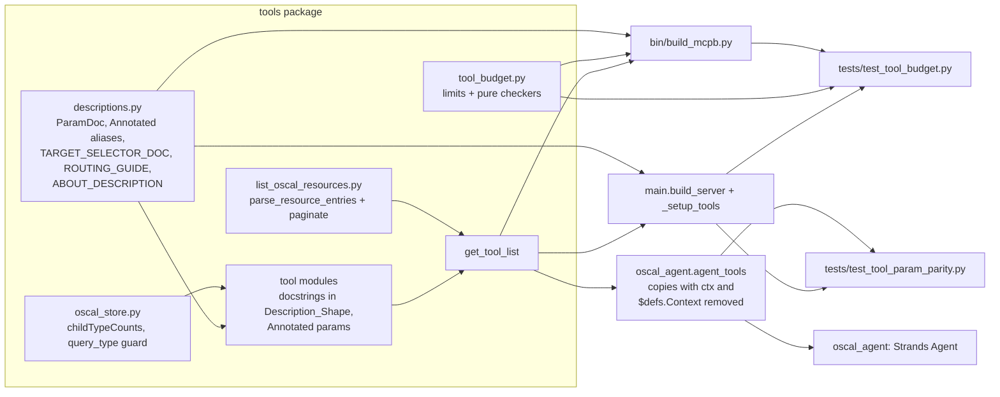

# Design Document: Tool Context Optimization

## Overview

This design makes the `tools/list` response of the OSCAL MCP Server smaller and more accurate (GitHub issue #39, branch `39-tighten-tool-descriptions`). It covers seven concrete changes:

1. A Budget_Module (`tools/tool_budget.py`) with the limits and pure check functions, and Budget_Tests that run them against the live `tools/list` response.
2. A shared descriptions module (`tools/descriptions.py`) with one parameter-description marker (`ParamDoc`), reusable `Annotated` parameter aliases, the Target_Selector grammar text, the `about` description, and the Routing_Guide.
3. Rewritten tool docstrings in the Description_Shape, with parameter descriptions moved into the `inputSchema`.
4. Stricter signatures: required identifying parameters, `Literal` enums, `ctx` last.
5. Per-model query results with `childTypeCounts` in place of inline `children`, and no `by_type` query type.
6. Paging for `list_oscal_resources`, plus the steering file, `AGENTS.md`, MCPB manifest, and README sync.
7. Agent tool specs without `ctx`: `create_oscal_agent()` gives the Agent per-agent copies of the tools whose spec has no `ctx` property and no `$defs.Context` (Req 11). The Server and Agent then expose the same property set for every tool (Req 3.4-3.6).

Tool names and the tool count do not change (issue #40 owns renames and removals).

### Guardrails for future tools

The rewrite alone would erode as tools are added. Two mechanisms keep the savings:

- **Live-registry Budget_Tests.** `tests/test_tool_budget.py` builds the server with the production registration path and checks every entry of `tools/list` against the caps, the Description_Shape, the unknown-name check, and the Total_Budget. The test iterates the registry, not a fixed tool list, so a new tool in `get_tool_list()` is checked with no test change. Exceeding a limit fails `hatch run tests`, which gates every commit and CI.
- **Steering file.** `.kiro/steering/tool-authoring.md` (`inclusion: always`) gives contributors and agents the rules and limits before they write the tool. A sync test keeps its numbers equal to the Budget_Module constants.

### Measured baseline

A throwaway script measured the baseline on commit `c973674` (`main`, equal to the branch head), Python 3.14, `mcp==2.1.1`, `strands-agents==1.59.0`, `pydantic==2.14.1`. The script ran `main._setup_tools()` and `await main.mcp.list_tools()`, then serialized the tools as compact JSON (described under Budget_Module below). The script was deleted after the run.

| Measure | Value |
|---|---|
| Tools in `tools/list` (incl. `about`) | 45 |
| Baseline_Size (compact JSON of the `tools` array) | **55,685** |
| Sum of all Tool_Description lengths | 38,753 |
| Size with every Tool_Description set to `""` (schema overhead) | 15,898 |
| `inputSchema` properties across all tools | 125 |
| Properties with a description today | 0 |
| Of the overhead: per-property and per-schema `title` keys | 4,125 |
| Largest descriptions | `query_component_definition` 3,415; `get_constraints` 2,916; `get_allowed_values` 2,518; `find_references_to` 2,313; `get_definition` 2,289 |
| Current `instructions` length | 572 |

The 0 parameter descriptions are expected: the MCP SDK does not read docstring `Args:` sections. It sends the whole docstring, `Args:` and `Returns:` included, as the tool description. Strands does read `Args:`.

### Key findings that shape the design

These come from probe scripts run with `hatch run python` against the pinned versions. The scripts were deleted after the runs.

| Mechanism | MCP SDK `MCPServer.add_tool` | Strands `@tool` `tool_spec` |
|---|---|---|
| `Annotated[T, Field(description=...)]` | Description in schema | **Raises `NotImplementedError` at import** ("Using pydantic.Field within Annotated is not yet supported") |
| `Annotated[T, "plain str"]` | Ignored (no description) | Description in spec |
| `Annotated[T, ParamDoc("...")]` (a `str` subclass with `__get_pydantic_json_schema__`) | Description in schema | Description in spec (read as the Annotated string) |
| Docstring `Args:` section | Not parsed; sent verbatim in the tool description | Used for parameter descriptions; removed from the tool description |
| `ctx: Context \| None = None` | Excluded from `inputSchema` | **Included** as an optional `ctx` property (`$ref` to `$defs.Context`, description from docstring `Args:` or `"Parameter ctx"`) plus a 1,048-character `$defs.Context`, on 43 of 44 tools (`list_oscal_models` has no `ctx`). Strands treats only its own `context=` parameter as special. Fixed by Req 11, see [component 9](#9-oscal_agentpy-agent-tool-specs-without-ctx) |
| Replace `tool_spec` on a copy of a `DecoratedFunctionTool` | n/a | Public `tool_spec` setter (checks name, `description`, `inputSchema`). `copy.copy` shares `_tool_func` and the input model, leaves the original spec untouched, and the Agent registry sends the replaced spec to the model |
| Call a tool whose spec has no `ctx` | n/a | Input validation still uses the original input model, where `ctx` is optional with default `None`. A call without `ctx` succeeds and the function receives `ctx=None` |
| `Literal[...]` | `enum`; invalid value gives `literal_error`: "Input should be 'json' or 'xsd'" | `enum` |
| `annotated_types.Ge(0)` in `Annotated` | `minimum: 0`, enforced | Dropped (Strands keeps only `args[0]`) |
| Per-property `title` | Added at field level after metadata hooks; a hook cannot remove it | Not emitted |

So **Requirement 3.1 cannot be implemented literally** with the current Strands release, because every tool is Strands-decorated. This design uses `Annotated[T, ParamDoc("...")]`. It gives the same result in both registries: one description per parameter in the signature, with no docstring `Args:`. See [Requirement deviations](#requirement-deviations).

## Architecture



`descriptions.py` is the only place shared parameter text is written. `tool_budget.py` holds no runtime behavior: it has the constants and pure functions that the Budget_Tests and `bin/build_mcpb.py` use. Neither module imports `main`, so importing them has no side effects.

The Server and the Agent read the same tool objects from `get_tool_list()`. The MCP SDK builds its schema from the function signature and never reads `tool_spec`. The Agent gets copies from `agent_tools()`, so the shared objects and the Server `tools/list` do not change (Req 11.7).

## Components and Interfaces

### 1. `src/mcp_server_for_oscal/tools/descriptions.py` (new)

```python
"""Shared parameter descriptions and server-level text for the OSCAL tools.

Parameter descriptions use ``ParamDoc`` inside ``Annotated``. Strands ``@tool`` rejects
``pydantic.Field`` inside ``Annotated`` (strands-agents 1.59.0, NotImplementedError), but reads
any ``str`` metadata as the description. Pydantic, which the MCP SDK uses, calls
``__get_pydantic_json_schema__`` on the same object. One marker works in both registries.
"""

from typing import Annotated, Any, Literal

from pydantic import GetJsonSchemaHandler
from pydantic_core import CoreSchema


class ParamDoc(str):
    """Parameter description for both the MCP inputSchema and the Strands tool spec."""

    __slots__ = ()

    def __get_pydantic_json_schema__(
        self, schema: CoreSchema, handler: GetJsonSchemaHandler
    ) -> dict[str, Any]:
        json_schema = handler.resolve_ref_schema(handler(schema))
        json_schema["description"] = str(self)
        return json_schema


# --- Shared text (each <= PARAMETER_DESCRIPTION_CAP; the budget test enforces it) ---
OFFSET_DOC = "Zero-based index of the first item."
LIMIT_DOC = "Maximum items per page, 1-100."
BUDGETED_LIMIT_DOC = "Maximum items per page, 1-100. A page may hold fewer to fit the response budget."
PARENT_DOC_UUID_DOC = "UUID of one parent document to scope results to. Omit for all documents."
MODEL_NAME_DOC = 'OSCAL model name from list_oscal_models, e.g. "catalog".'
OPTIONAL_MODEL_DOC = 'OSCAL model name from list_oscal_models, e.g. "catalog". Omit for all models.'
TARGET_SELECTOR_DOC = (
    'Target_Selector: a Metaschema definition name, optionally followed by "/" (child) or "//" '
    '(descendant) and instance names, e.g. "defined-component/prop/@name". '
    "No predicates, unions, or whitespace."
)
QUERY_TYPE_DOC = '"all" (paged), "by_uuid", or "by_title" (exact, then full-text).'
QUERY_VALUE_DOC = "UUID or title to match. Required for by_uuid and by_title."

# --- Reusable Annotated aliases. Keep these as plain assignments, not PEP 695 `type`
# statements: Strands checks `get_origin(annotation) is Annotated` and does not unwrap a
# TypeAliasType, so a `type` alias would lose the description in the Agent spec.
Offset = Annotated[int, ParamDoc(OFFSET_DOC)]
Limit = Annotated[int, ParamDoc(LIMIT_DOC)]
BudgetedLimit = Annotated[int, ParamDoc(BUDGETED_LIMIT_DOC)]
ParentDocUuid = Annotated[str | None, ParamDoc(PARENT_DOC_UUID_DOC)]
ModelName = Annotated[str, ParamDoc(MODEL_NAME_DOC)]
OptionalModelName = Annotated[str | None, ParamDoc(OPTIONAL_MODEL_DOC)]
TargetSelector = Annotated[str, ParamDoc(TARGET_SELECTOR_DOC)]
PerModelQueryType = Annotated[Literal["all", "by_uuid", "by_title"], ParamDoc(QUERY_TYPE_DOC)]
QueryValue = Annotated[str | None, ParamDoc(QUERY_VALUE_DOC)]

ABOUT_DESCRIPTION = "Return server metadata: package version, keywords, and bundled OSCAL version."

ROUTING_GUIDE = """..."""  # see "Routing_Guide" below
SERVER_INSTRUCTIONS = INTRO + "\n\n" + ROUTING_GUIDE
```

Design rules:

- Parameters that occur in more than one tool use an alias from this module. Parameters used by one tool declare `Annotated[T, ParamDoc("...")]` inline.
- Defaults stay in the signature (`offset: Offset = 0`, `limit: BudgetedLimit = 25`), so direct Python calls keep working. A `FieldInfo` default would break them, because the function would receive the `FieldInfo` object.
- Range checks for `offset` and `limit` stay where they are now (`utils.paginate`, `metaschema_common.check_page`). `annotated_types.Ge/Le` is not added: Strands drops it, and the current tool-side checks already send errors through `try_notify_client_error`. Adding schema-level checks would split error reporting into two paths.

### 2. `src/mcp_server_for_oscal/tools/tool_budget.py` (new, the Budget_Module)

```python
"""Context budget for the tools/list response: limits and pure checks (single source of truth)."""

import json
import re
from collections.abc import Iterable, Mapping
from dataclasses import dataclass

# Measured on main at c973674 (45 tools, Python 3.14, mcp 2.1.1) with tools_list_size().
BASELINE_SIZE = 55_685
TOTAL_BUDGET = BASELINE_SIZE * 70 // 100        # 38_979 (Req 1.2: at most 70%)
TOOL_DESCRIPTION_CAP = 1_200
PARAMETER_DESCRIPTION_CAP = 250
ROUTING_GUIDE_CAP = 3_000                        # design addition, see below
MAX_DESCRIPTION_SENTENCES = 3
SUMMARY_VERBS = frozenset(
    {"Return", "List", "Get", "Find", "Read", "Look", "Search", "Validate", "Query"}
)
# Backticked snake_case names in descriptions that are neither tools, parameters, nor enum
# values (e.g. result keys). Keep this list short; prefer camelCase or hyphenated keys.
EXTRA_IDENTIFIERS = frozenset({"raw_json", "ambiguous_element_id"})


def tools_list_size(tools: list[dict]) -> int:
    """Characters in the compact JSON of a tools/list `tools` array."""
    return len(json.dumps(tools, separators=(",", ":"), ensure_ascii=False))


@dataclass(frozen=True)
class Violation:
    tool: str
    parameter: str | None
    kind: str          # "tool-description" | "parameter-description" | "missing-parameter-description" | ...
    measured: int | None
    limit: int | None
    detail: str = ""

    def message(self) -> str: ...   # "tool=<t> parameter=<p>: <kind> length 312 > limit 250"


def check_limits(tools: list[dict]) -> list[Violation]: ...
def check_total(tools: list[dict], budget: int = TOTAL_BUDGET) -> list[Violation]: ...
def split_sentences(text: str) -> list[str]: ...
def summary_sentence(description: str) -> str: ...
def description_shape_problems(description: str) -> list[str]: ...
def known_identifiers(tools: list[dict]) -> frozenset[str]: ...
def unknown_tool_refs(text: str, allowed: frozenset[str]) -> list[str]: ...
```

The module lives under `src/` rather than `tests/` for two reasons. `bin/build_mcpb.py` reuses `summary_sentence`, and the steering file can name an importable source of truth. It has no import-time side effects and imports only the standard library.

#### Measurement (Req 1.3, 1.6)

The Budget_Tests get the live list like this:

```python
@pytest.fixture(scope="module")
def live_tools() -> list[dict]:
    server = main.build_server()          # same constructor as the module-level `mcp`
    main._setup_tools(server)             # same registration path as production
    tools = asyncio.run(server.list_tools())
    return [t.model_dump(by_alias=True, exclude_none=True, mode="json") for t in tools]
```

`model_dump(by_alias=True, exclude_none=True, mode="json")` produces the wire shape of each `Tool` (`name`, `description`, `inputSchema`, and `outputSchema` when present). `tools_list_size` uses `separators=(",", ":")` and `ensure_ascii=False`, the same settings used for the baseline. A fresh server per test module avoids registering tools twice on the module-level `mcp`, which `tests/test_utils.py` already works around.

#### Limit checks (Req 1.4, 1.5, 1.7, 3.2)

`check_limits` walks each tool. It reports a `tool-description` violation when `len(description) > TOOL_DESCRIPTION_CAP`. For each `inputSchema.properties` entry, it reports a `parameter-description` violation when the description is longer than `PARAMETER_DESCRIPTION_CAP`, and a `missing-parameter-description` violation when the description is absent or blank. `check_total` reports one violation with `tool="<all>"`. The test asserts `violations == []` and on failure joins `v.message()` for all violations. Each message names the tool, the parameter (when applicable), the measured length, and the limit.

#### Description shape (Req 2.1-2.4)

- `split_sentences(text)`: protect `e.g.`, `i.e.`, and `etc.` with a placeholder, collapse whitespace, split on `(?<=[.?!])\s+(?=[A-Z"`(])`, then restore the placeholders.
- `summary_sentence(desc)`: first element of `split_sentences(desc)`.
- `description_shape_problems(desc)` returns a problem for each of these cases:
  - A line matches `^\s*(Args|Arguments|Parameters|Returns|Raises|Yields):`.
  - `\bctx\b` occurs.
  - `len(split_sentences(desc)) > MAX_DESCRIPTION_SENTENCES`.
  - The first word of the summary sentence is not in `SUMMARY_VERBS`. This is a checkable stand-in for "states what the tool returns".
  - A sentence after the first starts with `Use ` but not `Use when`.

#### Unknown tool names (Req 2.5, 2.6, 8.3, 8.4)

A candidate in "tool-name format" is a lowercase snake_case identifier with at least one underscore: `[a-z][a-z0-9]*(?:_[a-z0-9]+)+`. `unknown_tool_refs` collects candidates from three patterns:

1. Backticked: `` `name` `` or `` `name()` ``.
2. Call form: `\bname\(`.
3. Bare verb-prefixed words: `\b(?:list|get|query|validate|find|search|text_search)_[a-z0-9]+(?:_[a-z0-9]+)*\b`. This catches unbackticked references such as today's "use the list_models tool".

`known_identifiers(tools)` builds the allowed set from four sources: the tool names in the Tool_List_Response, every `inputSchema` property name, every string `enum` value (so `by_uuid` and `by_type` for `query_component_definition` pass), and `EXTRA_IDENTIFIERS`. The function returns the sorted distinct candidates that are not in the allowed set. The test runs it on every Tool_Description and on `server.instructions`. Each failure names the tool (or `instructions`) and the unknown name.

Req 4.1 also has an explicit check: `\b(list_models|get_schema)\b` must not match any description. With word boundaries, neither pattern matches inside `list_oscal_models` or `get_oscal_schema`.

### 3. `main.py` changes

```python
from mcp_server_for_oscal.tools.descriptions import ABOUT_DESCRIPTION, SERVER_INSTRUCTIONS

def build_server() -> MCPServer:
    """Create the MCPServer with the server metadata and Routing_Guide instructions."""
    return MCPServer(
        config.server_name,
        version=meta.get("version") or "",
        website_url="https://github.com/dfkunstler/mcp-server-for-oscal",
        instructions=SERVER_INSTRUCTIONS,
    )

mcp = build_server()

def _setup_tools(server: MCPServer | None = None) -> None:
    server = server or mcp
    for tool_fn in get_tool_list():
        server.add_tool(tool_fn)

    @server.tool(name="about", description=ABOUT_DESCRIPTION)
    def about() -> dict: ...
```

Existing patches of `main._setup_tools` and `main.mcp` keep working because the no-argument call does what it does today.

#### Routing_Guide (Req 8)

`SERVER_INSTRUCTIONS` keeps a short intro that contains the strings `tests/test_integration.py` asserts: "OSCAL MCP server", "Open Security Controls Assessment Language", "NIST", "security", "controls". The Routing_Guide follows the intro. Draft:

```text
Pick a tool by task:
- OSCAL model names, layers, status: list_oscal_models
- JSON or XSD schema for one model: get_oscal_schema (model_name "complete" is very large)
- Metaschema docs for a definition: get_definition; allowed values: get_allowed_values; all constraints: get_constraints; what must reference an assembly: find_references_to; source lines behind their results: get_metaschema_source
- Loaded OSCAL documents: list_catalogs, list_profiles, list_ssps, list_assessment_plans, list_assessment_results, list_poams, list_mapping_collections; one document: query_catalog, query_profile, query_ssp, query_assessment_plan, query_assessment_results, query_poam, query_mapping_collection; its child elements: the matching list_* child tools, then get_child_element
- Full-text search across loaded documents: text_search_oscal
- Component Definitions: list_component_definitions, list_components, then query_component_definition; list_capabilities and get_capability only for definitions that contain capabilities
- Validate OSCAL JSON: validate_oscal_content (text) or validate_oscal_file (file)
- OSCAL documentation questions: query_oscal_documentation
- OSCAL community tools and resources: list_oscal_resources
Metaschema tips: rules for every prop and link are declared on the generic "property" and "link" definitions, so also query "property/@name" and "link/@rel".
```

Cross-tool guidance that is removed from the metaschema docstrings goes into the guide. The generic `property`/`link` advice is one example. This is why the per-tool descriptions can shrink without losing information. `query_oscal_documentation` is always in `get_tool_list()`, so the guide names it unconditionally (Req 8.5).

`ROUTING_GUIDE_CAP` (3,000 characters, tested) keeps the savings from moving into `instructions`. Clients also load `instructions` into context. This cap is a design addition, not a requirement.

### 4. Tool signatures and descriptions

Signature convention for all tools in `get_tool_list()`: required identifying parameters first, then optional parameters, then `ctx: Context | None = None` last. This is already the convention in the metaschema and validate tools. It is required wherever a parameter becomes required, because a required parameter cannot follow a defaulted `ctx`.

| Tool | Signature change | Req |
|---|---|---|
| `get_oscal_schema` | `model_name: Annotated[str, ParamDoc('OSCAL model name from list_oscal_models, or "complete" for all models (very large).')]` (required), `schema_type: Annotated[Literal["json", "xsd"], ParamDoc(...)] = "json"`, `ctx` last. The existing `"complete"` branch and runtime checks stay for direct calls | 5.1-5.3, 5.7, 5.8 |
| `get_definition` | `kind: Annotated[Literal["assembly", "field", "flag"] \| None, ParamDoc(...)] = None`; `_check_kind` stays for direct calls | 5.4, 5.8 |
| `get_capability` | `uuid` required, `ctx` last | 5.5, 5.7 |
| `text_search_oscal` | `query_text` required, `oscal_model_type: OptionalModelName = None`, `ctx` last | 5.6, 5.7 |
| `get_child_element` | `element_id` required, `parent_doc_uuid: ParentDocUuid = None`, `ctx` last. This applies the steering rule "identifying parameters are required" (design addition) | 9.3 |
| 7 Per_Model_Query_Tools | `query_type: PerModelQueryType = "all"`, `query_value: QueryValue = None`, `offset: Offset = 0`, `limit: Limit = 10`, `ctx` last | 6.1, 6.2 |
| `list_oscal_resources` | `offset: Offset = 0`, `limit: Limit = 10`, `ctx` last; return type `dict` | 7.1 |
| `validate_oscal_file` | `file_uri` description: "Path or URI of an OSCAL JSON file. Remote URIs are rejected unless the server operator enables remote URIs." | 4.4, 4.5 |
| `query_component_definition` | Description rewritten without the capability-first workflow. `query_type` keeps `by_type` here: it filters Components by type and is a different feature from the per-model `by_type` | 4.2, 4.3 |
| All others | Same parameters, now `Annotated` with `ParamDoc`; docstrings without `Args:`/`Returns:` | 2, 3 |

Positional calls in tests that pass `ctx` first, such as `get_oscal_schema(None, "catalog", "json")` in `tests/tools/test_get_schema.py`, change to keyword calls.

#### Description templates (examples, not final text)

```python
@tool()
def query_catalog(query_type: PerModelQueryType = "all", query_value: QueryValue = None,
                  offset: Offset = 0, limit: Limit = 10, ctx: Context | None = None) -> dict:
    """Return loaded OSCAL Catalogs with `childTypeCounts` per document. Use when you need
    catalog metadata; for controls and groups use list_catalog_controls, list_catalog_groups,
    and get_child_element."""
```

```python
@tool()
def list_components(offset: Offset = 0, limit: Limit = 10, ctx: Context | None = None) -> dict:
    """List loaded Components with UUID, title, and parent Component Definition. Use when
    picking a `query_value` for query_component_definition."""
```

```python
@tool()
def query_component_definition(...) -> dict[str, Any]:
    """Return OSCAL Components (or a Capability, when one matches) from loaded Component
    Definitions as OSCAL JSON. Use when you need full component details; find UUIDs and
    titles with list_component_definitions and list_components, and use list_capabilities or
    get_capability only for definitions that contain capabilities. Results are paged."""
```

```python
@tool()
def get_allowed_values(model: ModelName, target: TargetSelector, offset: Offset = 0,
                       limit: BudgetedLimit = 25, ctx: Context | None = None) -> dict:
    """Return the values OSCAL Metaschema `allowed-values` constraints permit at a target,
    with `allow-other`, conditions, and source file and line. Use when the JSON schema does
    not list the values; use get_constraints for other constraint types. Results are paged
    within a response budget."""
```

#### Size plan

The schema overhead after the changes is about 16k characters. That is today's 15,898, minus `by_type` in 7 enums, plus `offset`/`limit` on `list_oscal_resources`. 125 parameter descriptions at the shared lengths above add about 9.5k. With these per-tool targets, the total is about 36.5k, which leaves about 2.5k (6%) headroom under 38,979:

| Tool group | Count | Target description length |
|---|---|---|
| Per-model `query_*`, `list_*` documents, child `list_*`, `get_child_element`, `text_search_oscal` | 30 | ≤ 180 |
| Component Definition tools | 5 | ≤ 300 (`query_component_definition` ≤ 450) |
| Metaschema tools | 5 | ≤ 500 |
| Schema, models, validate, resources, documentation, `about` | 7 | ≤ 250 |

The test enforces the caps. The targets are guidance for the rewrite, and the steering file repeats them.

### 5. `oscal_store.py`: Child_Type_Counts and query_type guard

`_build_query_items` replaces the child list query with a grouped count:

```python
VALID_QUERY_TYPES: tuple[str, ...] = ("all", "by_uuid", "by_title")

def _child_type_counts(self, doc_id: int) -> dict[str, int]:
    """Map each child element type of one document to its count (empty when none)."""
    rows = self._conn.execute(
        "SELECT element_type, COUNT(*) AS cnt FROM child_elements "
        "WHERE parent_doc_id = ? GROUP BY element_type ORDER BY element_type",
        (doc_id,),
    ).fetchall()
    return {r["element_type"]: r["cnt"] for r in rows}

def _build_query_items(self, rows: list) -> list[dict]:
    items = []
    for row in rows:
        self._ensure_indexed(row["id"])
        items.append({
            "uuid": row["uuid"],
            "title": row["title"],
            "model_type": row["model_type"],
            "file_path": row["file_path"],
            "sizeInBytes": row["file_size"],
            "childTypeCounts": self._child_type_counts(row["id"]),
        })
    return items
```

- The query is static SQL with a bound value, so it needs no `# nosec`. It uses the existing `idx_child_parent` index. One query per document matches `list_documents`, and pages hold at most 100 documents.
- `query()` validates first: `if query_type not in VALID_QUERY_TYPES: raise ValueError(f"Invalid query_type {query_type!r}; valid types: all, by_uuid, by_title")`. Today an unknown value silently falls through to `"all"`. The guard covers direct Python calls, which skip the pydantic `Literal` check.
- `_query_by_type` is deleted. `query_component_definition` uses only `store.query(..., "by_uuid" | "by_title")` and reads `items[0]["uuid"]`, so it is not affected. Its own `by_type` handles Components in a different code path.
- The key is `childTypeCounts`. It is camelCase like the store's other non-OSCAL keys (`sizeInBytes`, `childCount`) and is not an OSCAL property name.

### 6. `list_oscal_resources.py`: paging

Return shape decision: the tool returns a **`dict` Page_Response** (`items`, `total`, `offset`, `limit`, `hasMore`) built by `utils.paginate`. Today it returns `str`. Req 7.2 asks for the paging format of the other list tools, and those all return this envelope. A side effect is that the SDK no longer adds an `outputSchema` (it does today for `str` returns, at 135 characters).

```python
def parse_resource_entries(markdown: str) -> list[dict[str, str]]:
    """Split awesome-oscal markdown into one entry per top-level list item.

    A heading of level 2-6 sets the category; entries before any such heading get
    "General". A line matching ``^[-*+]\\s+`` starts an entry. Following non-blank lines that
    are not headings or top-level items (indented continuations and sub-items) are joined to
    it with single spaces. A blank line ends the entry. Other prose is skipped.
    """

@tool
def list_oscal_resources(offset: Offset = 0, limit: Limit = 10, ctx: Context | None = None) -> dict:
    """List OSCAL community resources (tools, content, articles, talks) from the awesome-oscal
    list, each with `category` and markdown `text`. Results are paged."""
    try:
        entries = parse_resource_entries(read_resources_file())
        return paginate(entries, offset, limit)
    except Exception as err:   # ValueError from paginate included
        msg = f"Failed to list OSCAL resources: {err}"
        try_notify_client_error(msg, ctx)
        raise
```

- Each item is `{"category": "Tools", "text": "[Name](url): description"}`. The bundled file has 82 top-level entries in 5 categories, and one entry has an indented continuation line (line 117). The badge and intro lines are prose and are skipped.
- `read_resources_file()` and its DB-first, filesystem-fallback order do not change.
- Defaults are `offset=0`, `limit=10`, which match `utils.paginate` and the other list tools (Req 7.3). `offset >= total` returns an empty `items` with the correct `total` (Req 7.4). A negative `offset` or a `limit` outside 1-100 raises `ValueError` from `paginate`, after `try_notify_client_error` (Req 7.5).

### 7. Sync targets

- **`bin/build_mcpb.py`**: `tool_list()` uses `summary_sentence(inspect.getdoc(fn) or "")` in place of `doc.split("\n\n")[0]`, and `summary_sentence(ABOUT_DESCRIPTION)` in place of the hard-coded `about` string (Req 10.1). A test calls `build_mcpb.tool_list()` (loaded with `importlib` from `bin/`, as existing tests do) and compares each entry with `summary_sentence` of the live description.
- **`src/mcp_server_for_oscal/tools/README.md`**: update to match the new descriptions, the removed `by_type` for the per-model tools, `childTypeCounts`, the required parameters, and `list_oscal_resources` paging (Req 10.2).
- **`tests/test_tool_registry.py`**: unchanged. It must still pass with the same 44 names from `get_tool_list()` (Req 10.3).
- **Tests that assert old behavior** (Req 10.4):
  - `tests/tools/test_oscal_store.py`: `children` and `by_type` become `childTypeCounts` and the `ValueError`.
  - `tests/test_properties.py`: `by_type` tests.
  - `tests/tools/test_list_oscal_resources.py`: `str` return becomes the page `dict`.
  - `tests/tools/test_get_schema.py`: positional calls, the default `model_name`, and the first-paragraph docstring text.
  - `tests/tools/test_get_allowed_values.py`: the docstring tests for example questions, Target_Selector syntax, and property/link advice now assert `TARGET_SELECTOR_DOC` in the `target` parameter description and the advice in `ROUTING_GUIDE`. This supersedes metaschema-constraints Req 7.4, which required example questions in the first paragraph.
  - The `test_*_input_schema` tests in the metaschema test files: property order stays the same, so they must still pass.

### 8. Steering file and `AGENTS.md`

`.kiro/steering/tool-authoring.md` (front matter `inclusion: always`) contains:

1. The six wiring steps from today's "How a tool is wired" section, verbatim apart from updates for the new rules (Req 9.2).
2. The Description_Shape, with the `SUMMARY_VERBS` list and the three-sentence maximum.
3. Parameter rules: `Annotated[T, ParamDoc("...")]` and the shared aliases in `tools/descriptions.py`. Explain why not `Field` (the Strands limitation, with the version). No `ctx` docs, and `ctx` goes last. Keep the name `ctx` and the type `Context | None = None`: the MCP SDK hides it by type, and `oscal_agent.agent_tools()` hides it from the Agent by name. Use `Literal` for closed value sets. Identifying parameters are required. List-shaped results use `offset`/`limit` with `utils.paginate` or `paginate_within_budget`.
4. Limits: Total_Budget 38,979, Tool_Description_Cap 1,200, Parameter_Description_Cap 250, `ROUTING_GUIDE_CAP` 3,000, and the size-plan targets. It names `src/mcp_server_for_oscal/tools/tool_budget.py` as the source of truth and `tests/test_tool_budget.py` as the Budget_Tests (Req 1.9, 9.5).
5. Sync_Targets: `bin/build_mcpb.py` (`conf/mcpb/manifest.json`), `src/mcp_server_for_oscal/tools/README.md`, `tests/test_tool_registry.py`, and the Routing_Guide in `tools/descriptions.py`.

The `AGENTS.md` section "How a tool is wired" becomes at most 5 lines. For example: write a Strands `@tool` in `tools/<module>.py` with `ParamDoc` parameters and a Description_Shape docstring; add it to `get_tool_list()`; keep within the budgets checked by `tests/test_tool_budget.py`; update the Sync_Targets; then a link: "Full rules: [.kiro/steering/tool-authoring.md](.kiro/steering/tool-authoring.md)". The Code map table gets rows for `tools/descriptions.py` and `tools/tool_budget.py`, and the `oscal_agent.py` row mentions `agent_tools()`.

### 9. `oscal_agent.py`: Agent tool specs without `ctx`

Measured on `c973674` with strands-agents 1.59.0 (the pinned version) by a throwaway probe under `private/`, deleted after the run:

| Measure | Value |
|---|---|
| Tools in `get_tool_list()` that are `DecoratedFunctionTool` | 44 of 44 |
| Tools with `ctx` in the signature and in `tool_spec` | 43 (all except `list_oscal_models`) |
| `ctx` in `required` | 0 (it has a default) |
| `$defs` entries other than `Context` | none |
| `$ref` to `#/$defs/Context` outside `properties.ctx` | none |
| Size of `$defs.Context` (compact JSON) | 1,048 characters per tool |
| Total Agent spec size removed by stripping | 50,333 characters over 43 tools |

The `ctx` property today is `{"default": null, "description": "MCP server context (should be injected automatically by MCP server)", "$ref": "#/$defs/Context"}`. After the docstring rewrite removes `Args:`, the description becomes `"Parameter ctx"`, and the property and `$defs.Context` stay.

#### Mechanism

```python
import copy
from typing import Any

from strands.tools.decorator import DecoratedFunctionTool
from strands.types.tools import ToolSpec

# The MCP SDK excludes this parameter by its `Context` type; Strands does not know it.
MCP_CONTEXT_PARAM = "ctx"
MCP_CONTEXT_DEF = "Context"


def strip_mcp_context(spec: ToolSpec) -> ToolSpec:
    """Return a deep copy of a Strands tool spec without the MCP `ctx` parameter.

    Removes `ctx` from `properties` and `required`, removes `$defs.Context`, and removes
    `$defs` when it is then empty. Everything else is unchanged. The input is not mutated.
    """
    new_spec = copy.deepcopy(spec)
    schema = new_spec["inputSchema"]["json"]
    schema.get("properties", {}).pop(MCP_CONTEXT_PARAM, None)
    if "required" in schema:
        schema["required"] = [r for r in schema["required"] if r != MCP_CONTEXT_PARAM]
    defs = schema.get("$defs")
    if isinstance(defs, dict):
        defs.pop(MCP_CONTEXT_DEF, None)
        if not defs:
            del schema["$defs"]
    return new_spec


def agent_tool(tool: Any) -> Any:
    """Return the Agent's copy of one tool: a `DecoratedFunctionTool` gets a stripped spec.

    Other objects (plain callables, mocks, other AgentTool types) pass through unchanged.
    The shared module-level tool, which the MCP server also registers, is not modified.
    """
    if not isinstance(tool, DecoratedFunctionTool):
        return tool
    clone = copy.copy(tool)           # shares _tool_func and the input model
    clone.tool_spec = strip_mcp_context(tool.tool_spec)   # public setter, validates name
    return clone


def agent_tools(tools: list[Any]) -> list[Any]:
    """Map `agent_tool` over a tool list, keeping order."""
    return [agent_tool(t) for t in tools]
```

`create_oscal_agent()` calls `tools = agent_tools(tools)` right after it resolves the `tools` default, and passes that list to `Agent(...)`. `_build_system_prompt` reads `__name__`, which `copy.copy` keeps (`functools.update_wrapper` stored it in the instance `__dict__`).

Why this mechanism:

- **Invocation keeps working (Req 11.5).** `DecoratedFunctionTool.stream` validates input with `_metadata.input_model`, not with `tool_spec`. In that model `ctx` is optional with default `None`, so a call without `ctx` passes validation and `model_dump()` gives the function `ctx=None`. The probe confirmed this through `stream()` with `{"model_name": "catalog"}` on `get_oscal_schema` (a spy saw `ctx=None`) and through `agent.tool.get_oscal_schema(model_name="catalog", record_direct_tool_call=False)`. Both returned `status: success`.
- **The Agent sends the stripped spec (Req 11.1-11.4).** The probe built a real `Agent(model=BedrockModel(...), tools=agent_tools(get_tool_list()))` (no network call at construction) and read `agent.tool_registry.get_all_tools_config()`. No spec contained `ctx` or `Context`. The registry config shows `"required": []` for tools with no required parameters, which meets Req 11.2.
- **No shared state changes (Req 11.6, 11.7).** The tool functions keep `ctx: Context | None = None`, the MCP SDK keeps excluding it by type, and the module-level tool objects keep their original `tool_spec`. Calling `create_oscal_agent()` twice, or in the same process as the Server, gives the same result.
- **Public API only.** The mechanism uses `tool_spec` (getter and setter) and `copy.copy`. It does not read `_metadata` or `_tool_func`.

Alternatives considered and rejected:

- `@tool(context="ctx")` on each tool: Strands would then inject its own `ToolContext` into `ctx`, and the tools would pass it to `try_notify_client_error`, which expects an MCP `Context`. This breaks Req 11.5 and needs 43 decorator edits.
- Set `fn.tool_spec` in place on the shared objects: simple, but it changes global state as a side effect of creating an Agent, and makes test results depend on test order.
- An `AgentTool` wrapper subclass that delegates `stream`: more code (`tool_name`, `tool_type`, `stream`, display properties) for the same result.
- `@tool(inputSchema=...)` per tool: duplicates every schema by hand.

Known behavior: the input model still has a `ctx` field. If the model sends a `ctx` value anyway (it is not in the spec), Strands returns a validation error for that call ("Input should be a valid dictionary or instance of Context"). That is the correct result for an argument the spec does not offer, and the design does not add code for it.

Req 11.6 applies to each tool that declares `ctx` (deviation 4, resolved). `list_oscal_models` has no `ctx` and does not get an unused one. The tests check that the 43 tools still declare it.

## Data Models

**Per-model query item** (Per_Model_Query_Tools, `OscalStore.query`):

```json
{
  "uuid": "…", "title": "…", "model_type": "catalog",
  "file_path": "…", "sizeInBytes": 12345,
  "childTypeCounts": {"control": 1007, "group": 20}
}
```

The `children` key is removed. `childTypeCounts` keys are a subset of `CHILD_ELEMENT_TYPES[model_type]`, and every value is ≥ 1. A document with no child elements gets `{}`.

**Resource page** (`list_oscal_resources`):

```json
{"items": [{"category": "Tools", "text": "[CivicActions' ssp-toolkit](https://…): a suite …"}],
 "total": 82, "offset": 0, "limit": 10, "hasMore": true}
```

**Agent_Tool_Spec** (`agent_tool(fn).tool_spec`, `get_oscal_schema` after this feature):

```json
{"name": "get_oscal_schema", "description": "Return …",
 "inputSchema": {"json": {"type": "object",
   "properties": {"model_name": {"type": "string", "description": "OSCAL model name …"},
                  "schema_type": {"type": "string", "enum": ["json", "xsd"], "default": "json", "description": "…"}},
   "required": ["model_name"]}}}
```

No `ctx` property, no `ctx` in `required`, and no `$defs` (Context was its only entry).

**Violation** (Budget_Module): `tool`, `parameter | None`, `kind`, `measured | None`, `limit | None`, `detail`. Example message: `tool=get_constraints parameter=target: parameter-description length 270 > limit 250`.

## Error Handling

| Case | Path | Result |
|---|---|---|
| Invalid `Literal` value (`schema_type`, `kind`, `query_type`) over MCP | Pydantic validation in the SDK before the function runs | `ToolError` / `isError` result with `literal_error` text listing the valid values (verified: "Input should be 'json' or 'xsd'") |
| Same through the Agent | Strands input model (`enum`) | Strands validation error |
| Missing required `model_name`, `uuid`, `query_text`, `element_id` over MCP | SDK validation | `missing` field error |
| Unknown `query_type` on a direct Python call to a query tool or `store.query` | `OscalStore.query` guard | `ValueError` listing `all, by_uuid, by_title` |
| `list_oscal_resources` with negative `offset`, or `limit` outside 1-100 | `utils.paginate` | `ValueError`, reported with `try_notify_client_error`, then raised |
| `list_oscal_resources` content missing or unreadable | `read_resources_file` (unchanged) | Existing error, reported and raised |
| Agent calls a tool without `ctx` | Strands input model (`ctx` optional, default `None`) | Tool runs with `ctx=None`; `try_notify_client_error` and `safe_log_mcp` already accept `None` |
| Agent model sends a `ctx` value although the spec has none | Strands input model | Strands validation error result for that call; no tool code runs |
| `create_oscal_agent(tools=...)` with objects that are not `DecoratedFunctionTool` (plain callables, mocks) | `agent_tool` | Passed through unchanged |
| A future Strands release changes the `tool_spec` setter or the spec layout | Parity and Agent spec tests | Tests fail on upgrade (Dependabot PR) before release |
| Budget, shape, or unknown-reference violation | Budget_Tests | Test fails with one line per violation: tool, parameter, measured length, limit, or unknown name |

## Correctness Properties

*A property is a characteristic or behavior that should hold true across all valid executions of a system: a formal statement about what the system should do. Properties connect human-readable specifications to machine-verifiable correctness guarantees.*

Reflection on redundancy: the limit checks for tool descriptions, parameter descriptions, and failure messages (1.4, 1.5, 1.7) are one checker, so they are one property. The Args/Returns, `ctx`, and sentence-count shape rules (2.1, 2.3, 2.4) are one checker. Unknown-name detection for descriptions and for the Routing_Guide (2.5, 2.6, 8.3, 8.4) uses one function. The Child_Type_Counts criteria (6.3, 6.4, 6.5, 6.7) all describe one item shape. Resource paging (7.2-7.4) is one model-based property, and invalid paging (7.5) is a separate error property. The Agent spec criteria 11.1-11.4 are all removals done by one pure function, `strip_mcp_context`, so they are one property; 11.4 (empty `$defs`) is an edge case its generator covers. Criteria about fixed facts of the live registry (caps on the live list, required arrays, enums, Server/Agent parity in 3.4-3.6, the live Agent specs, signatures in 11.6, the unchanged Server list in 11.7, manifest, steering values) are example tests, and the Agent invocation in 11.5 is an integration test. These are listed under Testing Strategy.

### Property 1: Limit checker reports exactly the over-limit descriptions

For any list of tool entries with arbitrary names, description lengths, and parameter description lengths (including missing descriptions), `check_limits` reports a violation for a tool description if and only if its length exceeds `TOOL_DESCRIPTION_CAP`. It reports a violation for a parameter if and only if its description is missing, blank, or longer than `PARAMETER_DESCRIPTION_CAP`. Every length violation message contains the tool name, the parameter name when applicable, the measured length, and the limit. `check_total` reports a violation if and only if `tools_list_size(tools) > budget`.

**Validates: Requirements 1.4, 1.5, 1.7, 3.2**

### Property 2: Shape checker rejects forbidden structure

For any description text, `description_shape_problems` reports a problem whenever the text has a line starting with `Args:`, `Returns:`, `Raises:`, or `Parameters:`, contains the word `ctx`, has more than `MAX_DESCRIPTION_SENTENCES` sentences by `split_sentences`, or has a summary sentence whose first word is not in `SUMMARY_VERBS`. For any text built from 1 to 3 well-formed sentences that starts with a `SUMMARY_VERBS` word and has none of these features, it reports no problems.

**Validates: Requirements 2.1, 2.2, 2.3, 2.4**

### Property 3: Unknown tool references are detected exactly

For any allowed identifier set `K` and any text built by mixing prose, members of `K`, and generated snake_case names `U` disjoint from `K` (placed in backticks, in `name(` call form, or bare with a `list_`/`get_`/`query_`/`validate_`/`find_` prefix), `unknown_tool_refs(text, K)` returns exactly the sorted distinct members of `U` that occur in the text. Names in `K` are never reported.

**Validates: Requirements 2.5, 2.6, 8.3, 8.4**

### Property 4: Only the three per-model query types are accepted

For any string `q` not in `{"all", "by_uuid", "by_title"}` (including `"by_type"`), `OscalStore.query(query_type=q, ...)` raises `ValueError`, and the message names all three valid types. For each valid type with a required `query_value`, the call does not raise this error.

**Validates: Requirements 5.9, 6.1, 6.2**

### Property 5: Query items carry exact child type counts

For any set of generated OSCAL Catalogs with arbitrary numbers of top-level controls, groups, and controls nested in groups (validated through `MODEL_MAP`), loaded into a temporary store, each item from `query(oscal_model_type=CATALOG, query_type="all")` meets four conditions:

- Its key set is exactly `{"uuid", "title", "model_type", "file_path", "sizeInBytes", "childTypeCounts"}`.
- `childTypeCounts` equals the per-type count of controls and groups in the generated document.
- `childTypeCounts` has only keys with counts ≥ 1, so it is `{}` for a catalog without controls or groups.
- `uuid`, `title`, `model_type`, `file_path`, and `sizeInBytes` equal the values `list_documents` and the documents table hold for that document.

**Validates: Requirements 6.3, 6.4, 6.5, 6.7**

### Property 6: Resource markdown parsing round trip

For any list of sections, where each section has a category heading (level 2-6, non-empty, single line) and a list of entries (each entry is one or more non-empty single-line parts), rendering the sections as markdown and parsing with `parse_resource_entries` gives the entries in order. Rendering means one `## heading` per section, each entry as `- part1` followed by indented continuation lines for the other parts, blank lines between sections, and optional prose paragraphs. Each parsed entry has the section's category and the entry's parts joined with single spaces.

**Validates: Requirements 7.2**

### Property 7: Resource pages match a slice of the entries

For any parsed entry list `E`, any `offset ≥ 0`, and any `limit` in 1-100, `list_oscal_resources(offset, limit)` returns `items == E[offset:offset+limit]`, `total == len(E)`, the given `offset` and `limit`, and `hasMore == (offset + limit < len(E))`. In particular, `offset ≥ len(E)` gives empty `items` with the correct `total`, and the pages for offsets `0, limit, 2·limit, …` concatenate to `E`.

**Validates: Requirements 7.2, 7.3, 7.4**

### Property 8: Invalid paging arguments are rejected

For any `offset < 0` or any `limit < 1` (and any `limit > 100`), `list_oscal_resources` raises `ValueError` and does not return a page.

**Validates: Requirements 7.5**

### Property 9: Stripping the MCP context removes exactly ctx and its definition

For any Strands tool spec whose `inputSchema.json` has arbitrary properties (with or without `ctx`), an optional `required` list (with or without `ctx`), and an optional `$defs` object (with or without `Context`, with zero or more other entries), `strip_mcp_context(spec)` returns a spec where:

- `properties` equals the input `properties` without the `ctx` key.
- `required`, when present in the input, equals the input list without `"ctx"`, in the same order.
- `$defs` equals the input `$defs` without `Context`, and the `$defs` key is absent when that leaves it empty or when the input had none.
- Every other key of the spec and of `inputSchema.json` is equal to the input.
- The input spec is unchanged, and applying `strip_mcp_context` to the result returns an equal spec (idempotence).

**Validates: Requirements 11.1, 11.2, 11.3, 11.4**

## Testing Strategy

All commands run through hatch (`hatch test -- <pytest flags>`, `hatch run tests`), and never with a `cd` prefix.

**Property tests** (Hypothesis, `@settings(max_examples=100)`, capped by `OSCAL_TEST_MAX_EXAMPLES` on Windows CI). Each test is tagged `Feature: tool-context-optimization, Property N: <title>`:

| Property | File | Generators |
|---|---|---|
| 1 | `tests/test_tool_budget.py` | Lists of synthetic tool dicts: names from `st.from_regex(r"[a-z]+(_[a-z]+){0,3}")`, descriptions of lengths around each cap (cap−1, cap, cap+1, random) |
| 2 | `tests/test_tool_budget.py` | Sentences from a verb prefix and text with no `.?!`; mutations that inject `Args:` lines, `ctx`, extra sentences, or a non-verb first word |
| 3 | `tests/test_tool_budget.py` | Disjoint sets of snake_case names; text assembled with `st.sampled_from` placement styles |
| 4 | `tests/tools/test_oscal_store.py` | `st.text()` filtered to exclude the valid types, plus `"by_type"` as an explicit example |
| 5 | `tests/tools/test_oscal_store.py` | Catalog dicts with generated control and group trees, written to `tmp_path` and scanned into an ephemeral store |
| 6, 7, 8 | `tests/tools/test_list_oscal_resources.py` | Section/entry structures; `read_resources_file` patched to return the rendered markdown; offsets and limits from `st.integers` |
| 9 | `tests/test_oscal_agent.py` | Specs with property names from `st.from_regex(r"[a-z][a-z_]{0,10}")` plus optional `ctx`; property schemas from small JSON dicts; `required` as subsets with optional `"ctx"`; `$defs` as optional dicts with optional `Context`; extra top-level keys |

**Example tests on the live registry** (`tests/test_tool_budget.py`, using the `live_tools` fixture):

- Budget: `check_limits(live) == []`, `check_total(live) == []`, `TOTAL_BUDGET <= BASELINE_SIZE * 0.7`, and the live names equal `{fn.__name__ for fn in get_tool_list()} | {"about"}` (Req 1.1-1.6, 1.8).
- Shape: `description_shape_problems(d) == []` for each tool. No `ctx` in any `inputSchema`. `\b(list_models|get_schema)\b` never matches. `unknown_tool_refs` is empty for each description and for `instructions` (Req 2, 3.3, 4.1).
- Content checks:
  - Component Definition descriptions contain no "capability-first", "Prefer querying by Capability", or "Start here" text, name `list_components` and `query_component_definition`, and qualify `list_capabilities` and `get_capability` with "contain capabilities".
  - `validate_oscal_file` has no `allow_remote_uris`, and its `file_uri` description mentions remote URIs and the operator (Req 4.2-4.5).
  - The per-model query descriptions name a `list_*` child tool and `get_child_element` (Req 6.6).
- Schema facts: `required` contains `model_name` (`get_oscal_schema`), `uuid` (`get_capability`), and `query_text` (`text_search_oscal`). `enum` is `["json", "xsd"]` for `schema_type` and `["assembly", "field", "flag"]` for `kind`. The per-model `query_type` enum is `["all", "by_uuid", "by_title"]`. `list_oscal_resources` has `offset` and `limit` (Req 5.1-5.8, 6.1, 7.1).
- MCP call path: `asyncio.run(server.call_tool(...))` with `schema_type="yaml"`, `kind="module"`, and `query_type="by_type"` raises `ToolError`, and the message lists the valid values (Req 5.9, 6.2). `get_oscal_schema(model_name="complete")` succeeds (Req 5.2).
- Parity (`tests/test_tool_param_parity.py`): parametrized over `get_tool_list()`. The Agent_Tool_Spec is `oscal_agent.agent_tool(fn).tool_spec`, the same function `create_oscal_agent()` uses. Its property name set equals the server `inputSchema.properties` key set exactly, with no exception for `ctx`. For each property `p`, the Agent description equals the server description (Req 3.4-3.6). A separate test asserts that `create_oscal_agent()` (with `boto3.Session`, `BedrockModel`, and `Agent` patched, as the existing tests do) passes `Agent` the specs from `agent_tools`, so the parity test checks what the Agent really gets.

**Example and integration tests for the Agent specs** (`tests/test_oscal_agent.py`):

- Live specs: for each tool in `agent_tools(get_tool_list())`, the input schema has no `ctx` property, no `ctx` in `required`, no `$defs.Context`, no empty `$defs`, and no `"#/$defs/Context"` reference anywhere (Req 11.1-11.4, 11.8).
- Registry: an `Agent` built by `create_oscal_agent()` with `boto3.Session` patched to `boto3.Session(region_name="us-east-1")` (real `BedrockModel` and `Agent`; construction makes no network call). `agent.tool_registry.get_all_tools_config()` contains no `ctx` or `Context` in any input schema.
- Invocation: on that Agent, `agent.tool.get_oscal_schema(model_name="catalog", record_direct_tool_call=False)` returns `status == "success"`. A second test runs `agent_tool(fn).stream(...)` with input `{"model_name": "catalog"}` on a tool whose function is wrapped by a spy, and asserts the function received `ctx=None` (Req 11.5, 11.8).
- Unchanged originals: every tool that declares `ctx` still has it in `inspect.signature` and in the original `fn.tool_spec` after `agent_tools()` runs. Non-`DecoratedFunctionTool` items pass through as the same object, so the existing mock-based `create_oscal_agent` tests keep passing (Req 11.6).
- Server unaffected: the live `tools/list` (via `build_server()` and `_setup_tools`) is equal before and after `create_oscal_agent()` runs in the same process (Req 11.7).
- Routing_Guide: `build_server().instructions` contains `ROUTING_GUIDE`. It names the expected tool for each task in Req 8.2, including `query_oscal_documentation`. Its length is ≤ `ROUTING_GUIDE_CAP` (Req 8.1-8.5).
- Sync: `bin/build_mcpb.py` `tool_list()` descriptions equal `summary_sentence` of the live descriptions (Req 10.1). The steering file has `inclusion: always` and the formatted constants (`38,979`, `1,200`, `250`) and names both files. The `AGENTS.md` section body is ≤ 5 non-blank lines and links to the steering file (Req 1.9, 9.1, 9.4, 9.5).

**Optional smoke check**: `tests/test_integration_stdio_smoke.py` already runs `initialize` against the real server. One added assertion that the initialize result's `instructions` contains `list_oscal_models` covers Req 8.1 over the wire.

**Full gate**: `hatch run tests` (mypy, `hatch test --all --cover` on 3.13 and 3.14, bandit) must pass before each commit (Req 10.5).

## Requirement deviations

Item 1 is accepted. Item 2 is confirmed with the spec review. Item 3 is now in scope as Req 11. Item 4 is resolved: requirements.md 11.6 now uses the recommended wording.

1. **Req 3.1, `Field(description=...)`.** Accepted by the user; requirements.md 3.1 and 9.3 now use the `ParamDoc` wording. Strands 1.59.0 raises `NotImplementedError` at import for `pydantic.Field` inside `Annotated`, and every tool is Strands-decorated. The design uses `Annotated[T, ParamDoc("...")]`, a `str` subclass that both registries read (verified). Alternatives were considered and rejected:
   - A `Field(...)` default value breaks direct Python calls.
   - A plain `str` in `Annotated` is ignored by the MCP SDK.
   - Dropping `@tool` and building Strands specs from the MCP schema is a large refactor.
2. **Design additions beyond the requirements.** These are small, follow the requirements' intent, and are also listed in the requirements.md introduction:
   - `ROUTING_GUIDE_CAP` (3,000) and its test.
   - `get_child_element.element_id` becomes required.
   - `ctx` moves last in all tools.
   - `OscalStore.query` rejects unknown query types instead of falling back to `"all"`.
   - `ABOUT_DESCRIPTION` becomes a shared constant.
3. **`ctx` in the Agent specs (was out of scope, now Req 11).** An earlier draft of this design left the Strands `ctx` property and `$defs.Context` as a follow-up issue. Req 11 brings it into this feature, and Req 3.4-3.6 now require exact property-set parity between Server and Agent. [Component 9](#9-oscal_agentpy-agent-tool-specs-without-ctx) covers it: `create_oscal_agent()` gives the Agent copies of the tools with a stripped `tool_spec`. It removes 50,333 characters from the Agent specs (measured on `c973674`) and does not change the MCP `tools/list`. `@tool(context="ctx")` was rejected because Strands would inject its own `ToolContext` into `ctx`. Verified on strands-agents 1.59.0, the pinned version. The requirements name 1.59.0 through 1.62.0 as affected; the design depends only on the public `tool_spec` setter and `copy.copy`, and the parity and Agent spec tests catch a change on upgrade.
4. **Req 11.6 and `list_oscal_models` (resolved).** `list_oscal_models` has no `ctx` parameter, so "every tool keeps `ctx`" could not be literally true for it. requirements.md 11.6 now reads: "Each tool function in `get_tool_list()` that declares `ctx` SHALL keep `ctx: Context | None = None` in its signature." The design does not add an unused parameter.
