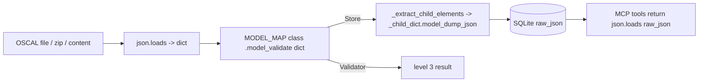

# Design Document: Upgrade oscal-bindings to 0.3.1

## Overview

Bump `oscal-bindings` from 0.1.0 to 0.3.1, re-lock, fix any breakage from the 0.3.0 renames and shape changes, add regression tests that pin the behavior the Server relies on, and update the oscal-bindings guidance for the 0.2.0 serialization defaults.

The Server's coupling to Bindings is narrow, which keeps this upgrade low-risk:

| Site | Bindings usage | 0.3.x risk |
|---|---|---|
| `tools/utils.py` `MODEL_MAP` | Imports 8 top-level classes from `oscal_bindings.models` | Low. Top-level class names are unchanged in the 0.3.0 rename list; confirm at import |
| `tools/oscal_store.py` `_validate_oscal_model` (~L1245) | `MODEL_MAP[t].model_validate(dict)` | None for #6 (dict input). Closed enums now reject out-of-enum values; content in `data/` may newly fail |
| `tools/oscal_store.py` `_extract_child_elements` (~L648) | `getattr` attribute walk; `str(...)` on ids/titles; `getattr(mappings, "root", mappings)` | `mappings` is now always `MappingCollectionMappings`; the existing unwrap handles it. `str()` on Enum members would change titles, but extraction only stringifies uuid/id/title/name/description/href, none of which are closed enums |
| `tools/oscal_store.py` `_child_dict` (~L898) | `model_dump_json(exclude_none=True, by_alias=True)` | None. Output identical under 0.2.0+ defaults |
| `tools/validate_oscal_content.py` `_validate_model` (~L142) | `MODEL_MAP[t].model_validate(dict)` | None for #6. Error strings may differ (enum errors, union variant names) |
| `tools/query_component_definition.py` (L24, L212, L221) | Imports `ComponentDefinition` for `isinstance`; `model_dump_json(exclude_none=True, by_alias=True)` | Name unchanged. The direct import duplicates `MODEL_MAP` (existing rule violation; out of scope, see Decisions) |
| `tools/query_oscal_models.py` | Store API only | None expected; audit confirms |
| `tests/` | `from oscal_bindings import models`, `from oscal_bindings.models import ComponentDefinition`; Hypothesis strategies in `test_oscal_models.py` (`_BUILDERS`, `_MUTATIONS`), `test_properties.py` (`COMPONENT_TYPES`, `PROP_*`, `ROLE_IDS`) | Strategies that hit closed-enum fields with arbitrary text now fail validation |

No call to `model_validate_json` or a `parse_*` helper exists in `src/` today (verified by grep). The design adds a test that keeps it that way.

## Architecture

No architectural change. Data flow stays:

All parsing stays on the dict path, which is unaffected by upstream #6.

## Components and Interfaces

### 1. Dependency pin (`pyproject.toml`, `requirements.txt`)

- `pyproject.toml` line 14: `"oscal-bindings==0.1.0"` → `"oscal-bindings==0.3.1"`.
- `hatch run update` re-locks `requirements.txt`. Review the diff: expect `oscal-bindings` and possibly `pydantic`/`pydantic-core` transitive bumps. Flag any unrelated churn to the user before committing.
- If the resolver picks pydantic 2.13.x, #6 applies to JSON-string parsing only; the Server does not use it.

### 2. Source audit and fixes

Audit checklist, applied to `oscal_store.py`, `validate_oscal_content.py`, `query_oscal_models.py`, `query_component_definition.py`, `utils.py`:

1. Renamed classes: any `oscal_bindings.models` name other than the 8 top-level classes. Expected: none in `src/`.
2. Repurposed names: `Status`, `Origin`, `LocalDefinitions`, `MergeFlat`, `MergeCustom`, `ExternalId`, `ExternalId1`. Expected: none in `src/`.
3. Enum-as-str: any `==`, `in`, dict key, or `str()` on a closed-enum field (e.g. SSP `status.state`, profile `merge`, finding/risk status). Fix by comparing `.value` or the Enum member.
4. Merge `combine`/`flat`: any dict-style access. Expected: none (`modify` is serialized whole).
5. Mappings shape: `getattr(mappings, "root", mappings)` already unwraps; the `isinstance(list)` fallback stays harmless.
6. Union variant order: any `isinstance` on a variant class to decide behavior. Catalog groups are walked by attribute (`controls`, `groups`), so variant order does not matter. Expected: none.
7. `get_supported_element_types()`: not used in `src/`.

If mypy or the tests surface a rename, change the import to the 0.3.1 name and nothing else.

### 3. Regression guard tests

New file `tests/test_oscal_bindings_upgrade.py` (unit + Hypothesis), reusing the document builders in `tests/test_oscal_models.py` where they fit (import or move shared builders into `tests/conftest.py` only if an import would create a cycle):

- Source scan: walk `src/mcp_server_for_oscal/**/*.py` with `ast` and assert no attribute call named `model_validate_json` and no import of a `parse_*` name from `oscal_bindings`.
- Child extraction model-based property (Property 1).
- Child `raw_json` validity property (Property 2).
- Validator acceptance and rejection properties (Properties 3–5).
- Default-vs-explicit serialization equivalence (Property 6).
- Open-enum acceptance property (Property 7).
- Schema-oracle enum parity check (unit, not Hypothesis). Encodes the contract in cairn-proofs/oscal-bindings-specs#9, whose Python fix cairn-proofs/oscal-bindings-python#21 is already in 0.3.1, so no behavior change is expected when #9 lands:
  - Walk the bundled `oscal_complete_schema.json` and collect every closed enum (an `allOf` with an `enum` member) and every open enum (an `anyOf` with an `enum` member) as value sets.
  - Assert the schema has exactly 26 closed enums, so a schema bump forces a review of this test.
  - Introspect the `model_fields` of every `oscal_bindings.models` class. A closed Bindings field has a bare `Enum` annotation with no base-datatype branch (26 fields today; some schema sites split across union classes such as `MetadataPartyWithAddresses`/`MetadataPartyWithLocationUuids`, `InsertControlsWithIncludeAll`/`InsertControlsWithIncludeControls`, and `Mapping`/`Map`/`MappingProvenance`). An open Bindings field has an `Enum` branch plus a base-datatype branch, `str` or `AnyUrl`: `Annotated[str, ...] | Enum`, `AnyUrl | Enum` (the 6 URI enums such as `DocumentId.scheme`), or list-valued `list[str | Enum]` (`Observation.methods`, `Observation.types`) (27 fields today).
  - Assert each schema closed set equals the member values of at least one closed Bindings field, and each closed Bindings field's member values equal some schema closed set.
  - Assert each schema open set matches the member values of an open Bindings field (one with a base-datatype branch, `str` or `AnyUrl`), so no open enum is bound as closed.
- Property 4 stays the document-level closed-enum test (generated documents, Validator model level). The parity check extends 4.7 coverage to every closed enum without generating a document for each site.

Error type: all enum tests assert the result at the model level (Validator model level invalid or valid, Store rejects or ingests). `model_validate` raises pydantic `ValidationError`, which is not a subclass of `OscalParseError`; `OscalParseError` (the contract's `parse-error` category) comes only from the banned `parse_*` helpers, so tests never assert it.

Hypothesis tests use `@settings(max_examples=100)`; `OSCAL_TEST_MAX_EXAMPLES` caps them on Windows CI through `tests/conftest.py`.

### 4. Hypothesis strategy audit

Review every strategy that produces OSCAL fields fed to `model_validate`:

- `tests/test_properties.py`: `COMPONENT_TYPES` (component `type` is an open token in OSCAL 1.2.3, keep), `ROLE_IDS`, `PROP_NAMES`, `PROP_VALUES` (props with `ns` absent: `name` is a token, open; keep).
- `tests/test_oscal_models.py`: `_BUILDERS`, `_MUTATIONS`. Check any field that is a closed enum in 0.3.1.
- Any strategy using `st.text()` for a closed-enum field: replace with `st.sampled_from(<Enum>)` mapped to `.value`, or a fixed valid literal.

Find closed-enum fields with `hatch run python -c` introspection of the model `model_fields` annotations for `enum.Enum` subclasses, then cross-check against the strategies.

### 5. Guidance documentation

`.kiro/steering/oscal-bindings.md`:

- Section 3: keep `CatalogGroupWithControls`/`CatalogGroupWithGroups` (unchanged in 0.3.0), mention the `CatalogGroup` union alias, and name `MappingCollectionMappings` as the RootModel example. Add: closed-enum fields hold Enum members; compare with `.value`.
- Section 4, rewritten:
  - Bindings 0.2.0+ serialize to valid OSCAL by default (`model_dump`, `model_dump_json`, and `pydantic_core.to_json` on models nested in plain containers): aliases, no nulls. `exclude_none=False` has no effect. Explicit `by_alias=True, exclude_none=True` is optional and harmless.
  - Keep "Prefer returning stored element JSON (child `raw_json`)". Rationale: it avoids re-parsing and re-serializing on every request, and it returns exactly what was indexed.
  - Keep "Don't return Pydantic models from tools", with an updated rationale: the MCP SDK and Strands serialize tool results through their own paths (Strands can fall back to `repr` for non-JSON-serializable values in dicts). 0.2.0 fixes what Pydantic emits, but it cannot make a caller that does not use Pydantic serialization (e.g. `json.dumps` with `default=str`) produce JSON. Return plain dicts/strings.
- Add a 2.x bullet: validate with `model_validate(dict)`. Don't use `model_validate_json` on user content: upstream #6 (pydantic 2.13.x) drops Python-field-name keys silently on the JSON path, while the dict path rejects them.
- Implementation Workflow item 2: mark #5 as resolved in 0.2.0 and keep the upstream link.
- Anti-patterns: replace "serializing without `by_alias=True, exclude_none=True`" with "Returning Pydantic models from tools" and "`model_validate_json` on untrusted content".
- Example: keep the explicit kwargs (consistent with code) and add a comment that they are the 0.2.0+ defaults.

`AGENTS.md` line 101: "Tools return stored OSCAL JSON (child `raw_json`) with hyphenated keys. Never return Pydantic models from tools. Since oscal-bindings 0.2.0, models serialize to valid OSCAL by default; explicit `by_alias=True, exclude_none=True` is optional."

Also check `.agents/summary/*.md` and `src/mcp_server_for_oscal/tools/README.md` for the same rule and update matching lines only.

### 6. Bundled database

Rebuild with `hatch run build-db` if the audit changes extraction code or if any document in `data/` changes validation outcome under 0.3.1. Capture the document count and per-model-type counts before (on 0.1.0) and after; a drop means closed-enum rejection of real content, which needs user review before proceeding. The DB is gitignored, so nothing to commit.

## Data Models

No Server data model change. Bindings shape changes that the Server touches:

| Bindings 0.3.x shape | Server handling |
|---|---|
| `MappingCollection.mappings: MappingCollectionMappings` (RootModel of list) | `getattr(x, "root", x)` unwrap, unchanged |
| `CatalogGroup = CatalogGroupWithControls \| CatalogGroupWithGroups` | Attribute walk with `getattr(..., None) or []`, unchanged |
| Closed enums hold `Enum` members | Not stringified in extraction; audit confirms no comparisons |
| Profile `merge.combine` / `merge.flat` are empty models | Not accessed; `modify` serialized whole |

## Decisions

- Keep explicit `by_alias=True, exclude_none=True` in `oscal_store.py` and `query_component_definition.py`. They are harmless, self-documenting, and Property 6 proves equivalence. Removing them is a cosmetic change outside a dependency bump.
- Leave the direct `ComponentDefinition` import in `query_component_definition.py`. It conflicts with the "MODEL_MAP only" rule, but changing it is unrelated to the upgrade. Note it to the user as a follow-up.
- No local workarounds for Bindings behavior. If 0.3.1 breaks something the Server needs, stop and raise it upstream.

## Error Handling

- Import or mypy failure after the bump: fix only the renamed import.
- New validation failures in `data/` content from closed enums: report affected files to the user; don't loosen validation.
- Validator error messages change wording: update tests that assert exact message text to assert the level result and field location instead.
- `hatch run update` produces unrelated upgrades: show the diff to the user before committing.

## Correctness Properties

*A property is a characteristic or behavior that should hold true across all valid executions of a system-essentially, a formal statement about what the system should do. Properties serve as the bridge between human-readable specifications and machine-verifiable correctness guarantees.*

### Property 1: Child extraction is complete

For any generated valid OSCAL document of any model type (including catalogs with arbitrarily nested groups and mapping collections with any number of mappings), the set of (element_type, id) pairs the Store extracts equals the set computed by walking the raw input dict for the same element types.

**Validates: Requirements 4.1, 4.4, 4.5**

### Property 2: Child raw_json is valid OSCAL and round-trips

For any generated valid OSCAL document, every extracted Child_Element `raw_json` parses as a JSON object with no `null` values and no Python-only field names, and validating that object with the child's Bindings class then serializing it yields an equal object.

**Validates: Requirements 4.2, 4.3**

### Property 3: Validator accepts model-valid documents

For any generated document that the MODEL_MAP class accepts, the Validator reports the model level as valid.

**Validates: Requirements 4.6, 3.4**

### Property 4: Out-of-enum values are rejected

For any generated valid document containing a closed-enum field, and any string that is not a member of that enum, replacing the field value with that string makes the Validator report the model level as invalid.

**Validates: Requirements 4.7**

This property is the document-level closed-enum test. Parity of every closed enum's value set with the bundled schema is covered by the schema-oracle parity check.

### Property 5: Python field names are rejected on the dict path

For any generated valid document and any hyphenated key whose Python field name differs from its alias, renaming that key to the Python field name makes both `OscalStore` model validation and the Validator model level reject the document.

**Validates: Requirements 4.8, 3.4**

### Property 6: Default serialization equals explicit-flag serialization

For any generated valid OSCAL document, `model_dump_json()` with default arguments equals `model_dump_json(by_alias=True, exclude_none=True)` for the top-level model and for every extracted child object.

**Validates: Requirements 6.1, 6.5**

### Property 7: Open enums accept off-list values

For any generated valid document with an open-enum field (component `type` in component definitions and SSPs, assessment plan task `type`), and any NCName/token valid for the field's base datatype that is not a listed value, setting the field to that value keeps the Validator model level valid and the Store ingests the document.

**Validates: Requirements 4.9**

## Testing Strategy

- Property tests (Hypothesis, 100 examples each) in `tests/test_oscal_bindings_upgrade.py`, one test per property, each tagged in its docstring: `Feature: upgrade-oscal-bindings-0-3-1, Property N: <title>`.
- Example/smoke tests:
  - Existing `TestBundledOscalVersion` and `TestModelMap` cover Requirements 2 and 3.2.
  - New AST source-scan test covers 3.5.
  - New schema-oracle enum parity test covers 4.7 and 4.9 for every enum site.
  - Existing tool and store tests cover behavior preservation on fixtures.
- Snapshot check for Requirement 4.1 on real content: before the bump, record (element_type, uuid, title) tuples for every fixture and `data/` document with a throwaway `hatch run python -c` script into a temp file; compare after the bump; delete the temp file.
- Quality gates: `hatch run tests`, `hatch check fmt`, `hatch check code`.
- All commands run through hatch, with pytest flags after `--`, and never with a `cd` prefix (use the tool's working-directory parameter).
